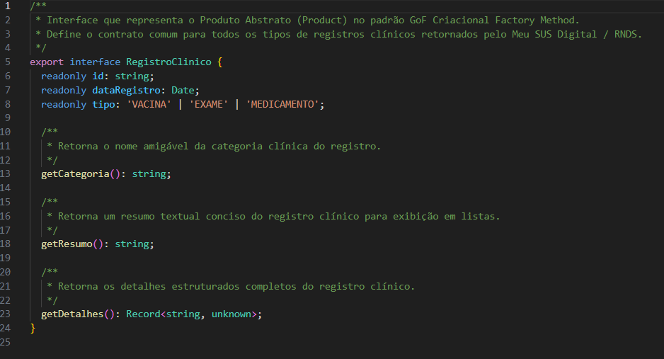
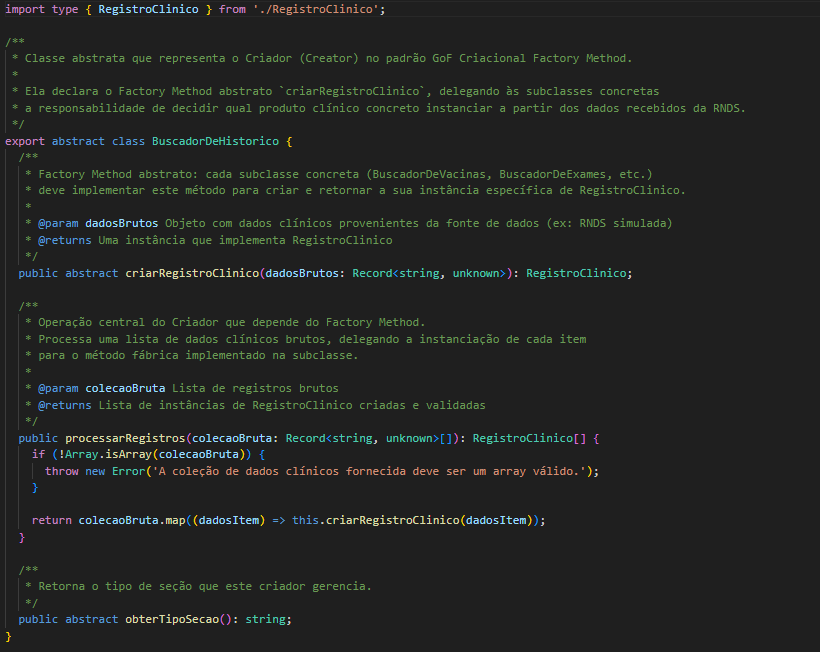
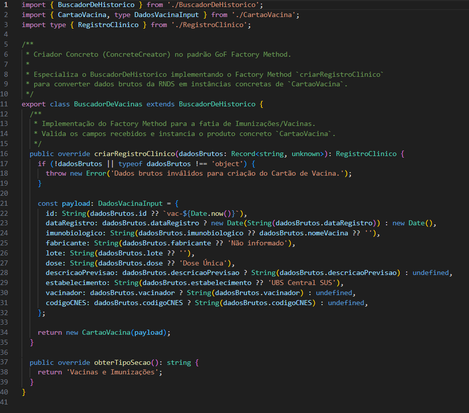
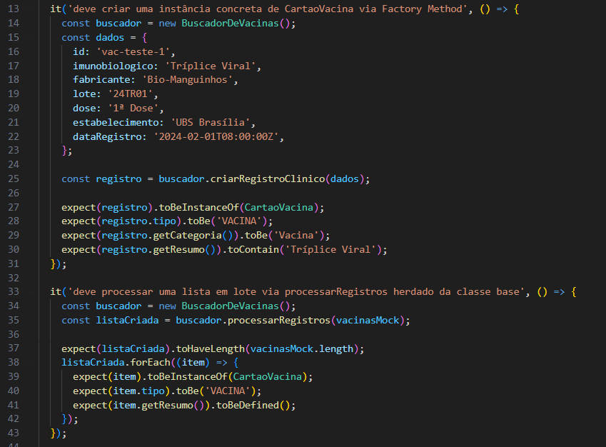
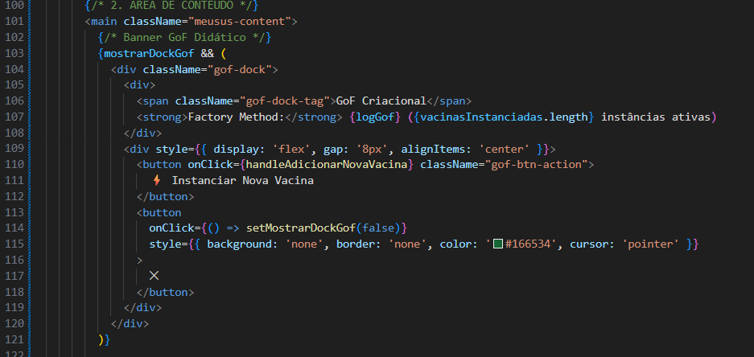
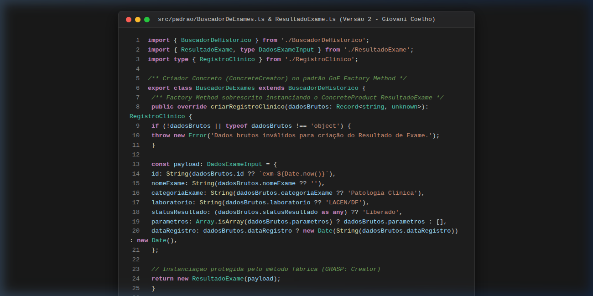
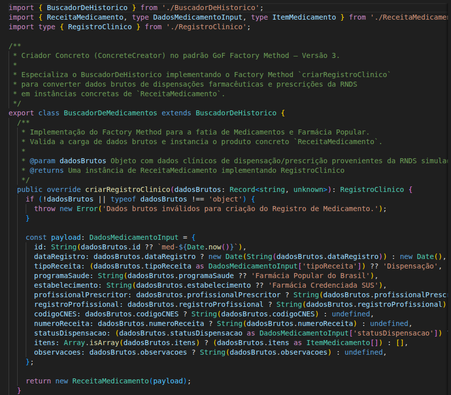

# Código | GoF Criacional (Factory Method)

## 1. Visão Geral da Arquitetura do Código

O mini-projeto independente da SubEquipe 01 está localizado no diretório [`code/criacional/`](file:///code/criacional/), completamente desacoplado da pasta de documentação `docs/`. O projeto foi construído em **React com Vite e TypeScript**, garantindo tipagem estática rigorosa e separação entre o padrão de projeto arquitetural e a camada de visualização:

- [`code/criacional/src/padrao/`](file:///code/criacional/src/padrao/): **Núcleo GoF Factory Method em TypeScript puro** (sem dependências de framework ou bibliotecas de UI).
- [`code/criacional/src/dominio/`](file:///code/criacional/src/dominio/): Modelos de domínio e dados simulados (mocks) que emulam as estruturas de dados oficiais do Ministério da Saúde e da RNDS (Rede Nacional de Dados em Saúde).
- [`code/criacional/src/ui/`](file:///code/criacional/src/ui/): Componentes visuais em React com estilização CSS fiel ao design system oficial do **Meu SUS Digital** e do **Gov.br**.
- [`code/criacional/src/padrao/__tests__/`](file:///code/criacional/src/padrao/__tests__/): Suíte de testes unitários automatizados com **Vitest**.

### 1.1. Princípios GRASP Aplicados no Código

A distribuição de responsabilidades nas classes foi pautada diretamente pelos padrões **GRASP** (*General Responsibility Assignment Software Patterns*):
- **Creator:** A responsabilidade de instanciar `CartaoVacina` foi delegada exclusivamente ao criador concreto `BuscadorDeVacinas`, pois este possui o contexto dos dados brutos recebidos da RNDS para validar e compor o registro clínico.
- **Low Coupling (Baixo Acoplamento) & High Cohesion (Alta Coesão):** O núcleo em `src/padrao/` é estritamente isolado de dependências visuais, bibliotecas de terceiros ou frameworks. A camada de UI (`App.tsx`) interage somente com o contrato abstrato de alto nível, permitindo que novas categorias clínicas sejam plugadas sem modificar o cliente.
- **Protected Variations (Variações Protegidas):** A interface `RegistroClinico` atua como uma barreira protetora para o sistema contra divergências e formatos variantes de dados providos por serviços de saúde.

---

## 2. Planejamento das Versões de Código

Para atender ao critério de divisão equilibrada e trabalho individual avaliável, o desenvolvimento do código foi fatiado em 4 versões incrementais:

| Versão | Responsável | Escopo e Fatia do Domínio Clínico | Status |
| :---: | :---: | :--- | :---: |
| **V1** | [Artur Galdino](https://github.com/ArturFGaldino) | **Fatia de Vacinas**: Criação do núcleo abstrato do Factory Method (`RegistroClinico`, `BuscadorDeHistorico`), produto concreto `CartaoVacina`, criador concreto `BuscadorDeVacinas`, mocks FHIR e interface fiel da Carteira de Vacinação ([PR #19](https://github.com/UnBArqDsw2026-2-Turma01/2026.2-T01-_G5_ProjetoGovernoEletronico_Entrega_03/pull/19)). | **Concluído** |
| **V2** | [Giovani Coelho](https://github.com/Gotc2607) | **Fatia de Exames**: Implementação do produto concreto `ResultadoExame`, do criador concreto `BuscadorDeExames`, mocks de laudos da RNDS, suíte de testes unitários Vitest e integração visual no Meu SUS Digital. | **Concluído** |
| **V3** | [João Leles](https://github.com/joaoleless) | **Fatia de Medicamentos**: Implementação do produto concreto `ReceitaMedicamento`, do criador concreto `BuscadorDeMedicamentos`, mocks da Farmácia Popular e testes unitários. | *Planejado* |
| **V4** | [Nicole Jovita](https://github.com/nicolejovita) | **Núcleo Unificador / Seletor Dinâmico**: Implementação do `SeletorDeHistorico` para despacho dinâmico de criadores, consolidação da suíte de testes integrados e fechamento da interface unificada. | *Planejado* |

---

> **Aviso sobre as imagens do código:** Todas as figuras desta seção apresentam **apenas trechos ilustrativos e recortes parciais** do código-fonte para destacar a estrutura do padrão GoF Factory Method. O código completo, tipado e executável está disponível diretamente nos arquivos do diretório [`code/criacional/`](file:///code/criacional/).

---

## 3. Versão 1 — Fatia de Vacinas (Artur Galdino)

### 3.1. Núcleo Abstrato do Padrão GoF

A Versão 1 estabeleceu os contratos fundamentais da arquitetura do Factory Method:
- **`RegistroClinico` (*Product*)**: Interface em [`code/criacional/src/padrao/RegistroClinico.ts`](file:///code/criacional/src/padrao/RegistroClinico.ts) que padroniza os métodos `getCategoria()`, `getResumo()` e `getDetalhes()`.
- **`BuscadorDeHistorico` (*Creator*)**: Classe abstrata em [`code/criacional/src/padrao/BuscadorDeHistorico.ts`](file:///code/criacional/src/padrao/BuscadorDeHistorico.ts) que declara o método fábrica abstrato `criarRegistroClinico()` e implementa a operação de alto nível `processarRegistros()`.



<center><strong>Legenda:</strong> Figura 1 - Trecho de código da interface RegistroClinico (Product abstrato). O código completo está disponível em `code/criacional/src/padrao/RegistroClinico.ts`. Autoria: Artur Galdino.</center>

<br>



<center><strong>Legenda:</strong> Figura 2 - Trecho de código da classe abstrata BuscadorDeHistorico (Creator) declarando o Factory Method. O código completo está disponível em `code/criacional/src/padrao/BuscadorDeHistorico.ts`. Autoria: Artur Galdino.</center>

---

### 3.2. Implementação Concreta da Fatia de Vacinas

Na fatia de imunização:
- **`CartaoVacina` (*ConcreteProduct*)**: Classe em [`code/criacional/src/padrao/CartaoVacina.ts`](file:///code/criacional/src/padrao/CartaoVacina.ts) que encapsula regras de negócio, dados de imunobiológico, fabricante, lote, dose e estabelecimento.
- **`BuscadorDeVacinas` (*ConcreteCreator*)**: Classe em [`code/criacional/src/padrao/BuscadorDeVacinas.ts`](file:///code/criacional/src/padrao/BuscadorDeVacinas.ts) que sobrepõe o Factory Method instanciando `CartaoVacina` a partir de cargas de dados brutas da RNDS.



<center><strong>Legenda:</strong> Figura 3 - Trecho de código do criador concreto BuscadorDeVacinas (ConcreteCreator) sobrescrevendo o Factory Method. O código completo está disponível em `code/criacional/src/padrao/BuscadorDeVacinas.ts`. Autoria: Artur Galdino.</center>

---

### 3.3. Testes Unitários Automatizados (Vitest)

Para garantir a confiabilidade do padrão, foram desenvolvidos testes unitários cobrindo instanciação, polimorfismo, integridade de campos e tratamento de exceções:
- [`CartaoVacina.test.ts`](file:///code/criacional/src/padrao/__tests__/CartaoVacina.test.ts) (6 testes)
- [`BuscadorDeVacinas.test.ts`](file:///code/criacional/src/padrao/__tests__/BuscadorDeVacinas.test.ts) (5 testes)



<center><strong>Legenda:</strong> Figura 4 - Trecho de código dos testes automatizados validando o Factory Method no Vitest. A suíte completa está disponível em `code/criacional/src/padrao/__tests__/`. Autoria: Artur Galdino.</center>

---

### 3.4. Interface Gráfica Meu SUS Digital (React)

Apresentação gráfica em [`code/criacional/src/App.tsx`](file:///code/criacional/src/App.tsx) reproduzindo a experiência visual do Meu SUS Digital, com navegação entre a visão geral de saúde e a Carteira Nacional de Vacinação Digital.



<center><strong>Legenda:</strong> Figura 5 - Trecho de código do componente React integrando e acionando o Factory Method. O arquivo completo está disponível em `code/criacional/src/App.tsx`. Autoria: Artur Galdino.</center>

### 3.5. Embasamento Teórico da Implementação (Versão 1)

A implementação do código-fonte da Versão 1 reflete os seguintes fundamentos de engenharia de software e orientação a objetos:
- **Refatoração "Replace Constructor with Factory Method" (Fowler, 2020):** A instanciação direta de cartões vacinais pelo cliente é substituída por um método fábrica especializado. Isso permite que a classe base `BuscadorDeHistorico` abstraia o fluxo de iteração e processamento de registros sem conhecer a classe concreta instanciada.
- **Princípio da Inversão de Dependência (DIP - Martin, 2002):** A camada de interface (`App.tsx`) e a lógica de processamento operam estritamente sobre a interface abstrata `RegistroClinico` e a classe base `BuscadorDeHistorico`. Nenhuma classe cliente depende diretamente de implementações concretas de baixo nível.
- **Segregação de Responsabilidades e Tipagem Estática:** O código do padrão em `src/padrao/` é implementado em TypeScript puro, completamente desacoplado de React, JSX ou APIs do navegador, garantindo que o núcleo possa ser executado e testado de forma portátil em qualquer ambiente Node.js.

---

## 4. Versão 2 — Fatia de Exames Laboratoriais (Giovani Coelho)

A Versão 2 expandiu a aplicação do padrão GoF Criacional **Factory Method** para a fatia de **Exames Laboratoriais**, permitindo que o subsistema do Meu SUS Digital processe laudos e resultados diagnósticos providos pela Rede Nacional de Dados em Saúde (RNDS) de forma desacoplada:

- **`ResultadoExame` (*ConcreteProduct*)**: Implementado em [`code/criacional/src/padrao/ResultadoExame.ts`](file:///code/criacional/src/padrao/ResultadoExame.ts), satisfaz o contrato da interface [`RegistroClinico`](file:///code/criacional/src/padrao/RegistroClinico.ts) (`tipo = 'EXAME'`). Encapsula os dados do exame, categoria clínica (Hematologia, Bioquímica, Biologia Molecular), metodologia analítica, status do laudo (`Liberado`, `Em Análise`), parecer conclusivo e tabela estruturada de parâmetros clínicos com valores de referência.
- **`BuscadorDeExames` (*ConcreteCreator*)**: Implementado em [`code/criacional/src/padrao/BuscadorDeExames.ts`](file:///code/criacional/src/padrao/BuscadorDeExames.ts), especializa a classe abstrata [`BuscadorDeHistorico`](file:///code/criacional/src/padrao/BuscadorDeHistorico.ts) e sobrepõe o Factory Method `criarRegistroClinico()` (*GRASP Creator*). Valida os campos da carga bruta recebida da RNDS e instancia o produto concreto `ResultadoExame`.
- **Mocks Oficiais de Exames**: Definidos em [`code/criacional/src/dominio/examesMock.ts`](file:///code/criacional/src/dominio/examesMock.ts), simulando laudos do LACEN/DF e laboratórios regionais da SES/DF (Hemograma Completo, Glicemia de Jejum, Lipidograma Completo, RT-PCR COVID-19/Influenza).
- **Testes Unitários e de Integração**: Desenvolvidos rigorosamente de acordo com o [Padrão de Testes](../../../Projeto/ExtrasEntrega3/PadraoDeTestes.md) (Arrange-Act-Assert, em português):
  - [`ResultadoExame.test.ts`](file:///code/criacional/src/padrao/__tests__/ResultadoExame.test.ts) (8 testes unitários cobrindo instanciação, valores padrão, formatação de resumo, detalhes e validações defensivas).
  - [`BuscadorDeExames.test.ts`](file:///code/criacional/src/padrao/__tests__/BuscadorDeExames.test.ts) (6 testes unitários validando herança, método fábrica, processamento em lote e tratamento de payloads nulos ou parciais).
  - [`App.test.tsx`](file:///code/criacional/src/ui/__tests__/App.test.tsx) (2 testes de integração da interface React validando a navegação para a fatia de exames e o disparo dinâmico do Factory Method em tempo de execução).
- **Interface Gráfica React**: Atualização em [`code/criacional/src/App.tsx`](file:///code/criacional/src/App.tsx) e [`meuSus.css`](file:///code/criacional/src/ui/meuSus.css) incorporando a aba lateral de Exames, banner com contagem de laudos da RNDS, cards completos com parâmetros laboratoriais e botão interativo no Dock GoF (`⚡ +Exame (V2)`).



<center><strong>Legenda:</strong> Figura 6 - Trecho de código do ConcreteCreator (BuscadorDeExames) sobrescrevendo o Factory Method e instanciando ResultadoExame (código parcial ilustrativo; Autoria: Giovani Coelho).</center>

### 4.1. Embasamento Teórico da Implementação (Versão 2)

A extensão do código-fonte para a fatia de Exames Laboratoriais concretiza os seguintes princípios teóricos:
- **Princípio Aberto/Fechado (OCP - Meyer, 1988):** A adição de `ResultadoExame` e `BuscadorDeExames` comprova na prática que a arquitetura do código está aberta para extensão e fechada para modificação. Nenhuma linha de `RegistroClinico.ts`, `BuscadorDeHistorico.ts` ou `BuscadorDeVacinas.ts` precisou ser alterada para que os laudos laboratoriais fossem processados e exibidos.
- **Composição sobre Herança na Agregação de Parâmetros:** A classe `ResultadoExame` utiliza composição para encapsular a lista de parâmetros laboratoriais (`ParametroExame[]`), mantendo a coesão de cada métrica (nome, resultado, unidade, faixa de referência e situação clínica) e evitando subclasses redundantes para diferentes tipos de laudos químicos ou hematológicos.
- **Validação de Invariantes e Programação Defensiva (Meyer, 1997):** Conforme preconizado pelo princípio de *Design by Contract*, tanto o construtor de `ResultadoExame` quanto o Factory Method de `BuscadorDeExames` aplicam validações defensivas imediatas, garantindo que payloads incompletos, nulos ou malformatados oriundos da RNDS sejam tratados de forma previsível e segura, preenchendo valores padrão ou lançando exceções controladas.

---

## 5. Versão 3 — Fatia de Medicamentos e Farmácia Popular (João Leles)

A Versão 3 estendeu o Factory Method para a fatia de **Medicamentos e Farmácia Popular**, permitindo consultar dispensações farmacêuticas e prescrições registradas na RNDS sem alterar o núcleo abstrato:

- **`ReceitaMedicamento` (*ConcreteProduct*)**: Implementado em [`code/criacional/src/padrao/ReceitaMedicamento.ts`](file:///code/criacional/src/padrao/ReceitaMedicamento.ts), realiza o contrato [`RegistroClinico`](file:///code/criacional/src/padrao/RegistroClinico.ts) (`tipo = 'MEDICAMENTO'`). Encapsula estabelecimento dispensador, prescritor, programa (Farmácia Popular, CBAF), status da dispensação, observações e a lista composta de itens (`ItemMedicamento[]`: princípio ativo, concentração, forma farmacêutica, posologia e quantidade).
- **`BuscadorDeMedicamentos` (*ConcreteCreator*)**: Implementado em [`code/criacional/src/padrao/BuscadorDeMedicamentos.ts`](file:///code/criacional/src/padrao/BuscadorDeMedicamentos.ts), herda de [`BuscadorDeHistorico`](file:///code/criacional/src/padrao/BuscadorDeHistorico.ts) e sobrepõe `criarRegistroClinico()` (*GRASP Creator*), validando a carga bruta e preenchendo valores padrão para payloads parciais.
- **Mocks de Dispensações**: Definidos em [`code/criacional/src/dominio/medicamentosMock.ts`](file:///code/criacional/src/dominio/medicamentosMock.ts), com anti-hipertensivos, antidiabéticos e estatinas do Farmácia Popular e itens do componente básico da assistência farmacêutica.
- **Testes Unitários** (padrão AAA, em português):
  - [`ReceitaMedicamento.test.ts`](file:///code/criacional/src/padrao/__tests__/ReceitaMedicamento.test.ts) (9 testes: instanciação, valores padrão, resumo, detalhes e validações defensivas).
  - [`BuscadorDeMedicamentos.test.ts`](file:///code/criacional/src/padrao/__tests__/BuscadorDeMedicamentos.test.ts) (7 testes: herança, método fábrica, lote, payloads nulos/parciais e receitas com múltiplos itens).
- **Interface Gráfica React**: [`App.tsx`](file:///code/criacional/src/App.tsx) e [`meuSus.css`](file:///code/criacional/src/ui/meuSus.css) receberam a aba lateral de Medicamentos, banner com contagem de dispensações, cards com tabela de itens e o botão `⚡ +Medicamento (V3)` no Dock GoF.

```typescript
export class BuscadorDeMedicamentos extends BuscadorDeHistorico {
  public criarRegistroClinico(dadosBrutos: Record<string, unknown>): RegistroClinico {
    // validação defensiva + defaults do payload da RNDS
    return new ReceitaMedicamento(/* dados normalizados */);
  }
}
```



<center><strong>Legenda:</strong> Figura 7 - Trecho de código do ConcreteProduct e ConcreteCreator de Medicamentos (código parcial ilustrativo; Autoria: João Leles).</center>

### 5.1. Embasamento Teórico da Implementação (Versão 3)

- **OCP (Meyer, 1988):** Nenhuma linha de `RegistroClinico`, `BuscadorDeHistorico`, vacinas ou exames foi modificada; a terceira fatia foi adicionada apenas por extensão.
- **LSP (Liskov, 1987):** `ReceitaMedicamento` é substituível por `RegistroClinico` em todo o fluxo `processarRegistros()` e na UI.
- **Composição:** Os itens da receita são agregados via `ItemMedicamento[]`, evitando subclasses por tipo de medicamento.
- **Programação Defensiva (Meyer, 1997):** Payloads nulos/inválidos geram exceções controladas; campos ausentes recebem valores padrão.

---

## 6. Versão 4 — Unificação e Seletor Dinâmico de Histórico (Nicole Jovita) `[PLACEHOLDER]`

Esta versão consolidará a camada de despacho e consumo centralizado do padrão GoF Criacional:

- `SeletorDeHistorico.ts`: Fachada/orquestrador que seleciona o criador adequado em tempo de execução com base no tipo de registro solicitado.
- Unificação das abas clínicas na interface do Meu SUS Digital.
- Suíte integrada de testes unitários e testes de regressão do padrão completo.


<center><strong>Legenda:</strong> Figura 8 - Trecho de código da integração consolidada e despacho dinâmico do histórico de saúde (código parcial ilustrativo; Autoria: Nicole Jovita - Em breve).</center>

---

## 7. Instruções de Reprodução e Execução

O ambiente de execução foi padronizado utilizando Node.js (v22+) e NPM. Para reproduzir e testar o código localmente:

1. Acesse o diretório do mini-projeto:
   ```bash
   cd code/criacional
   ```
2. Instale as dependências:
   ```bash
   npm install
   ```
3. Execute a suíte de testes automatizados:
   ```bash
   npm test
   ```
4. Gere o build de produção:
   ```bash
   npm run build
   ```
5. Inicie o servidor de desenvolvimento para visualização no navegador:
   ```bash
   npm run dev
   ```

## 8. Bibliografia

1. GAMMA, Erich; HELM, Richard; JOHNSON, Ralph; VLISSIDES, John. **Padrões de Projeto: Soluções Reutilizáveis de Software Orientado a Objetos**. Porto Alegre: Bookman, 2000.
2. FOWLER, Martin. **Refatoração: Aperfeiçoando o Design de Código Existente**. 2. ed. Porto Alegre: Bookman, 2020.
3. MARTIN, Robert C. **Código Limpo: Habilidades Práticas do Agile Software**. Rio de Janeiro: Alta Books, 2009.
4. MARTIN, Robert C. **Princípios, Padrões e Práticas Ágeis em C#**. Porto Alegre: Bookman, 2006.
5. MEYER, Bertrand. **Object-Oriented Software Construction**. 2. ed. Upper Saddle River: Prentice Hall, 1997.
6. LARMAN, Craig. **Utilizando UML e Padrões: Uma Introdução à Análise e ao Projeto Orientados a Objetos e ao Desenvolvimento Iterativo**. 3. ed. Porto Alegre: Bookman, 2005.

---

## 9. Histórico de Versionamento

| Versão | Data | Descrição / Contribuição | Autor(es) | Commit(s) |
| :---: | :---: | :--- | :--- | :--- |
| `0.1` | 14/10/2026 | Estruturação do template inicial de documentação de código | [Gustavo Fornaciari](https://github.com/GUGOFO) | [`7c66f78`](https://github.com/UnBArqDsw2026-2-Turma01/2026.2-T01-_G5_ProjetoGovernoEletronico_Entrega_03/commit/7c66f78dc795f080bc43dc01f094e8976462d5b8) |
| `1.0` | 15/10/2026 | Implementação da Versão 1: Núcleo abstrato do Factory Method, fatia de Vacinas, 11 testes unitários com Vitest, interface Meu SUS Digital e estruturação dos placeholders V2, V3 e V4 com fotos | [Artur Galdino](https://github.com/ArturFGaldino) | [`90df441`](https://github.com/UnBArqDsw2026-2-Turma01/2026.2-T01-_G5_ProjetoGovernoEletronico_Entrega_03/commit/90df441), [`45f29be`](https://github.com/UnBArqDsw2026-2-Turma01/2026.2-T01-_G5_ProjetoGovernoEletronico_Entrega_03/commit/45f29be), [`c605056`](https://github.com/UnBArqDsw2026-2-Turma01/2026.2-T01-_G5_ProjetoGovernoEletronico_Entrega_03/commit/c605056), [`664e603`](https://github.com/UnBArqDsw2026-2-Turma01/2026.2-T01-_G5_ProjetoGovernoEletronico_Entrega_03/commit/664e603) |
| `1.1` | 15/10/2026 | Ajuste nas legendas e notas das figuras indicando explicitamente trechos parciais de código e padronização da numeração sequencial das Figuras 1 a 8 | [Artur Galdino](https://github.com/ArturFGaldino) | [`d6cfdcd`](https://github.com/UnBArqDsw2026-2-Turma01/2026.2-T01-_G5_ProjetoGovernoEletronico_Entrega_03/commit/d6cfdcd), [`664e603`](https://github.com/UnBArqDsw2026-2-Turma01/2026.2-T01-_G5_ProjetoGovernoEletronico_Entrega_03/commit/664e603) |
| `1.2` | 15/10/2026 | Documentação dos princípios GRASP (Creator, Low Coupling, High Cohesion, Protected Variations) aplicados à arquitetura do código | [Artur Galdino](https://github.com/ArturFGaldino) | [`82f8d04`](https://github.com/UnBArqDsw2026-2-Turma01/2026.2-T01-_G5_ProjetoGovernoEletronico_Entrega_03/commit/82f8d04) |
| `2.0` | 15/10/2026 | Implementação da Versão 2: ConcreteProduct ResultadoExame, ConcreteCreator BuscadorDeExames, mocks de exames laboratoriais da RNDS, 16 testes unitários e de integração com Vitest, e interface gráfica integrada ao Meu SUS Digital | [Giovani Coelho](https://github.com/Gotc2607) | [`1138b20`](https://github.com/UnBArqDsw2026-2-Turma01/2026.2-T01-_G5_ProjetoGovernoEletronico_Entrega_03/commit/1138b20), [`921255f`](https://github.com/UnBArqDsw2026-2-Turma01/2026.2-T01-_G5_ProjetoGovernoEletronico_Entrega_03/commit/921255f), [`ef66d3b`](https://github.com/UnBArqDsw2026-2-Turma01/2026.2-T01-_G5_ProjetoGovernoEletronico_Entrega_03/commit/ef66d3b), [`f62ad72`](https://github.com/UnBArqDsw2026-2-Turma01/2026.2-T01-_G5_ProjetoGovernoEletronico_Entrega_03/commit/f62ad72), [`359aaa5`](https://github.com/UnBArqDsw2026-2-Turma01/2026.2-T01-_G5_ProjetoGovernoEletronico_Entrega_03/commit/359aaa5), [`0c096ab`](https://github.com/UnBArqDsw2026-2-Turma01/2026.2-T01-_G5_ProjetoGovernoEletronico_Entrega_03/commit/0c096ab), [`b59686e`](https://github.com/UnBArqDsw2026-2-Turma01/2026.2-T01-_G5_ProjetoGovernoEletronico_Entrega_03/commit/b59686e), [`e32794a`](https://github.com/UnBArqDsw2026-2-Turma01/2026.2-T01-_G5_ProjetoGovernoEletronico_Entrega_03/commit/e32794a), [`fb9f581`](https://github.com/UnBArqDsw2026-2-Turma01/2026.2-T01-_G5_ProjetoGovernoEletronico_Entrega_03/commit/fb9f581) |
| `2.1` | 15/10/2026 | Inclusão de embasamento teórico da implementação para as Versões 1 e 2 (Replace Constructor with Factory Method, DIP, OCP, Programação Defensiva) e adição da bibliografia | [Giovani Coelho](https://github.com/Gotc2607) | [`6eed676`](https://github.com/UnBArqDsw2026-2-Turma01/2026.2-T01-_G5_ProjetoGovernoEletronico_Entrega_03/commit/6eed676) |
| `2.2` | 15/10/2026 | Anonimização de identificadores e referências pessoais na interface e nos mocks para Usuário genérico | [Giovani Coelho](https://github.com/Gotc2607) | [`d85c432`](https://github.com/UnBArqDsw2026-2-Turma01/2026.2-T01-_G5_ProjetoGovernoEletronico_Entrega_03/commit/d85c432) |
| `3.0` | 16/10/2026 | Implementação da Versão 3: ConcreteProduct ReceitaMedicamento, ConcreteCreator BuscadorDeMedicamentos, mocks da Farmácia Popular, 16 testes unitários e aba de Medicamentos na interface | [João Leles](https://github.com/joaoleless) | - |
