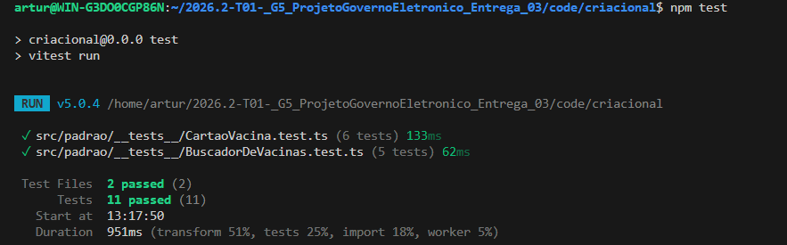
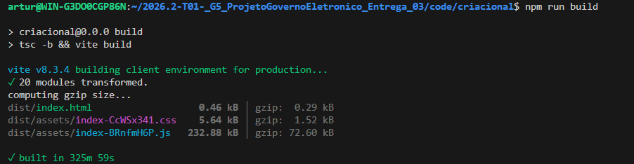
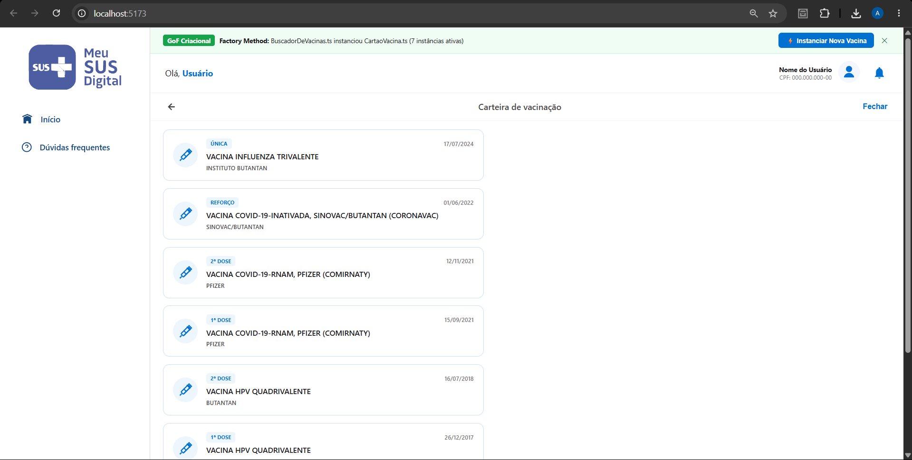
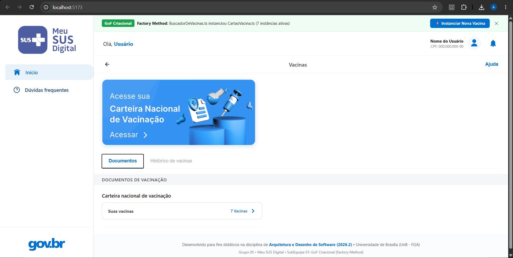
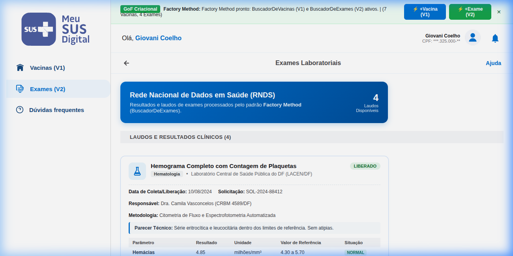
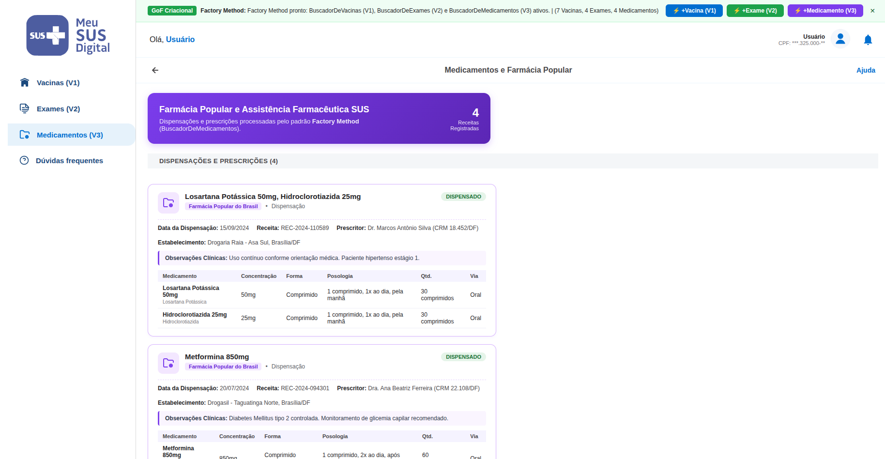

# Execução do Padrão | GoF Criacional (Factory Method)

## 1. Demonstração e Acesso

A demonstração prática exibe o padrão **Factory Method** operando sobre os dados clínicos da Rede Nacional de Dados em Saúde (RNDS) dentro do mini-projeto independente desenvolvido em React/TypeScript localizado no diretório [`code/criacional/`](file:///code/criacional/).

- **Ambiente de Demonstração Local:** Inicializado em `http://localhost:5173/` via Vite Dev Server.
- **Modo 100% Offline:** O projeto não depende de conexão externa ou credenciais ativas do Gov.br para ser executado e avaliado.
- **Vídeo de Demonstração:** `[PLACEHOLDER: Link para o vídeo no YouTube/Loom com a demonstração gravada pela subequipe]`

---

## 2. Planejamento das Evidências de Execução por Versão

Para viabilizar a rastreabilidade e a avaliação individual de cada participante nos três focos metodológicos, a execução é demonstrada por versões:

| Versão | Responsável | Escopo de Execução | Status |
| :---: | :---: | :--- | :---: |
| **V1** | [Artur Galdino](https://github.com/ArturFGaldino) | Execução dos testes unitários da fatia de Vacinas, validação do build estático e simulação interativa na interface da Carteira de Vacinação do Meu SUS Digital. | **Concluído** |
| **V2** | [Giovani Coelho](https://github.com/Gotc2607) | Execução dos testes unitários da fatia de Exames e exibição do histórico de laudos laboratoriais na interface. | *Planejado* |
| **V3** | [João Leles](https://github.com/joaoleless) | Execução dos testes unitários da fatia de Medicamentos e exibição de dispensações da Farmácia Popular na interface. | *Planejado* |
| **V4** | [Nicole Jovita](https://github.com/nicolejovita) | Execução da suíte consolidada de testes de integração e demonstração do seletor dinâmico unificado com todas as categorias clínicas. | *Planejado* |

---

## 3. Versão 1 — Evidências de Execução (Artur Galdino)

### 3.1. Execução dos Testes Automatizados no Vitest

A integridade do padrão GoF Criacional foi testada através do executor **Vitest**, onde 100% dos testes unitários foram executados com sucesso (11 testes aprovados em menos de 1 segundo), comprovando:
- A correta delegação da instanciação pelo Factory Method no `BuscadorDeVacinas`.
- A herança e processamento em lote da classe abstrata `BuscadorDeHistorico`.
- O encapsulamento e validação de regras de negócio no produto concreto `CartaoVacina`.

<strong>Legenda:</strong> Figura 1 - Evidência de execução dos 11 testes unitários com aprovação de 100% no terminal via Vitest (Autoria: Artur Galdino).

---

### 3.2. Validação de Build e Checagem Estática de Tipos

A compilação do TypeScript (`tsc -b`) e o empacotamento com Vite geraram os artefatos estáticos de produção sem nenhum erro de tipagem ou dependências pendentes:

<strong>Legenda:</strong> Figura 2 - Evidência do build estático de produção e checagem de tipos compilado com sucesso (Autoria: Artur Galdino).

---

### 3.3. Interface Gráfica — Visão Geral do Meu SUS Digital

A tela inicial reproduz o design system do Meu SUS Digital e do Gov.br, listando os registros de imunização do cidadão processados pelo método fábrica:

<strong>Legenda:</strong> Figura 3 - Interface do Meu SUS Digital em execução apresentando os registros de vacinas carregados (Autoria: Artur Galdino).

---

### 3.4. Interface Gráfica — Carteira Nacional de Vacinação Digital

Ao selecionar o cartão de vacinas, o usuário é direcionado para a visualização detalhada de doses (Covid-19 Bivalente, Influenza, Febre Amarela, etc.), contando com um botão interativo para simulação de disparo do Factory Method em tempo real:

<strong>Legenda:</strong> Figura 4 - Visualização da Carteira de Vacinação Digital com detalhamento de doses e acionamento interativo do Factory Method (Autoria: Artur Galdino).

---

## 4. Versão 2 — Evidências de Execução de Exames (Giovani Coelho) `[PLACEHOLDER]`

Demonstração da execução dos testes e da tela da fatia de Exames Laboratoriais:
- Execução da suíte de testes unitários do `BuscadorDeExames`.
- Exibição gráfica dos resultados de exames no design system do Meu SUS Digital.

<strong>Legenda:</strong> Figura 5 - Evidência de testes e interface da fatia de Exames em execução (Autoria: Giovani Coelho - Em breve).

---

## 5. Versão 3 — Evidências de Execução de Medicamentos (João Leles) `[PLACEHOLDER]`

Demonstração da execução dos testes e da tela da fatia de Medicamentos:
- Execução da suíte de testes unitários do `BuscadorDeMedicamentos`.
- Exibição gráfica das receitas e dispensações da Farmácia Popular.

<strong>Legenda:</strong> Figura 6 - Evidência de testes e interface da fatia de Medicamentos em execução (Autoria: João Leles - Em breve).

---

## 6. Versão 4 — Evidências de Execução Integrada (Nicole Jovita) `[PLACEHOLDER]`

Demonstração da execução do histórico integrado e do seletor dinâmico:
- Execução da suíte completa de testes de regressão de todo o padrão GoF Criacional.
- Exibição da navegação unificada entre Vacinas, Exames e Medicamentos na mesma sessão do cidadão.

<strong>Legenda:</strong> Figura 7 - Evidência de testes consolidados e visão unificada do histórico de saúde em execução (Autoria: Nicole Jovita - Em breve).

---

## 7. Histórico de Versionamento

| Versão | Data | Descrição / Contribuição | Autor(es) | Revisor(es) |
| :---: | :---: | :--- | :--- | :--- |
| `0.1` | 14/10/2026 | Estruturação do template inicial de evidências de execução | [Gustavo Fornaciari](https://github.com/GUGOFO) | SubEquipe 01 |
| `1.0` | 15/10/2026 | Registro das evidências visuais de execução da Versão 1 (Vitest, build e telas do Meu SUS Digital), substituição de saídas de texto por fotos e inclusão de placeholders estruturados para V2, V3 e V4 | [Artur Galdino](https://github.com/ArturFGaldino) | SubEquipe 01 |
| `1.1` | 15/10/2026 | Padronização e harmonização das legendas e da numeração sequencial das Figuras 1 a 7 | [Artur Galdino](https://github.com/ArturFGaldino) | SubEquipe 01 |