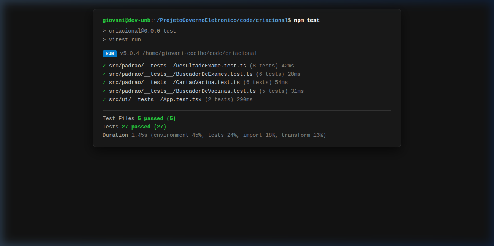
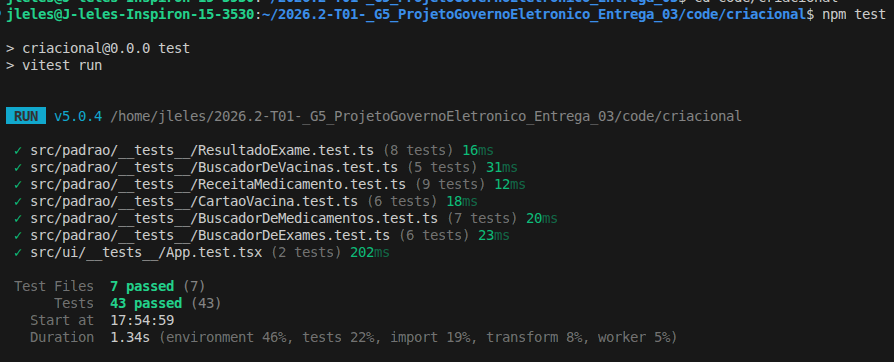

# Execução do Padrão | GoF Criacional (Factory Method)

## 1. Demonstração e Acesso

A demonstração prática exibe o padrão **Factory Method** operando sobre os dados clínicos da Rede Nacional de Dados em Saúde (RNDS) dentro do mini-projeto independente desenvolvido em React/TypeScript localizado no diretório [`code/criacional/`](file:///code/criacional/).

- **Ambiente de Demonstração Local:** Inicializado em `http://localhost:5173/` via Vite Dev Server.
- **Modo 100% Offline:** O projeto não depende de conexão externa ou credenciais ativas do Gov.br para ser executado e avaliado.
- **Vídeo de Demonstração:** `[PLACEHOLDER: Link para o vídeo no YouTube/Loom com a demonstração gravada pela subequipe]`

---

## 2. Planejamento das Evidências de Execução por Versão

Para viabilizar a rastreabilidade e a avaliação individual de cada participante nos três focos metodológicos, a execução é demonstrada por versões:

| Versão | Responsável | Escopo de Execução | Status |
| :---: | :---: | :--- | :---: |
| **V1** | [Artur Galdino](https://github.com/ArturFGaldino) | Execução dos testes unitários da fatia de Vacinas, validação do build estático e simulação interativa na interface da Carteira de Vacinação do Meu SUS Digital ([PR #19](https://github.com/UnBArqDsw2026-2-Turma01/2026.2-T01-_G5_ProjetoGovernoEletronico_Entrega_03/pull/19)). | **Concluído** |
| **V2** | [Giovani Coelho](https://github.com/Gotc2607) | Execução dos testes unitários da fatia de Exames, testes de interface e exibição do histórico de laudos laboratoriais no Meu SUS Digital. | **Concluído** |
| **V3** | [João Leles](https://github.com/joaoleless) | Execução dos testes unitários da fatia de Medicamentos e exibição de dispensações da Farmácia Popular na interface. | *Planejado* |
| **V4** | [Nicole Jovita](https://github.com/nicolejovita) | Execução da suíte consolidada de testes de integração e demonstração do seletor dinâmico unificado com todas as categorias clínicas. | *Planejado* |

---

## 3. Versão 1 — Evidências de Execução (Artur Galdino)

### 3.1. Execução dos Testes Automatizados no Vitest

A integridade do padrão GoF Criacional foi testada através do executor **Vitest**, onde 100% dos testes unitários foram executados com sucesso (11 testes aprovados em menos de 1 segundo), comprovando:
- A correta delegação da instanciação pelo Factory Method no `BuscadorDeVacinas`.
- A herança e processamento em lote da classe abstrata `BuscadorDeHistorico`.
- O encapsulamento e validação de regras de negócio no produto concreto `CartaoVacina`.


<center><strong>Legenda:</strong> Figura 1 - Evidência de execução dos 11 testes unitários com aprovação de 100% no terminal via Vitest (Autoria: Artur Galdino).</center>

---

### 3.2. Validação de Build e Checagem Estática de Tipos

A compilação do TypeScript (`tsc -b`) e o empacotamento com Vite geraram os artefatos estáticos de produção sem nenhum erro de tipagem ou dependências pendentes:


<center><strong>Legenda:</strong> Figura 2 - Evidência do build estático de produção e checagem de tipos compilado com sucesso (Autoria: Artur Galdino).</center>

---

### 3.3. Interface Gráfica — Visão Geral do Meu SUS Digital

A tela inicial reproduz o design system do Meu SUS Digital e do Gov.br, listando os registros de imunização do cidadão processados pelo método fábrica:


<center><strong>Legenda:</strong> Figura 3 - Interface do Meu SUS Digital em execução apresentando os registros de vacinas carregados (Autoria: Artur Galdino).</center>

---

### 3.4. Interface Gráfica — Carteira Nacional de Vacinação Digital

Ao selecionar o cartão de vacinas, o usuário é direcionado para a visualização detalhada de doses (Covid-19 Bivalente, Influenza, Febre Amarela, etc.), contando com um botão interativo para simulação de disparo do Factory Method em tempo real:


<center><strong>Legenda:</strong> Figura 4 - Visualização da Carteira de Vacinação Digital com detalhamento de doses e acionamento interativo do Factory Method (Autoria: Artur Galdino).</center>

### 3.5. Embasamento Teórico da Execução e Testes (Versão 1)

A estratégia de testes e execução da Versão 1 apoia-se em conceitos consolidados de verificação e validação de software:
- **Pirâmide de Testes (Fowler, 2012; Cohn, 2009):** Priorização de testes unitários rápidos e determinísticos na base da pirâmide. O núcleo do Factory Method é validado diretamente em memória sem necessidade de renderizar o DOM ou subir servidores HTTP.
- **Padrão Estrutural AAA (Arrange-Act-Assert, Wake, 2001):** Cada caso de teste segue a divisão clara em três etapas: preparação dos dados de entrada (payload simulado da RNDS), execução da ação (chamada ao Factory Method) e verificação das propriedades do objeto criado (`toBeInstanceOf(CartaoVacina)`).
- **Hermeticidade e Reprodutibilidade:** Os testes são 100% isolados de APIs externas e de rede, garantindo que o build e a execução sejam reproduzíveis em qualquer máquina local ou esteira de CI/CD sem dependência de credenciais Gov.br ativas.

---

## 4. Versão 2 — Evidências de Execução de Exames (Giovani Coelho)

### 4.1. Execução da Suíte Expandida de Testes no Vitest

Com a adição da fatia de Exames Laboratoriais e dos testes de integração de interface, a suíte de testes automatizados passou a contar com **27 testes unitários e de integração** distribuídos em 5 arquivos de teste, todos aprovados com 100% de sucesso no executor **Vitest**:
- [`ResultadoExame.test.ts`](file:///code/criacional/src/padrao/__tests__/ResultadoExame.test.ts): 8 testes validando integridade, immutabilidade, valores padrão e tratamento de exceções do produto concreto.
- [`BuscadorDeExames.test.ts`](file:///code/criacional/src/padrao/__tests__/BuscadorDeExames.test.ts): 6 testes validando a sobreposição do Factory Method, processamento em lote da classe abstrata e geração de laudos.
- [`CartaoVacina.test.ts`](file:///code/criacional/src/padrao/__tests__/CartaoVacina.test.ts): 6 testes de imunizações (V1).
- [`BuscadorDeVacinas.test.ts`](file:///code/criacional/src/padrao/__tests__/BuscadorDeVacinas.test.ts): 5 testes do criador de vacinas (V1).
- [`App.test.tsx`](file:///code/criacional/src/ui/__tests__/App.test.tsx): 2 testes de interface cobrindo a renderização dos componentes e o disparo interativo do Factory Method pelo usuário.



<center><strong>Legenda:</strong> Figura 5 - Evidência de execução dos 27 testes unitários e de integração com aprovação de 100% no terminal via Vitest (Autoria: Giovani Coelho).</center>

---

### 4.2. Interface Gráfica — Exibição e Instanciação Dinâmica de Laudos Laboratoriais

A interface gráfica do Meu SUS Digital foi expandida para contemplar o catálogo de **Exames Laboratoriais** integrados à RNDS. Na tela, o usuário pode consultar laudos de Hematologia (Hemograma Completo), Bioquímica (Glicemia, Lipidograma) e Biologia Molecular (RT-PCR), com detalhamento de parâmetros clínicos, valores de referência e parecer técnico. Além disso, o botão interativo `⚡ +Exame (V2)` no Dock GoF permite acionar em tempo de execução o método fábrica [`BuscadorDeExames.criarRegistroClinico()`](file:///code/criacional/src/padrao/BuscadorDeExames.ts), instanciando novos produtos clínicos dinamicamente:


<center><strong>Legenda:</strong> Figura 6 - Interface do Meu SUS Digital em execução exibindo os laudos de exames laboratoriais processados via Factory Method (Autoria: Giovani Coelho).</center>

### 4.3. Embasamento Teórico da Execução e Testes (Versão 2)

A suíte expandida de execução e testes da Versão 2 incorpora os seguintes princípios teóricos:
- **Princípios F.I.R.S.T. para Testes Unitários (Martin, 2008):**
  - *Fast (Rápido):* A suíte completa de 27 testes é executada pelo Vitest em aproximadamente 2 segundos.
  - *Independent (Independente):* Nenhum teste compartilha estado mutável global ou depende da ordem de execução de outros testes.
  - *Repeatable (Repetível):* Execução determinística em qualquer ambiente, sem dependência de banco de dados ou variáveis de ambiente voláteis.
  - *Self-Validating (Auto-validável):* Saídas booleanas explícitas aprovado/reprovado sem necessidade de inspeção manual de logs.
  - *Timely (Oportuno):* Construídos em conjunto com as classes do padrão, guiando o refinamento de interfaces e contratos clínicos.
- **Testes de Integração Centrados no Usuário (Dodds, 2018):** Nos testes de interface em `App.test.tsx` com React Testing Library, a verificação não inspeciona detalhes internos de implementação ou estado do React, mas simula o comportamento real do cidadão (navegar até a aba de Exames e clicar no acionamento dinâmico do Dock GoF), validando a integração completa entre a camada de apresentação e o Factory Method.
- **Teste de Regressão e Validação de Contrato:** A adição dos 16 novos testes da Versão 2 não apenas comprovou o correto funcionamento da fatia de exames, mas atuou como teste de regressão garantindo que os 11 testes da fatia de vacinas (V1) continuassem 100% aprovados, assegurando a integridade contínua do padrão GoF.

---

## 5. Versão 3 — Evidências de Execução de Medicamentos (João Leles)

### 5.1. Execução da Suíte de Testes no Vitest

Com a fatia de Medicamentos e Farmácia Popular, a suíte passou a contar com **43 testes** distribuídos em 7 arquivos, todos aprovados com 100% de sucesso:
- [`ReceitaMedicamento.test.ts`](file:///code/criacional/src/padrao/__tests__/ReceitaMedicamento.test.ts): 9 testes validando instanciação, valores padrão, resumo, detalhes e validações defensivas do produto concreto.
- [`BuscadorDeMedicamentos.test.ts`](file:///code/criacional/src/padrao/__tests__/BuscadorDeMedicamentos.test.ts): 7 testes validando herança, sobreposição do Factory Method, processamento em lote, payloads nulos/parciais e receitas com múltiplos itens.
- Testes de regressão das Versões 1 e 2 (vacinas, exames e interface): 27 testes, todos mantidos aprovados.

```bash
cd code/criacional
npm install
npx vitest run   # Test Files 7 passed (7) | Tests 43 passed (43)
npx tsc --noEmit # sem erros de tipagem
```



<center><strong>Legenda:</strong> Figura 7 - Evidência de execução dos 43 testes com aprovação de 100% no Vitest (Autoria: João Leles).</center>

### 5.2. Interface Gráfica — Receitas e Dispensações da Farmácia Popular

A interface do Meu SUS Digital ganhou a aba **Medicamentos**, que exibe as dispensações do cidadão (anti-hipertensivos, antidiabéticos, estatinas etc.) com estabelecimento, prescritor, itens, posologia e quantidade. O botão `⚡ +Medicamento (V3)` no Dock GoF aciona em tempo de execução o método fábrica [`BuscadorDeMedicamentos.criarRegistroClinico()`](file:///code/criacional/src/padrao/BuscadorDeMedicamentos.ts), instanciando novas receitas dinamicamente.


<center><strong>Legenda:</strong> Figura 8 - Interface do Meu SUS Digital exibindo as dispensações de medicamentos processadas via Factory Method (Autoria: João Leles).</center>

### 5.3. Embasamento Teórico da Execução e Testes (Versão 3)

- **Padrão AAA (Beck, 2002):** Todos os 16 novos testes seguem Arrange-Act-Assert.
- **Teste de Regressão:** A inclusão da terceira fatia não quebrou nenhum dos 27 testes anteriores, comprovando empiricamente o princípio Aberto/Fechado do Factory Method.
- **Programação Defensiva:** Os testes cobrem payloads nulos, parciais e inválidos, garantindo que o criador concreto preencha valores padrão e o produto rejeite dados inconsistentes.

---

## 6. Versão 4 — Evidências de Execução Integrada (Nicole Jovita) `[PLACEHOLDER]`

Demonstração da execução do histórico integrado e do seletor dinâmico:
- Execução da suíte completa de testes de regressão de todo o padrão GoF Criacional.
- Exibição da navegação unificada entre Vacinas, Exames e Medicamentos na mesma sessão do cidadão.


<center><strong>Legenda:</strong> Figura 9 - Evidência de testes consolidados e visão unificada do histórico de saúde em execução (Autoria: Nicole Jovita - Em breve).</center>

## 7. Bibliografia

1. FOWLER, Martin. **TestPyramid**. MartinFowler.com, 2012. Disponível em: <https://martinfowler.com/bliki/TestPyramid.html>. Acesso em: 15 out. 2026.
2. COHN, Mike. **Succeeding with Agile: Software Development Using Scrum**. Boston: Addison-Wesley, 2009.
3. MARTIN, Robert C. **Clean Code: A Handbook of Agile Software Craftsmanship**. Upper Saddle River: Prentice Hall, 2008.
4. BECK, Kent. **Test Driven Development: By Example**. Boston: Addison-Wesley, 2002.
5. WAKE, William C. **Refactoring Workbook**. Boston: Addison-Wesley, 2001.
6. DODDS, Kent C. **Testing Implementation Details**. KentCDodds.com, 2018. Disponível em: <https://kentcdodds.com/blog/testing-implementation-details>. Acesso em: 15 out. 2026.

---

## 8. Histórico de Versionamento

| Versão | Data | Descrição / Contribuição | Autor(es) | Commit(s) |
| :---: | :---: | :--- | :--- | :--- |
| `0.1` | 14/10/2026 | Estruturação do template inicial de evidências de execução | [Gustavo Fornaciari](https://github.com/GUGOFO) | [`7c66f78`](https://github.com/UnBArqDsw2026-2-Turma01/2026.2-T01-_G5_ProjetoGovernoEletronico_Entrega_03/commit/7c66f78dc795f080bc43dc01f094e8976462d5b8) |
| `1.0` | 15/10/2026 | Registro das evidências visuais de execução da Versão 1 (Vitest, build e telas do Meu SUS Digital), substituição de saídas de texto por fotos e inclusão de placeholders estruturados para V2, V3 e V4 | [Artur Galdino](https://github.com/ArturFGaldino) | [`d6cfdcd`](https://github.com/UnBArqDsw2026-2-Turma01/2026.2-T01-_G5_ProjetoGovernoEletronico_Entrega_03/commit/d6cfdcd), [`4f6e55c`](https://github.com/UnBArqDsw2026-2-Turma01/2026.2-T01-_G5_ProjetoGovernoEletronico_Entrega_03/commit/4f6e55c) |
| `1.1` | 15/10/2026 | Padronização e harmonização das legendas e da numeração sequencial das Figuras 1 a 7 | [Artur Galdino](https://github.com/ArturFGaldino) | [`4f6e55c`](https://github.com/UnBArqDsw2026-2-Turma01/2026.2-T01-_G5_ProjetoGovernoEletronico_Entrega_03/commit/4f6e55c) |
| `2.0` | 15/10/2026 | Registro das evidências de execução da Versão 2: 27 testes aprovados no Vitest (16 novos testes da fatia de exames e interface), build estático e captura da interface de laudos laboratoriais do Meu SUS Digital | [Giovani Coelho](https://github.com/Gotc2607) | [`f62ad72`](https://github.com/UnBArqDsw2026-2-Turma01/2026.2-T01-_G5_ProjetoGovernoEletronico_Entrega_03/commit/f62ad72), [`359aaa5`](https://github.com/UnBArqDsw2026-2-Turma01/2026.2-T01-_G5_ProjetoGovernoEletronico_Entrega_03/commit/359aaa5), [`e32794a`](https://github.com/UnBArqDsw2026-2-Turma01/2026.2-T01-_G5_ProjetoGovernoEletronico_Entrega_03/commit/e32794a), [`f8166ef`](https://github.com/UnBArqDsw2026-2-Turma01/2026.2-T01-_G5_ProjetoGovernoEletronico_Entrega_03/commit/f8166ef), [`4bdef88`](https://github.com/UnBArqDsw2026-2-Turma01/2026.2-T01-_G5_ProjetoGovernoEletronico_Entrega_03/commit/4bdef88) |
| `2.1` | 15/10/2026 | Inclusão de embasamento teórico de testes e execução para as Versões 1 e 2 (Pirâmide de Testes, Padrão AAA, Princípios FIRST, Testes Centrados no Usuário) e adição da bibliografia | [Giovani Coelho](https://github.com/Gotc2607) | [`6eed676`](https://github.com/UnBArqDsw2026-2-Turma01/2026.2-T01-_G5_ProjetoGovernoEletronico_Entrega_03/commit/6eed676) |
| `3.0` | 16/10/2026 | Registro das evidências de execução da Versão 3: 43 testes aprovados (16 novos da fatia de Medicamentos), checagem de tipos e interface da Farmácia Popular | [João Leles](https://github.com/joaoleless) | - |