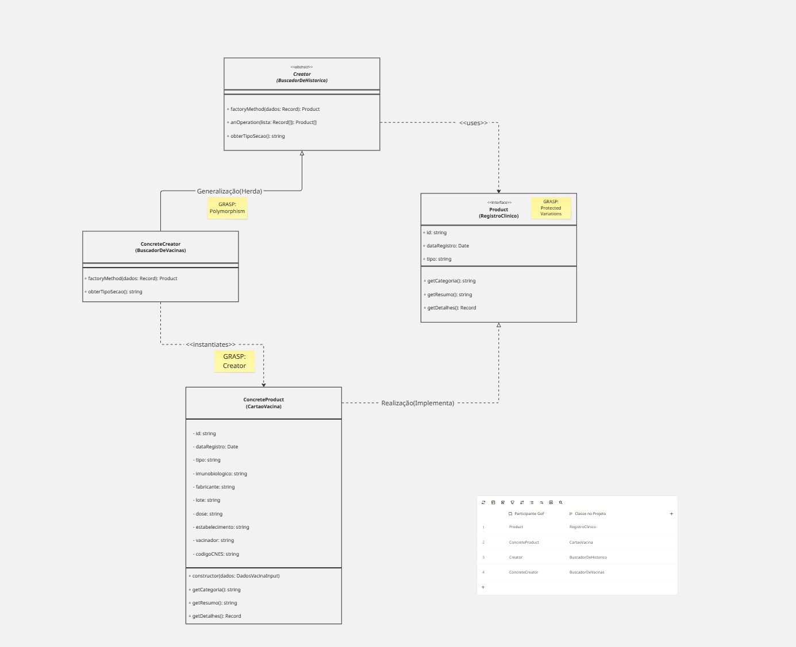
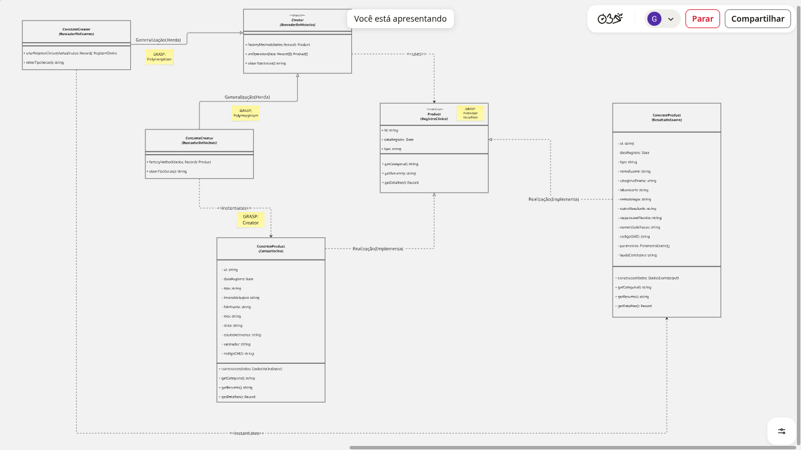
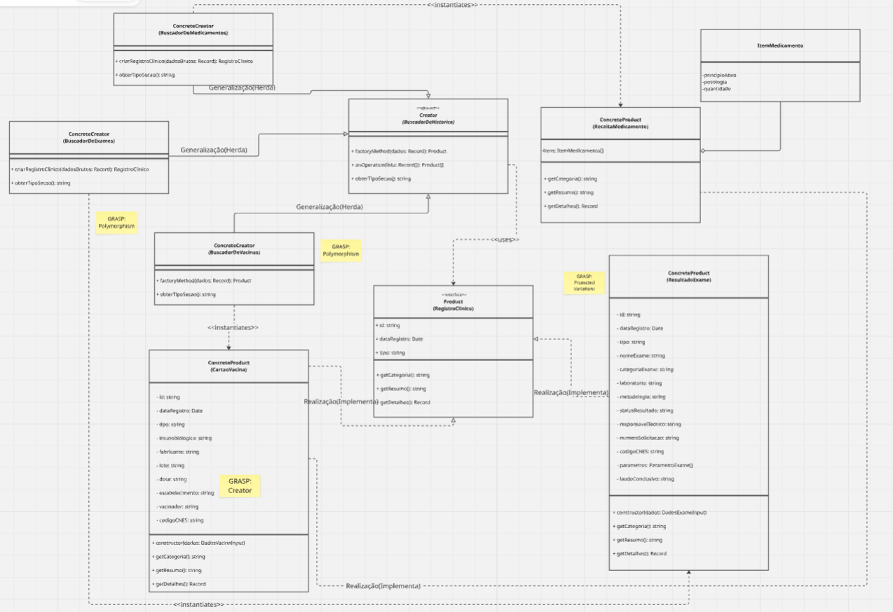

# GoF Criacional | Factory Method

## 1. Ambiente de Modelagem (Miro)

<iframe 
  width="768" 
  height="432" 
  src="https://miro.com/app/board/uXjVEZGI2ZU=/?share_link_id=95444474569" 
  frameborder="0" 
  scrolling="no" 
  allow="fullscreen; clipboard-read; clipboard-write" 
  allowfullscreen>
</iframe>

<strong>Espaço Colaborativo:</strong> Painel de modelagem UML da SubEquipe 01 no Miro.

---

## 2. Versão Final do Modelo

<strong>Legenda:</strong> Figura 1 - Diagrama de Classes UML consolidado (Versão Final) do padrão GoF Factory Method aplicado ao Meu SUS Digital (Autoria: SubEquipe 01 - Em breve).

---

## 3. Participantes da SubEquipe 01

| Nome do Membro | Papel na Modelagem e Foco Temático |
| :--- | :--- |
| [Artur Galdino](https://github.com/ArturFGaldino) | Versão 1: Diagrama Genérico do Factory Method e Fatia de Vacinas |
| [Giovani Coelho](https://github.com/Gotc2607) | Versão 2: Diagrama Aplicado com Extensão para Exames Laboratoriais |
| [João Leles](https://github.com/joaoleless) | Versão 3: Diagrama Refinado com Extensão para Medicamentos e Farmácia Popular |
| [Nicole Jovita](https://github.com/nicolejovita) | Versão 4: Consolidação Final com Seletor Dinâmico de Histórico |

---

## 4. Fundamentação Teórica

### 4.1. O que são os Padrões GoF Criacionais

Os padrões criacionais descritos pelo *Gang of Four* (Gamma et al., 1995) abstraem o processo de instanciação de objetos. Eles tornam um sistema independente de como seus objetos são criados, compostos e representados, encapsulando o conhecimento sobre quais classes concretas o sistema utiliza e ocultando como instâncias dessas classes são criadas e combinadas.

### 4.2. O Padrão Escolhido: Factory Method

* **Nome e Classificação:** Factory Method (Método Fábrica) — Padrão GoF de Criação de Objetos.
* **Intenção:** Definir uma interface para criar um objeto, mas delegar às subclasses a decisão sobre qual classe instanciar. O Factory Method permite adiar a instanciação para as subclasses em tempo de execução.
* **Problema que Resolve:** O sistema do Meu SUS Digital consome registros de saúde providos pela Rede Nacional de Dados em Saúde (RNDS). Embora todos os itens clínicos representem dados de saúde de um mesmo cidadão, a estrutura, as validações e as peculiaridades de cada categoria (doses e lotes de vacinas, laudos e parâmetros de exames, prescrições e dosagens de medicamentos) são completamente heterogêneas. Instanciar esses objetos de maneira acoplada e dispersa na camada de aplicação geraria alta fragilidade, violando o princípio *Open/Closed* (Aberto para Extensão, Fechado para Modificação) e o princípio de Responsabilidade Única (*Single Responsibility Principle*).
* **Solução Proposta:** Instituir uma classe abstrata criadora (`BuscadorDeHistorico` / `Creator`) que estabelece o contrato do método fábrica abstrato `criarRegistroClinico()` (`factoryMethod()`). Subclasses concretas (`BuscadorDeVacinas`, `BuscadorDeExames`, `BuscadorDeMedicamentos`) estendem essa base e realizam a instanciação de seus respectivos produtos clínicos (`CartaoVacina`, etc.), todos em conformidade com uma interface comum de produto (`RegistroClinico` / `Product`).
* **Estrutura e Participantes do Padrão:**
  1. **`Product` (`RegistroClinico`):** Interface que define os métodos comuns a todos os registros de saúde exibidos no sistema (`getCategoria()`, `getResumo()`, `getDetalhes()`).
  2. **`ConcreteProduct` (`CartaoVacina`):** Implementa o contrato de `Product`, encapsulando as propriedades e regras de negócio de imunobiológicos, lotes e doses.
  3. **`Creator` (`BuscadorDeHistorico`):** Declara o Factory Method abstrato `criarRegistroClinico()` e implementa operações concretas de alto nível, como `processarRegistros()`.
  4. **`ConcreteCreator` (`BuscadorDeVacinas`):** Sobrescreve o método fábrica para instanciar e retornar objetos `CartaoVacina`.
* **Consequências (Vantagens e Desvantagens):**
  - *Vantagens:* Desacopla o processador de dados clínicos das classes concretas de cada registro; facilita a adição de novas fatias clínicas sem impacto nas fatias existentes; viabiliza testes unitários isolados e reutilização da lógica de processamento em lote.
  - *Desvantagens:* Pode aumentar a quantidade de classes no sistema, visto que para cada novo produto clínico é necessário criar uma subclasse criadora correspondente.
* **Quando Usar:** Quando uma classe não pode antecipar a classe de objetos que deve criar; quando se deseja que as subclasses especifiquem os objetos criados; e quando se deseja centralizar e isolar as responsabilidades de instanciação.

### 4.3. Senso Crítico e Alternativas Consideradas

A escolha do **Factory Method** como padrão criacional principal foi fundamentada na análise comparativa de soluções alternativas do catálogo GoF:

- **Abstract Factory:** Foi considerada para a instanciação de famílias completas de componentes por ambiente (ex.: alternar entre provedor RNDS Real em nuvem e provedor Mock Local para desenvolvimento offline). Contudo, no contexto da busca de histórico clínico individual, o foco não é criar famílias de produtos interdependentes, mas sim permitir a instanciação polimórfica de categorias heterogêneas de registros a partir da escolha do cidadão. Adotar Abstract Factory nesse estágio acrescentaria camadas extras de abstração sem benefício direto imediato.
- **Builder:** Foi analisado para o fluxo de montagem progressiva do termo de consentimento LGPD, que possui múltiplos parâmetros granulares e passos sequenciais de autorização. No entanto, os registros retornados pela RNDS (vacinas, laudos) chegam na aplicação como cargas de dados consolidadas (JSON/FHIR Bundles), onde a criação direta do produto via método fábrica é mais direta, idiomática e coesa do que uma montagem passo a passo.
- **Singleton (Crítica Técnica):** O padrão Singleton foi expressamente evitado como padrão arquitetural principal da subequipe. Embora frequentemente utilizado para gerenciamento de conexões ou caches de sessão, a literatura especializada e a comunidade de arquitetura de software apontam que o Singleton atua majoritariamente como um anti-padrão de estado global disfarçado. Ele introduz forte acoplamento entre classes, oculta dependências diretas, impede a execução de testes unitários paralelos e determinísticos (como os que implementamos no Vitest) e viola tanto o Princípio da Responsabilidade Única (SRP) quanto o Princípio Aberto/Fechado (OCP).

### 4.4. Integração com Padrões e Princípios GRASP

A modelagem e implementação do Factory Method foram diretamente enriquecidas com os princípios e padrões de atribuição de responsabilidades **GRASP** (*General Responsibility Assignment Software Patterns*, Larman, 2005):

- **Creator (Criador):** O padrão GRASP Criador define que uma classe $B$ deve criar instâncias de $A$ caso $B$ agregue, contenha ou possua os dados essenciais para inicializar $A$. No nosso desenho, `BuscadorDeVacinas` é o Criador legítimo de `CartaoVacina`, pois processa e valida a carga bruta de imunobiológicos da RNDS.
- **Low Coupling (Baixo Acoplamento):** A interface de visualização React interage exclusivamente com as abstrações `BuscadorDeHistorico` e `RegistroClinico`. Nenhuma tela ou componente de UI possui acoplamento rígido com a classe concreta `CartaoVacina`, permitindo que novas fatias sejam acopladas transparentemente.
- **High Cohesion (Alta Coesão):** As responsabilidades de negócio estão estritamente segregadas: o produto concreto foca no encapsulamento e validação dos dados de vacinação, enquanto o criador concreto foca na lógica de instanciação e mapeamento do payload.
- **Polymorphism (Polimorfismo):** A delegação da criação para subclasses substitui estruturas condicionais (`if`/`switch`) por despacho polimórfico dinâmico baseado no tipo de seção clínica.
- **Protected Variations (Variações Protegidas):** A interface `RegistroClinico` atua como uma barreira estável que protege os consumidores do sistema contra instabilidades e variações de esquemas de dados da RNDS.

---

## 5. Contexto de Aplicação no Projeto

### 5.1. Onde o Padrão foi Aplicado

O padrão foi aplicado no subsistema de **Histórico de Saúde e Emissão de Documentos Clínicos** do Meu SUS Digital. A partir da autenticação via Gov.br e da concessão de consentimento nos termos da LGPD (mapeados no fluxo da Entrega 2 em [fluxograma.md](./fluxograma.md)), a aplicação requisita os registros à RNDS. Em vez de acoplar a visualização à estrutura crua de cada resposta de API, o subsistema aciona o criador especializado que instancia o produto clínico padronizado.

### 5.2. Rastreabilidade e Elos com Outros Artefatos

| Artefato Relacionado | Referência / Link | Relação com o Padrão GoF e Princípios GRASP |
| :--- | :--- | :--- |
| **Fluxograma de Processo (Entrega 2)** | [fluxograma.md](docs/3-PadroesDeProjetos/Relatórios/3.1.1.SubEquipe_01/fluxograma.md) | O Factory Method é acionado na etapa posterior à verificação de consentimento LGPD, processando a carga de dados brutos retornada pela RNDS. |
| **Diagrama de Pacotes (Entrega 2)** | [2.1.1.DiagramaDePacotes.md](../../../2-Modelagem/Relatórios/2.1.1.SubEquipe_01/ModelagemEstatica.md) | Fundamenta a separação em camadas arquiteturais (UI, Domínio Clínico e Núcleo do Padrão), garantindo Baixo Acoplamento e Alta Coesão. |
| **Diagrama de Colaboração (Entrega 2)** | [2.1.4.DiagramaDeColaboracao.md](../../../2-Modelagem/Relatórios/2.1.1.SubEquipe_01/ModelagemDinamica.md) | Mapeia o fluxo de mensagens entre o cidadão autenticado, o controlador de histórico e a RNDS no momento da busca. |
| **Código Fonte e Pull Request** | [Codigo.md](../../../3-PadroesDeProjetos/Relatórios/3.1.1.SubEquipe_01/Codigo.md), [PR #19](https://github.com/UnBArqDsw2026-2-Turma01/2026.2-T01-_G5_ProjetoGovernoEletronico_Entrega_03/pull/19) | Implementação executável das classes modeladas no diagrama e Pull Request da Versão 1. |
| **Execução e Testes** | [Execucao.md](../../../3-PadroesDeProjetos/Relatórios/3.1.1.SubEquipe_01/Execucao.md) | Validação da instanciação dinâmica e dos testes automatizados. |

---

## 6. Modelagem por Versões

### 6.1. Versão 1 — Diagrama de Classes Genérico (Artur Galdino)

A Versão 1 estabelece a correspondência formal entre a estrutura canônica do padrão GoF (Gang of Four) e o domínio do Meu SUS Digital, incorporando os princípios de atribuição de responsabilidades GRASP:

<strong>Legenda:</strong> Figura 2 - Modelagem UML do Factory Method — Versão 1: Diagrama Genérico com papéis GoF, mapeamento para o domínio e princípios GRASP (Autoria: Artur Galdino).

- **Mapeamento de Participantes:**
  - `Creator` --> `BuscadorDeHistorico`: Classe abstrata que declara o método fábrica abstrato `factoryMethod()` (`criarRegistroClinico`) e define a operação concreta de processamento em lote `anOperation()` (`processarRegistros`).
  - `Product` --> `RegistroClinico`: Interface que uniformiza o contrato dos registros de saúde exibidos no Meu SUS Digital (*Protected Variations*).
  - `ConcreteCreator` --> `BuscadorDeVacinas`: Criador concreto da fatia de Vacinas que sobrescreve o Factory Method (*GRASP Creator*).
  - `ConcreteProduct` --> `CartaoVacina`: Produto concreto que encapsula os dados e regras de negócio da imunização do cidadão.
- **Elementos e Notação UML Utilizados:**
  - Interface `<<interface>>` `Product` com métodos abstratos.
  - Classe Abstrata `{abstract}` `Creator` com método fábrica em itálico.
  - Realização (`..|>`) de `Product` por `ConcreteProduct` com ponta triangular oca.
  - Generalização/Herança (`--|>`) de `Creator` por `ConcreteCreator` com ponta triangular oca.
  - Dependência de Instanciação (`..>`) com estereótipo `<<instantiates>>` associada ao princípio *GRASP: Creator*.
  - Dependência de Uso (`..>`) com estereótipo `<<uses>>`.

---

### 6.2. Versão 2 — Diagrama de Classes Aplicado (Giovani Coelho) `[PLACEHOLDER]`

Evolução do diagrama apresentando a nomenclatura aplicada aos componentes do Meu SUS Digital com a adição da fatia de Exames Laboratoriais:
- Nova classe de produto concreto `ResultadoExame` realizando `RegistroClinico`.
- Nova classe criadora concreta `BuscadorDeExames` herdando de `BuscadorDeHistorico`.

<strong>Legenda:</strong> Figura 3 - Modelagem UML do Factory Method — Versão 2: Diagrama Aplicado com Vacinas e Exames (Autoria: Giovani Coelho - Em breve).

---

### 6.3. Versão 3 — Diagrama Refinado (João Leles) `[PLACEHOLDER]`

Refinamento do modelo após validação da implementação e integração da fatia de Medicamentos e Farmácia Popular:
- Nova classe de produto concreto `ReceitaMedicamento` realizando `RegistroClinico`.
- Nova classe criadora concreta `BuscadorDeMedicamentos` herdando de `BuscadorDeHistorico`.

<strong>Legenda:</strong> Figura 4 - Modelagem UML do Factory Method — Versão 3: Diagrama Refinado com Medicamentos (Autoria: João Leles - Em breve).

---

### 6.4. Versão 4 — Consolidação Final com Seletor (Nicole Jovita) `[PLACEHOLDER]`

Diagrama consolidado final com a classe orquestradora `SeletorDeHistorico` e a visão completa das três fatias de produtos clínicos integrados:

<strong>Legenda:</strong> Figura 5 - Modelagem UML consolidada com o Seletor Dinâmico de Histórico (Autoria: Nicole Jovita - Em breve).

---

## 7. Metodologia

A SubEquipe 01 adotou uma metodologia iterativa e incremental de fatiamento arquitetural:
1. **Fatiamento Funcional:** Em vez de realizar todo o trabalho de forma monolítica ou dispersa, o domínio clínico do Meu SUS Digital foi particionado em fatias temáticas (Vacinas, Exames, Medicamentos e Seletor Unificador).
2. **Atuação nos Três Focos Obrigatórios:** Cada membro é diretamente responsável pelos 3 focos de sua versão: **Modelagem UML**, **Código Fonte** e **Execução/Evidências**.
3. **Padrão de Qualidade e Isolamento:** O código foi construído em repositório desacoplado (`code/criacional/`), garantindo execução offline e testes automatizados sem acoplamento a serviços externos.

Registros das atas de reunião e planejamento interno estão documentados em [Planejamento de Issues](#/3-PadroesDeProjetos/Relatórios/3.1.1.SubEquipe_01/PlanejamentoIssues).

---

## 8. Bibliografia

1. GAMMA, Erich; HELM, Richard; JOHNSON, Ralph; VLISSIDES, John. **Padrões de Projeto: Soluções Reutilizáveis de Software Orientado a Objetos**. Porto Alegre: Bookman, 2000.
2. LARMAN, Craig. **Utilizando UML e Padrões: Uma Introdução à Análise e ao Projeto Orientados a Objetos e ao Desenvolvimento Iterativo**. 3. ed. Porto Alegre: Bookman, 2005.
3. SERRANO, Milene; SERRANO, Maurício. **Material de Apoio da Disciplina Arquitetura e Desenho de Software**: Padrões GoF Criacionais. Universidade de Brasília (UnB), Faculdade do Gama (FGA), 2026.
4. FOWLER, Martin. **Refatoração: Aperfeiçoando o Design de Código Existente**. Porto Alegre: Bookman, 2020.
5. BRASIL. Ministério da Saúde. **Rede Nacional de Dados em Saúde (RNDS) - Especificações Técnicas de Integração**. Disponível em: <https://rnds.saude.gov.br/>. Acesso em: 15 out. 2026.

---

## 9. Histórico de Versionamento

| Versão | Data | Descrição / Contribuição | Autor(es) | Commit(s) |
| :---: | :---: | :--- | :--- | :--- |
| `0.1` | 06/10/2026 | Início do template do trabalho | [Gustavo Fornaciari](https://github.com/GUGOFO) | [`18b6195`](https://github.com/UnBArqDsw2026-2-Turma01/2026.2-T01-_G5_ProjetoGovernoEletronico_Entrega_03/commit/18b61958e419b67f95469d4a704ddcb9629b9803) |
| `0.2` | 14/10/2026 | Template mais detalhado de padrões GoF | [Gustavo Fornaciari](https://github.com/GUGOFO) | [`7c66f78`](https://github.com/UnBArqDsw2026-2-Turma01/2026.2-T01-_G5_ProjetoGovernoEletronico_Entrega_03/commit/7c66f78dc795f080bc43dc01f094e8976462d5b8) |
| `1.0` | 15/10/2026 | Elaboração completa da fundamentação teórica, contexto de aplicação no Meu SUS Digital, documentação detalhada da Versão 1 de modelagem UML (Artur Galdino) e estruturação dos placeholders formais para as Versões 2, 3 e 4 | [Artur Galdino](https://github.com/ArturFGaldino) | [`af87f42`](https://github.com/UnBArqDsw2026-2-Turma01/2026.2-T01-_G5_ProjetoGovernoEletronico_Entrega_03/commit/af87f42) |
| `1.1` | 15/10/2026 | Padronização e harmonização da numeração sequencial contínua das Figuras 1 a 5 | [Artur Galdino](https://github.com/ArturFGaldino) | [`af87f42`](https://github.com/UnBArqDsw2026-2-Turma01/2026.2-T01-_G5_ProjetoGovernoEletronico_Entrega_03/commit/af87f42) |
| `1.2` | 15/10/2026 | Enriquecimento da documentação com senso crítico de alternativas (Abstract Factory, Builder, Singleton), padrões GRASP (Creator, Low Coupling, High Cohesion, Protected Variations), rastreabilidade com Diagramas de Pacotes e Colaboração, e nomenclatura de versões (Genérico, Aplicado, Refinado) | [Artur Galdino](https://github.com/ArturFGaldino) | [`af87f42`](https://github.com/UnBArqDsw2026-2-Turma01/2026.2-T01-_G5_ProjetoGovernoEletronico_Entrega_03/commit/af87f42) |