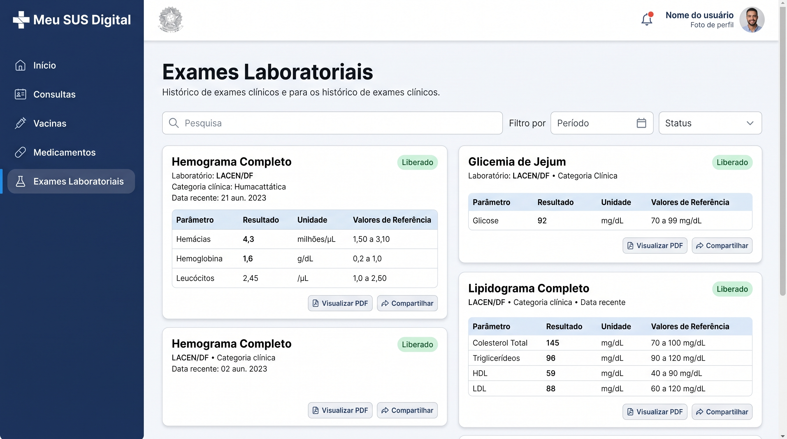

# Uso de Inteligência Artificial Generativa | GoF Criacional

---

## 1. Descrição e Objetivo

[PREENCHER] Registrar o apoio e o uso de ferramentas de IA Generativa na entrega de Padrões de Projeto (GoF Criacionais) pela SubEquipe 01, com transparência, senso crítico e rastreabilidade: o que foi pedido, o que foi obtido e o que a equipe decidiu manter, corrigir ou descartar.

---

## 2. Metodologia do Foco

[PREENCHER] Explicar como foram coletados os relatos e dados de uso (individual, assíncrono, em reunião etc.).

### Ferramentas Empregadas

* **Google Gemini (Google DeepMind / Gemini 2.5):** Utilizado por Giovani Coelho na geração de imagem conceitual de interface da fatia de Exames Laboratoriais (Versão 2) para fins de comparação com a implementação real.
* **[PREENCHER: ferramenta e versão]:** [PREENCHER: para que foi usada]

---

## 3. Experimentos com IA Generativa nesta Entrega

Adicione um experimento para cada uso relevante da IA (modelagem, código, execução, revisão), copiando o bloco abaixo.

### Experimento — Giovani Coelho: Prototipação Visual de Interface vs. Implementação Real do Factory Method (Fatia de Exames Laboratoriais - Versão 2)

* **Responsável:** [Giovani Coelho](https://github.com/Gotc2607)
* **Artefatos Relacionados:** [GoFCriacional.md](./GoFCriacional.md) (Versão 2), [Codigo.md](./Codigo.md) (Versão 2), [Execucao.md](./Execucao.md) (Versão 2).

#### Objetivo:

Avaliar a capacidade de um modelo generativo em sintetizar a experiência visual e a densidade de informações clínicas de uma interface governamental de saúde ("Meu SUS Digital — Exames Laboratoriais"), e contrapor criticamente o artefato visual gerado à implementação real da arquitetura de software orientada ao padrão GoF Factory Method (`BuscadorDeExames` e `ResultadoExame`).

#### Prompt Utilizado:

```text
Interface moderna de aplicativo web desktop para o sistema público de saúde brasileiro "Meu SUS Digital", estilo visual oficial Gov.br nas cores azul marinho e branco limpo. A tela ativa é "Exames Laboratoriais". O painel exibe cartões modernos de histórico de exames clínicos realizados: Hemograma Completo, Glicemia de Jejum e Lipidograma Completo. Cada cartão contém identificação do laboratório (LACEN/DF), categoria clínica, tag de status "Liberado" em verde e tabela clínica estruturada com parâmetros, resultados, unidades de medida (mg/dL) e valores de referência. Estilo mockup de UI/UX do Figma, design limpo, institucional e de alta fidelidade para saúde digital.
```

*(Prompt equivalente em inglês utilizado para refinamento da renderização de texto e layout: `Modern desktop web application interface of the Brazilian public health system "Meu SUS Digital", official Gov.br design system aesthetics with navy blue and clean white palette. The active section is "Exames Laboratoriais" (Laboratory Clinical Exams). The screen displays modern medical cards showing completed diagnostic lab tests: Complete Blood Count (Hemograma), Fasting Blood Glucose (Glicemia), and Lipid Panel. Each card highlights the issuing laboratory (LACEN/DF), exam category, status tag "Liberado" in green, and an expandable structured clinical table with parameters, detected values, measurement units (mg/dL, cells/mm³), and standard reference ranges. Clean corporate government dashboard, Figma UI mockup style, high resolution, minimalist healthcare UX design, no blur.`)*

#### Resultado Obtido:

A ferramenta de IA generativa produziu uma maquete visual de alta resolução representando o painel web do Meu SUS Digital:



<center><strong>Figura 1:</strong> Mockup conceitual da interface de Exames Laboratoriais gerado pelo Google Gemini a partir de engenharia de prompt (Autoria: Giovani Coelho via Google Gemini).</center>

<br>

Para fins de rastreabilidade e análise comparativa, a **Figura 2** apresenta a tela real desenvolvida e em execução na aplicação React/TypeScript da SubEquipe 01, na qual o padrão GoF Factory Method opera de forma dinâmica sobre os laudos da RNDS:


<center><strong>Figura 2:</strong> Interface real do Meu SUS Digital desenvolvida em React/TypeScript na Versão 2, com despacho do Factory Method e Dock GoF interativo (Autoria: Giovani Coelho; extraído de Execucao.md).</center>

#### Análise Crítica e Intervenção Humana:

A confrontação direta entre a imagem gerada pela IA (**Figura 1**) e o software real desenvolvido (**Figura 2**) evidencia convergências visuais expressivas, mas também limitações críticas incontornáveis da IA generativa de imagens no âmbito da Engenharia de Software:

1. **Convergências e Acertos Visuais:**
   - **Identidade Institucional:** A IA assimilou com fidelidade os padrões do Design System Gov.br e do Meu SUS Digital, adotando a paleta cromática em azul marinho e fundo claro, o logotipo com a cruz estilizada no canto superior esquerdo e a tipografia institucional limpa.
   - **Hierarquia de Navegação:** O layout gerou corretamente a barra lateral com abas temáticas de saúde (Início, Consultas, Vacinas, Medicamentos e o item ativo Exames Laboratoriais), alinhando-se à visão de fatiamento do histórico clínico.
   - **Estruturação Clínica:** A disposição dos dados em cartões individuais para cada laudo (Hemograma Completo, Glicemia de Jejum, Lipidograma Completo), o uso de tags verdes de status ("Liberado") e a apresentação de tabelas com parâmetros, resultados e valores de referência demonstraram boa apreensão do domínio conceitual de laudos laboratoriais.

2. **Divergências, Alucinações e Erros de Domínio:**
   - **Alucinação Semântica e Textual:** A IA apresentou artefatos clássicos de modelos de difusão de texto em imagens:
     - No subtítulo superior, gerou uma repetição incoerente: *"Histórico de exames clínicos e para os histórico de exames clínicos."*
     - Na categoria do hemograma, alucinou o termo inexistente *"Humacattática"* em vez de *"Hematologia"*.
     - Nas datas dos exames, grafou erros tipográficos como *"21 aun. 2023"*.
   - **Inconsistência Fisiológica dos Dados:** Os valores numéricos nos parâmetros laboratoriais gerados pela IA não possuem base clínica real: no hemograma, a IA indicou uma hemoglobina de `1,6 g/dL` com faixa de referência de `0,2 a 1,0` (valores clinicamente impossíveis ou incompatíveis com a vida). Em contrapartida, no código real do projeto ([`examesMock.ts`](file:///code/criacional/src/dominio/examesMock.ts)), foram pesquisados e implementados valores e unidades fisiológicas consistentes da RNDS e do LACEN/DF (ex.: Hemoglobina `14.8 g/dL`, referência de `13.0 a 17.5 g/dL`, com situação clínica calculada como `NORMAL`).

3. **O Limite Insuperável: A Ausência de Arquitetura de Software:**
   - **Casca Visual vs. Padrão GoF Factory Method:** A imagem da IA é uma representação puramente estática e cosmética. Ela não tem consciência de nenhum princípio de Orientação a Objetos. Na aplicação real, cada exame é uma instância do produto concreto `ResultadoExame`, criado exclusivamente pelo criador concreto `BuscadorDeExames` que sobrepõe o método fábrica `criarRegistroClinico()` da classe base `BuscadorDeHistorico`.
   - **Interatividade e Despacho Polimórfico:** A interface real desenvolvida conta com o **Dock GoF interativo** (`⚡ +Exame (V2)`), permitindo que o usuário ou avaliador dispare a fábrica em tempo de execução, consuma novos payloads brutos e visualize o registro sendo instanciado e renderizado reativamente pelo React. A imagem da IA não provê nenhuma dinamicidade.
   - **Robustez e Tipagem Estática:** A implementação humana assegurou tipagem rigorosa em TypeScript (`ParametroExame[]`), validação defensiva de payloads malformatados e uma suíte com **27 testes unitários e de integração** aprovados no Vitest, garantindo a integridade do sistema contra regressões.

* **Conclusão:** O experimento comprovou que a IA generativa é um recurso ágil para exploração de ideias e benchmarking de interfaces de usuário, mas a concepção da arquitetura, a fidelidade dos dados clínicos, a garantia dos padrões de projeto GoF/GRASP e a implementação do código executável dependem estritamente da intervenção e do rigor da engenharia humana.

---

### Experimento 01: [PREENCHER: título]

#### Objetivo:

[PREENCHER]

#### Prompt Utilizado:

```
[PREENCHER: prompt]
```

#### Resultado Obtido:

[PREENCHER]

#### Análise Crítica e Intervenção Humana:

[PREENCHER] O que a IA acertou, o que errou ou omitiu, e o que a equipe corrigiu manualmente.

---

## 4. Análise Crítica e Lições Aprendidas

* **Cobertura Conceitual:** [PREENCHER]
* **Aderência ao Padrão e à UML:** [PREENCHER]
* **Qualidade do Código Gerado e Execução:** [PREENCHER]
* **Influência do Prompting:** [PREENCHER]
* **Confiabilidade e Validação:** [PREENCHER]
* **Limites do Experimento:** [PREENCHER]

---

## 5. Pontos de Vista Individuais

Pontos de vista de cada membro da equipe sobre as lições aprendidas e o uso da IA Generativa.

### Resumo por Integrante

| Integrante | O que aprendi | Uso de IA Generativa |
| --- | --- | --- |
| [Artur Galdino](https://github.com/ArturFGaldino) | [PREENCHER] | [PREENCHER] |
| [Giovani Coelho](https://github.com/Gotc2607) | Compreendi na prática o contraste entre uma maquete visual estática gerada por IA e a engenharia de software real: a IA sintetiza bem a identidade visual de governo, mas alucina dados clínicos e não tem noção da arquitetura GoF (Factory Method), exigindo intervenção humana em 100% da lógica e dos testes. | Geração de mockup de interface no Google Gemini a partir de engenharia de prompt e comparação crítica com o protótipo real e a arquitetura da Versão 2 (Exames Laboratoriais). |
| [João Leles](https://github.com/joaoleless) | [PREENCHER] | [PREENCHER] |
| [Nicole Jovita](https://github.com/nicolejovita) | [PREENCHER] | [PREENCHER] |

---

### Detalhamento

### Artur Galdino

* **GitHub:** [@ArturFGaldino](https://github.com/ArturFGaldino)

* **Uso da IA Generativa (Senso Crítico):** [PREENCHER]

* **Lições Aprendidas:** [PREENCHER]

---

### Giovani Coelho

* **GitHub:** [@Gotc2607](https://github.com/Gotc2607)

* **Uso da IA Generativa (Senso Crítico):** Utilizei o Google Gemini para gerar uma imagem conceitual de interface representando a fatia de Exames Laboratoriais do Meu SUS Digital, comparando o resultado obtido com o código e a interface que implementei na Versão 2. Meu objetivo foi avaliar até onde a IA consegue antecipar a experiência do usuário de um sistema de governo eletrônico e onde ela falha. Exercendo o senso crítico, constatei que a imagem gerada é esteticamente coerente com o Gov.br, mas apresenta falhas de alucinação de texto e valores laboratoriais fisiologicamente incorretos (como hemoglobina letal), além de ser puramente uma maquete estática. Não adotei nenhum código ou dado gerado cegamente pela IA; toda a arquitetura do Factory Method (`BuscadorDeExames` instanciando `ResultadoExame`), a tipagem TypeScript, a tabela de parâmetros e a suíte de 27 testes unitários e de integração no Vitest foram construídos com rigor técnico manual.

* **Lições Aprendidas:** Aprendi que IAs generativas de imagem são úteis para brainstorming e exploração preliminar de layout, mas não têm qualquer capacidade de estruturar arquitetura de software, garantir integridade de dados clínicos ou atender aos princípios GoF e GRASP (Creator, Polymorphism, Low Coupling). A engenharia de software reside na correta separação de responsabilidades e na garantia de qualidade do código executável, algo que depende essencialmente do julgamento e da atuação humana.

---

### João Leles

* **GitHub:** [@joaoleless](https://github.com/joaoleless)

* **Uso da IA Generativa (Senso Crítico):** [PREENCHER]

* **Lições Aprendidas:** [PREENCHER]

---

### Nicole Jovita

* **GitHub:** [@nicolejovita](https://github.com/nicolejovita)

* **Uso da IA Generativa (Senso Crítico):** [PREENCHER]

* **Lições Aprendidas:** [PREENCHER]

---

## 6. Síntese do Aprendizado da Subequipe

[PREENCHER]

---

## 7. Referências e Ferramentas Utilizadas

1. **Google Gemini (Google DeepMind):** Ferramenta de Inteligência Artificial Generativa multimodelo utilizada na geração e prototipação de imagens conceituais de interface. Disponível em: <https://gemini.google.com/>. Acesso em: 18 out. 2026.
2. [PREENCHER: ferramenta, endereço e data de acesso.]

---

## Histórico de Versionamento

| Nome do Membro | Contribuição | Data | Commit |
| :--- | :--- | :--- | :--- |
| [Gustavo Fornaciari](https://github.com/GUGOFO) | Inicio do Teamplate do trabalho | 06/10/2026 | [18b6195](https://github.com/UnBArqDsw2026-2-Turma01/2026.2-T01-_G5_ProjetoGovernoEletronico_Entrega_03/tree/18b61958e419b67f95469d4a704ddcb9629b9803) |
| [Gustavo Fornaciari](https://github.com/GUGOFO) | Teamplate mais detalhado | 14/10/2026 | [7c66f78](https://github.com/UnBArqDsw2026-2-Turma01/2026.2-T01-_G5_ProjetoGovernoEletronico_Entrega_03/tree/7c66f78dc795f080bc43dc01f094e8976462d5b8) |
| [Giovani Coelho](https://github.com/Gotc2607) | Adição do experimento de IA com Google Gemini para a fatia de Exames (V2) e ponto de vista individual | 18/10/2026 | [e87e841](https://github.com/UnBArqDsw2026-2-Turma01/2026.2-T01-_G5_ProjetoGovernoEletronico_Entrega_03/commit/e87e841) |