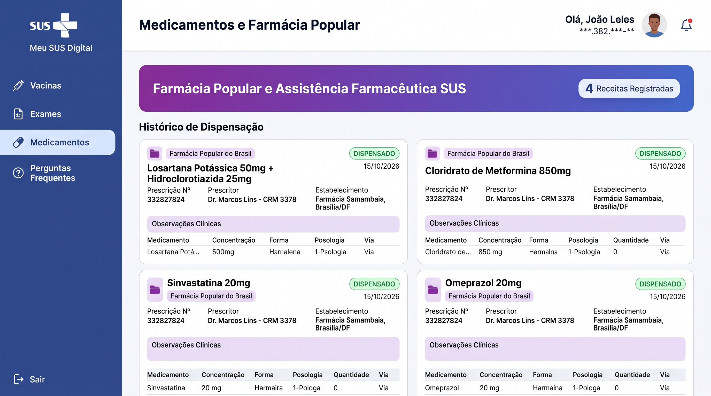
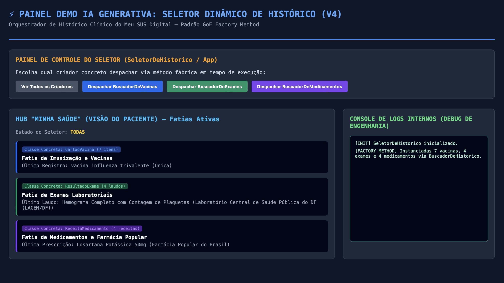
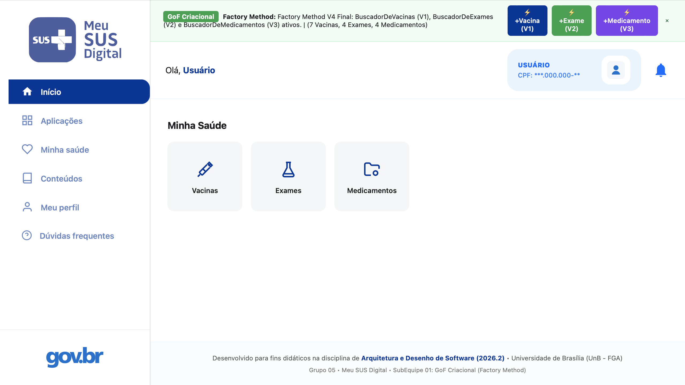

# Uso de Inteligência Artificial Generativa | GoF Criacional

---

## 1. Descrição e Objetivo

Este documento registra o apoio, a experimentação e a análise crítica sobre o uso de ferramentas de **Inteligência Artificial Generativa (IAG)** na **Entrega 3 (Padrões de Projeto GoF Criacionais — Factory Method)** pela **SubEquipe 01**. O propósito deste relatório é apresentar, com transparência, rigor técnico e rastreabilidade, de que maneira os modelos de linguagem e geração de código foram empregados durante o ciclo de engenharia de software da equipe — compreendendo as etapas de concepção visual, modelagem UML, implementação em TypeScript/React, elaboração de testes automatizados e confecção da documentação.

Seguindo a diretriz metodológica já consagrada na Entrega 2, a subequipe manteve a postura de tratar a IA estritamente como um **mecanismo acelerador e co-piloto exploratório**, reservando à engenharia humana a totalidade das decisões de design arquitetural, validação de regras de domínio e fiscalização das saídas geradas. Em especial, busca-se evidenciar nesta entrega os riscos e limites da geração automática quando desprovida de contexto visual e semântico adequado, contrapondo o comportamento dos modelos às necessidades reais do ecossistema do **Meu SUS Digital**.

---

## 2. Metodologia do Foco

A coleta de dados, registros de experimentos e reflexões críticas é realizada de forma **individual e assíncrona** por cada um dos integrantes da SubEquipe 01, respeitando o particionamento em quatro versões incrementais do domínio clínico (Vacinas, Exames Laboratoriais, Medicamentos e Seletor Unificador / Hub "Minha Saúde"). Cada participante tem a atribuição de documentar um experimento prático significativo em seu respectivo foco temático (modelagem, código, interface ou auditoria de qualidade), explicitando os objetivos, os prompts de entrada, os artefatos obtidos e as devidas correções ou descartes efetuados.

### Ferramentas Empregadas

- **ChatGPT (OpenAI - GPT-4o / Canvas):** Utilizado por Artur Galdino (Experimento 01) e Nicole Jovita (Experimento 04) em experimentos de geração de código para prototipação de interfaces web, orquestração de seletores e testes de layouts a partir de especificações em linguagem natural.
- **Claude (Anthropic - Claude 3.5 Sonnet):** Empregado por Artur Galdino e Nicole Jovita na revisão sintática de código TypeScript, validação de tipagem estática e auxílio na formatação de relatórios em Markdown.
- **Google Gemini (Advanced / 1.5 Pro):** Utilizado para confrontar modelos conceituais de design patterns e apoiar análises comparativas de requisitos do ecossistema governamental.
- **Google Gemini (Google DeepMind / Gemini 2.5):** Utilizado por Giovani Coelho na geração de imagem conceitual de interface da fatia de Exames Laboratoriais (Versão 2) para fins de comparação com a implementação real.
- **Google Gemini (Google DeepMind):** Utilizado por João Leles na geração de imagem conceitual de interface da fatia de Medicamentos e Farmácia Popular (Versão 3) para fins de comparação com a implementação real.

---

## 3. Experimentos com IA Generativa nesta Entrega

---

### Experimento 01: Geração de Interface com IA sem Contexto Visual — O Fenômeno da "Interface Alucinada" e o Desalinhamento com o Meu SUS Digital

#### Integrante Responsável

* **Nome:** [Artur Galdino](https://github.com/ArturFGaldino)
* **Foco / Papel:** Versão 1: Modelagem e Implementação do Factory Method — Fatia de Vacinas / Carteira de Vacinação Digital

#### Objetivo:

Investigar a capacidade e as limitações de uma IA Generativa (ChatGPT GPT-4o) ao receber a solicitação de prototipar uma interface gráfica em React/Tailwind/HTML para a demonstração do padrão de projeto GoF Criacional **Factory Method** aplicado à fatia de vacinas do **Meu SUS Digital**, **sem o fornecimento de imagens de referência, capturas de tela do aplicativo oficial, protótipos do Figma ou diretrizes do Design System do Governo Federal (DS-Gov)**.

O objetivo precípuo do experimento foi verificar na prática a hipótese de que, ao ser instruída unicamente por um prompt textual genérico, a IA tende a "delirar" (alucinar) — preenchendo as lacunas de contexto visual e semântico com metáforas conceituais artificiais, criando layouts que nada têm a ver com o produto real do Ministério da Saúde e expondo detalhes de baixo nível da arquitetura de software diretamente na interface do usuário.

#### Prompt Utilizado:

> Crie uma interface web moderna em HTML, CSS e React para demonstrar o padrão de projeto GoF Criacional Factory Method aplicado ao Meu SUS Digital, especificamente para a fatia de histórico de vacinas do cidadão. Mostre o usuário autenticado via Gov.br, um botão para acionar o Factory Method instanciando uma nova vacina e cards com as vacinas aplicadas (Covid-19, Gripe, Febre Amarela, Hepatite B) sincronizadas com a RNDS.


#### Resultado Obtido:

A Inteligência Artificial gerou uma página web completa e estilizou os componentes conforme demonstrado na imagem a seguir:

<div align="center">


</div>

<center><strong>Figura 1:</strong> Interface gráfica gerada pela IA generativa a partir de prompt puramente textual sem insumos visuais prévios. Nota-se a criação de um "painel didático de desenvolvedor" descolado da identidade real do Meu SUS Digital (Autoria: Artur Galdino).</center>

<br>

Para fins de contraste e fundamentação da análise crítica, apresenta-se abaixo a **interface real da Versão 1**, desenvolvida manualmente pela subequipe em estrita conformidade com o Design System oficial do Ministério da Saúde e as especificações do Gov.br:

<div align="center">


</div>

<center><strong>Figura 2:</strong> Interface real da Carteira Nacional de Vacinação Digital (Versão 1) desenvolvida pela equipe com fidelidade visual ao Meu SUS Digital e isolamento arquitetural do padrão de projeto (Autoria: Artur Galdino).</center>

<br>

#### Análise Crítica e Intervenção Humana:

A confrontação detalhada entre o resultado fabricado pela IA (Figura 1) e a aplicação desenvolvida pela equipe (Figura 2) revelou falhas conceituais, semânticas e ergonômicas profundas decorrentes da ausência de contexto visual:

1. **Alucinação Conceitual: O "Dashboard Acadêmico de Depuração" (*Toy Showcase*)**  
   Ao desconhecer o layout e a finalidade prática do aplicativo oficial do Meu SUS Digital, a IA interpretou o pedido de "demonstrar o padrão Factory Method" de forma excessivamente literal. Em vez de projetar um sistema de governo focado na jornada do paciente, a ferramenta alucinou um painel de laboratório didático para desenvolvedores. Ela inseriu cabeçalhos artificiais grotescos como *"Demonstração do Padrão GoF Criacional: Factory Method"*, criou uma tarja destacada *"PADRÃO DE PROJETO GOF CRIACIONAL Factory Method em Ação"* com a explicação teórica do código, e chegou a inventar uma janela textual intitulada *"LOG DE EXECUÇÃO: Factory Method pronto. 4 instâncias de CartaoVacina criadas via BuscadorDeVacinas"*. Em nenhum ambiente governamental de produção tais dados de infraestrutura/debug seriam exibidos em tela para o cidadão.

2. **Vazamento Abstrato da Arquitetura na Interface do Cidadão (*Leaky Abstraction*)**  
   Um dos desvios mais graves produzidos pela IA foi estampar nos cartões de cada imunizante a inscrição explícita: `"Classe: CartaoVacina"`. Sob a ótica da Engenharia de Software e das boas práticas de arquitetura em camadas (Gamma et al., 1995; Martin, 2002), o padrão de projeto existe para organizar e desacoplar o código-fonte internamente. A camada de apresentação (View/UI) deve consumir dados clínicos higienizados; expor o nome da classe concreta orientada a objetos na interface do paciente constitui uma violação crassa de encapsulamento e usabilidade.

3. **Incompatibilidade Estética e Ergonômica com o Design System Oficial (DS-Gov / Meu SUS Digital)**  
   Visualmente, a interface gerada pela IA não possui qualquer convergência com o aplicativo oficial:
   * **Cores e Banner Superior:** A IA adotou uma barra verde-escura chapada sem relação com o padrão azul clássico do Governo Federal (`#1351b4`) e do Meu SUS Digital.
   * **Identificação do Usuário:** A IA gerou um card genérico em cinza com ícone circular básico, enquanto a identidade do Meu SUS Digital utiliza o card azul escuro característico do cidadão com CPF, CNS e status de autenticação unificado.
   * **Cards Clínicos:** Os cards gerados pela IA dividiram a tela em colunas horizontais genéricas com badges de cores arbitrárias, omitindo informações essenciais da Carteira Nacional de Vacinação (como doses subsequentes, selo oficial de validação e rastreamento da RNDS no padrão oficial).

4. **Intervenção Humana e Decisão da Equipe:**  
   O código e a tela gerados pela IA foram **completamente descartados**. A equipe optou por:
   * Manter o código do padrão GoF estritamente isolado no pacote de domínio e regras de negócio (`code/criacional/src/padrao/`), sem nenhuma menção ou acoplamento a classes na tela de visualização do usuário.
   * Construir a interface do zero em React e CSS puro ([`meuSus.css`](file:///code/criacional/src/ui/meuSus.css)), inspirando-se fielmente nos fluxos reais capturados do aplicativo mobile/web do Ministério da Saúde.
   * Alocar a demonstração técnica do Factory Method em um painel discreto e segregado (o "Dock GoF" interativo), preservando o realismo e a fidedignidade do sistema principal.

**Conclusão do Experimento:** O teste comprovou empiricamente que o uso de IAs generativas sem insumos multimodais (screenshots, protótipos visuais, paletas de design tokens) é ineficaz para o design de interfaces de domínio específico. Quando a ferramenta é alimentada apenas com texto, ela tende a inventar uma estética genérica e misturar a lógica de depuração técnica na camada visual. A engenharia humana é indispensável para contextualizar, podar alucinações e aplicar o devido isolamento arquitetural.

---

### Experimento 02: Prototipação Visual de Interface vs. Implementação Real do Factory Method (Fatia de Exames Laboratoriais)

#### Integrante Responsável

* **Nome:** [Giovani Coelho](https://github.com/Gotc2607)
* **Foco / Papel:** Versão 2: Extensão do Factory Method para Exames Laboratoriais (`BuscadorDeExames` e `ResultadoExame`)
* **Artefatos Relacionados:** [GoFCriacional.md](../../../3-PadroesDeProjetos/Relatórios/3.1.1.SubEquipe_01/GoFCriacional.md) (Versão 2), [Codigo.md](../../../3-PadroesDeProjetos/Relatórios/3.1.1.SubEquipe_01/Codigo.md) (Versão 2), [Execucao.md](../../../3-PadroesDeProjetos/Relatórios/3.1.1.SubEquipe_01/Execucao.md) (Versão 2).

#### Objetivo:

Avaliar a capacidade de um modelo generativo em sintetizar a experiência visual e a densidade de informações clínicas de uma interface governamental de saúde ("Meu SUS Digital — Exames Laboratoriais"), e contrapor criticamente o artefato visual gerado à implementação real da arquitetura de software orientada ao padrão GoF Factory Method (`BuscadorDeExames` e `ResultadoExame`).

#### Prompt Utilizado:


> Interface moderna de aplicativo web desktop para o sistema público de saúde brasileiro "Meu SUS Digital", estilo visual oficial Gov.br nas cores azul marinho e branco limpo. A tela ativa é "Exames Laboratoriais". O painel exibe cartões modernos de histórico de exames clínicos realizados: Hemograma Completo, Glicemia de Jejum e Lipidograma Completo. Cada cartão contém identificação do laboratório (LACEN/DF), categoria clínica, tag de status "Liberado" em verde e tabela clínica estruturada com parâmetros, resultados, unidades de medida (mg/dL) e valores de referência. Estilo mockup de UI/UX do Figma, design limpo, institucional e de alta fidelidade para saúde digital.

*(Prompt equivalente em inglês utilizado para refinamento da renderização de layout: `Modern desktop web application interface of the Brazilian public health system "Meu SUS Digital", official Gov.br design system aesthetics with navy blue and clean white palette. The active section is "Exames Laboratoriais" (Laboratory Clinical Exams). The screen displays modern medical cards showing completed diagnostic lab tests: Complete Blood Count (Hemograma), Fasting Blood Glucose (Glicemia), and Lipid Panel. Each card highlights the issuing laboratory (LACEN/DF), exam category, status tag "Liberado" in green, and an expandable structured clinical table with parameters, detected values, measurement units (mg/dL, cells/mm³), and standard reference ranges. Clean corporate government dashboard, Figma UI mockup style, high resolution, minimalist healthcare UX design, no blur.`)*

#### Resultado Obtido:

A ferramenta de IA generativa (Google Gemini) produziu uma maquete visual de alta resolução representando o painel web do Meu SUS Digital:

<div align="center">


</div>

<center><strong>Figura 3:</strong> Mockup conceitual da interface de Exames Laboratoriais gerado pelo Google Gemini a partir de engenharia de prompt (Autoria: Giovani Coelho via Google Gemini).</center>

<br>

#### Análise Crítica e Intervenção Humana:

1. **Aderência Visual e Estética (O que a IA acertou):**
   - **Paleta Institucional e Identidade:** A IA absorveu muito bem as diretrizes do Design System do Gov.br (DS-Gov), utilizando a tipografia sem serifa limpa, cabeçalhos em tons sóbrios de azul marinho (`#1351b4`) e fundos neutros.
   - **Estruturação Clínica:** A disposição dos dados em cartões individuais para cada laudo (Hemograma Completo, Glicemia de Jejum, Lipidograma Completo), o uso de tags verdes de status ("Liberado") e a apresentação de tabelas com parâmetros, resultados e valores de referência demonstraram boa apreensão do domínio conceitual de laudos laboratoriais.

2. **Divergências, Alucinações e Erros de Domínio:**
   - **Alucinação Semântica e Textual:** A IA apresentou artefatos clássicos de modelos de difusão de texto em imagens: no subtítulo superior, gerou uma repetição incoerente (*"Histórico de exames clínicos e para os histórico de exames clínicos."*); na categoria do hemograma, alucinou o termo inexistente *"Humacattática"* em vez de *"Hematologia"*; e nas datas dos exames, grafou erros tipográficos como *"21 aun. 2023"*.
   - **Inconsistência Fisiológica dos Dados:** Os valores numéricos nos parâmetros laboratoriais gerados pela IA não possuem base clínica real: no hemograma, a IA indicou uma hemoglobina de `1,6 g/dL` com faixa de referência de `0,2 a 1,0` (valores clinicamente impossíveis ou incompatíveis com a vida). Em contrapartida, no código real do projeto ([`examesMock.ts`](file:///code/criacional/src/dominio/examesMock.ts)), foram pesquisados e implementados valores e unidades fisiológicas consistentes da RNDS e do LACEN/DF (ex.: Hemoglobina `14.8 g/dL`, referência de `13.0 a 17.5 g/dL`, com situação clínica calculada como `NORMAL`).

3. **O Limite Insuperável: A Ausência de Arquitetura de Software:**
   - **Casca Visual vs. Padrão GoF Factory Method:** A imagem da IA é uma representação puramente estática e cosmética. Ela não tem consciência de nenhum princípio de Orientação a Objetos. Na aplicação real, cada exame é uma instância do produto concreto `ResultadoExame`, criado exclusivamente pelo criador concreto `BuscadorDeExames` que sobrepõe o método fábrica `criarRegistroClinico()` da classe base `BuscadorDeHistorico`.
   - **Interatividade e Despacho Polimórfico:** A interface real desenvolvida conta com o **Dock GoF interativo** (`⚡ +Exame (V2)`), permitindo que o usuário ou avaliador dispare a fábrica em tempo de execução, consuma novos payloads brutos e visualize o registro sendo instanciado e renderizado reativamente pelo React. A imagem da IA não provê nenhuma dinamicidade.
   - **Robustez e Tipagem Estática:** A implementação humana assegurou tipagem rigorosa em TypeScript (`ParametroExame[]`), validação defensiva de payloads malformatados e uma suíte com **27 testes unitários e de integração** aprovados no Vitest, garantindo a integridade do sistema contra regressões.

**Conclusão do Experimento:** O experimento comprovou que a IA generativa é um recurso ágil para exploração de ideias e benchmarking de interfaces de usuário, mas a concepção da arquitetura, a fidelidade dos dados clínicos, a garantia dos padrões de projeto GoF/GRASP e a implementação do código executável dependem estritamente da intervenção e do rigor da engenharia humana.

---

### Experimento 03: Prototipação Visual de Interface vs. Implementação Real do Factory Method (Fatia de Medicamentos)

* **Responsável:** [João Leles](https://github.com/joaoleless)
* **Artefatos Relacionados:** [GoFCriacional.md](./GoFCriacional.md) (Versão 3), [Codigo.md](./Codigo.md) (Versão 3), [Execucao.md](./Execucao.md) (Versão 3).

#### Objetivo:

Avaliar se um modelo generativo de imagens, a partir de um prompt detalhado com a estrutura real da tela, consegue reproduzir com fidelidade a interface de "Medicamentos e Farmácia Popular" do Meu SUS Digital e os dados farmacêuticos do domínio (concentração, forma, posologia, quantidade e via), contrapondo criticamente o artefato visual à implementação real do padrão GoF Factory Method (`BuscadorDeMedicamentos` e `ReceitaMedicamento`).

#### Prompt Utilizado:

```text
Interface moderna de aplicativo web desktop para o sistema público de saúde brasileiro "Meu SUS Digital", estilo visual oficial Gov.br nas cores azul-índigo, roxo e branco limpo. Barra lateral esquerda com logotipo do SUS e menu: Vacinas, Exames, Medicamentos (ativo, destacado em azul-claro) e Dúvidas frequentes. Cabeçalho com "Olá, Usuário", CPF mascarado, avatar e sino de notificação. A tela ativa é "Medicamentos e Farmácia Popular", com um banner em gradiente roxo mostrando "Farmácia Popular e Assistência Farmacêutica SUS" e o contador "4 Receitas Registradas". Abaixo, cartões modernos de histórico de dispensações: Losartana Potássica 50mg + Hidroclorotiazida 25mg, Metformina 850mg, Sinvastatina 20mg e Omeprazol 20mg. Cada cartão contém o ícone de pasta roxo, a tag "Farmácia Popular do Brasil", o selo verde "DISPENSADO", data da dispensação, número da receita, prescritor com CRM, estabelecimento (drogaria em Brasília/DF), caixa de observações clínicas em lilás-claro e tabela estruturada com medicamento, concentração, forma, posologia, quantidade e via. Estilo mockup de UI/UX do Figma, design limpo, institucional e de alta fidelidade para saúde digital.
```

#### Resultado Obtido:

A ferramenta de IA generativa produziu uma maquete visual de alta resolução representando o painel web do Meu SUS Digital:



<center><strong>Figura 4:</strong> Mockup conceitual da interface de Medicamentos gerado pelo Google Gemini a partir de engenharia de prompt (Autoria: João Leles via Google Gemini).</center>

<br>

Para fins de rastreabilidade e análise comparativa, a **Figura 5** apresenta a tela real desenvolvida e em execução na aplicação React/TypeScript da SubEquipe 01, na qual o padrão GoF Factory Method opera de forma dinâmica sobre os laudos da RNDS:


<center><strong>Figura 5:</strong> Interface real do Meu SUS Digital desenvolvida em React/TypeScript na Versão 3, com despacho do Factory Method e Dock GoF interativo (Autoria: João Leles; extraído de Execucao.md).</center>

#### Análise Crítica e Intervenção Humana:

A comparação entre o mockup gerado pela IA (**Figura 4**) e a tela real implementada (**Figura 5**) mostra que, mesmo com um prompt bem mais detalhado que o da Versão 2, a IA acerta a "casca" visual, mas erra justamente nos dados que dão sentido ao domínio farmacêutico:

1. **Convergências e Acertos Visuais:**
   - **Layout geral:** barra lateral azul com logotipo do SUS, item "Medicamentos" destacado, cabeçalho com CPF mascarado, avatar e sino de notificação, todos fiéis ao que foi descrito.
   - **Banner e contador:** o banner em gradiente roxo com "Farmácia Popular e Assistência Farmacêutica SUS" e o contador "4 Receitas Registradas" ficaram muito próximos da tela real.
   - **Estrutura dos cartões:** os quatro medicamentos pedidos aparecem com ícone de pasta roxo, tag "Farmácia Popular do Brasil", selo verde "DISPENSADO", blocos de prescritor/estabelecimento, caixa de observações em lilás e tabela de itens, mesma organização adotada em `ReceitaMedicamento`.

2. **Divergências, Alucinações e Erros de Domínio:**
   - **Dados farmacêuticos inventados ou incoerentes:**
     - A Losartana aparece com concentração `500mg` na tabela, contradizendo o `50mg` do próprio título do cartão.
     - A coluna "Forma" traz palavras inexistentes (*"Harnalena"*, *"Harmalna"*, *"Harmaira"*) no lugar de "Comprimido" ou "Cápsula".
     - A coluna "Posologia" mostra *"1-Psologia"* / *"1-Pologa"*, sem nenhuma instrução de uso real; a "Quantidade" é sempre `0` e a "Via" repete literalmente o texto *"Via"*.
     - No cartão combinado (Losartana + Hidroclorotiazida), a tabela tem apenas uma linha e omite a coluna "Quantidade", perdendo a ideia de receita com múltiplos itens.
   - **Dados repetidos e sem rastreabilidade:** todas as receitas têm o mesmo número (`332827824`), o mesmo prescritor (*"Dr. Marcos Lins - CRM 3378"*, sem UF), o mesmo estabelecimento e a mesma data (`15/10/2026`). As caixas de "Observações Clínicas" estão vazias.
   - **Desobediência ao prompt e risco de privacidade:** o prompt pedia "Olá, Usuário", mas a IA escreveu um nome próprio no cabeçalho, contrariando a anonimização adotada no projeto (versão 2.2 do [Codigo.md](./Codigo.md)). A IA também trocou "Dúvidas frequentes" por "Perguntas Frequentes" e acrescentou um botão "Sair" não solicitado.
   - **Correção humana:** no código real ([`medicamentosMock.ts`](file:///code/criacional/src/dominio/medicamentosMock.ts)), cada dispensação tem número de receita próprio (ex.: `REC-2024-110589`), prescritor com CRM e UF (`CRM 18.452/DF`), estabelecimentos distintos, observações coerentes com o tratamento (ex.: *"Paciente hipertenso estágio 1"*) e itens completos com princípio ativo, forma, posologia, quantidade (`30 comprimidos`) e via (`Oral`).

3. **O Limite Insuperável: A Ausência de Arquitetura de Software:**
   - **Imagem estática vs. Factory Method:** na aplicação real, cada cartão é uma instância de `ReceitaMedicamento` criada exclusivamente por `BuscadorDeMedicamentos.criarRegistroClinico()`, que sobrepõe o método fábrica de `BuscadorDeHistorico`, sem nenhuma alteração no núcleo abstrato (OCP).
   - **Interatividade:** a tela real tem o botão `⚡ +Medicamento (V3)` no Dock GoF, que instancia novas receitas em tempo de execução e atualiza o contador do banner; a imagem da IA não tem comportamento algum.
   - **Robustez e testes:** a implementação humana conta com tipagem TypeScript (`ItemMedicamento[]`, `DadosMedicamentoInput`), validação defensiva de payloads nulos/parciais e 16 novos testes no Vitest (total de 43 aprovados). O próprio `npm run build` revelou um erro de tipagem (`tipoReceita` obrigatório no tipo de entrada, mas tratado como opcional no construtor) que só foi percebido e corrigido por verificação humana.

* **Conclusão:** detalhar mais o prompt melhorou a fidelidade do layout, mas não a dos dados: a IA continua gerando textos e números sem significado clínico e ignorando instruções explícitas, como a anonimização do usuário. O mockup serve como referência visual rápida, mas os dados, a arquitetura do Factory Method e o código testável dependem inteiramente da intervenção humana.

---

### Experimento 04: Geração do Seletor Dinâmico e Hub com IA sem Contexto Visual — O Fenômeno do "Console de Depuração de Software" e a Falta de Ergonomia no Meu SUS Digital

#### Integrante Responsável

- **Nome:** [Nicole Jovita](https://github.com/nicolejovita)
- **Foco / Papel:** Versão 4: Consolidação Final, Seletor Dinâmico de Histórico (`SeletorDeHistorico`), Hub "Minha Saúde" e Suíte Consolidada de Testes

#### Objetivo:

Investigar a capacidade e os limites de um modelo de Inteligência Artificial Generativa (ChatGPT GPT-4o) ao ser solicitado para prototipar em React/TypeScript a **Versão 4 (Seletor Dinâmico de Histórico e Hub "Minha Saúde")**, orquestrando as três fatias clínicas (*Vacinas*, *Exames Laboratoriais* e *Medicamentos*) via **Factory Method**, **sem o fornecimento prévio de capturas de tela do aplicativo oficial, protótipos do Figma ou diretrizes do Design System do Governo Federal (DS-Gov)**.

O experimento buscou testar a hipótese de que, na ausência de diretrizes estéticas e de um fluxo de uso centrado no cidadão, a IA criaria uma interface altamente artificial (em *dark mode* e estilo dashboard de desenvolvimento backend), misturando botões de disparo da fábrica, consoles de logs internos de engenharia e tags exibindo explicitamente os nomes das classes concretas orientadas a objetos.

#### Prompt Utilizado:

> Crie um componente React em TypeScript e CSS para a Versão 4 da nossa aplicação do Meu SUS Digital. A tela deve atuar como a página inicial (Hub "Minha Saúde") integrando o padrão de projeto GoF Criacional Factory Method com um Seletor Dinâmico de Histórico (SeletorDeHistorico). Mostre um painel com botões para despachar dinamicamente a busca de Vacinas (BuscadorDeVacinas), Exames (BuscadorDeExames) e Medicamentos (BuscadorDeMedicamentos), exibindo um console de logs de depuração das instâncias criadas e a tela do paciente.

#### Resultado Obtido:

A Inteligência Artificial produziu um componente estilizado em tom escuro (*dark mode*), concentrando controles de despacho, o estado atual do seletor e uma janela textual de depuração, conforme demonstrado na imagem a seguir:

<div align="center">



</div>

<center><strong>Figura 6:</strong> Interface gráfica da Versão 4 gerada pela IA generativa a partir de prompt puramente textual sem diretrizes visuais. Nota-se a criação de um "painel de depuração em dark mode" com vazamento de nomes de classes e consoles de logs de engenharia (Autoria: Nicole Jovita).</center>

<br>

Para fins de contraste e fundamentação da análise crítica, apresenta-se abaixo a **interface real da Versão 4**, desenvolvida manualmente no padrão visual oficial do **Meu SUS Digital**:

<div align="center">



</div>

<center><strong>Figura 7:</strong> Interface real do Hub "Minha Saúde" (Versão 4) desenvolvida com fidelidade estética ao Meu SUS Digital, grid de cards intuitivo, sidebar oficial e isolamento do padrão GoF no Dock de demonstração (Autoria: Nicole Jovita).</center>

<br>

#### Análise Crítica e Intervenção Humana:

A confrontação detalhada entre o protótipo gerado pela IA (Figura 6) e a aplicação oficial desenvolvida para a V4 (Figura 7) revelou graves incompatibilidades conceituais, ergonômicas e arquiteturais:

1. **Vazamento da Arquitetura na Camada Visual (*Leaky Abstraction*)**  
   A IA estampou nos botões de ação e nos cards de exibição do paciente expressões internas do código-fonte como `BuscadorDeVacinas`, `BuscadorDeExames`, `BuscadorDeMedicamentos`, `Classe Concreta: CartaoVacina`, `ResultadoExame` e `ReceitaMedicamento`. Sob os princípios de engenharia de software (Gamma et al., 1995; Martin, 2002), o padrão de projeto Factory Method e o orquestrador `SeletorDeHistorico` pertencem ao domínio e ao controle da aplicação. Expor nomes de classes e métodos da infraestrutura interna para o cidadão viola diretamente o encapsulamento e a usabilidade.

2. **Criação de um "Console de Logs de Depuração" (*Toy Showcase*)**  
   Sem entender o contexto do Meu SUS Digital, a IA assumiu que uma aplicação de demonstração acadêmica de padrões de projeto deveria ter um terminal escuro lateral intitulado *"CONSOLE DE LOGS INTERNOS (DEBUG DE ENGENHARIA)"*, imprimindo mensagens como `[FACTORY METHOD] SeletorDeHistorico acionou BuscadorDeVacinas`. Em um sistema governamental de produção, logs técnicos são direcionados ao backend/monitoramento, nunca para a interface do paciente.

3. **Incompatibilidade Estética e Ergonômica (Dark Mode e Tema Industrial)**  
   Visualmente, a IA adotou um fundo azul-escuro chapado (`#0f172a`), tipografia monoespaçada típica de editores de código e botões em cores primárias desalinhadas do Design System do Governo Federal (DS-Gov), divergindo completamente da identidade oficial do Meu SUS Digital (fundo claro, sidebar azul institucional `#0056AC`, cards brancos e tipografia limpa).

4. **Intervenção Humana e Decisão Técnica:**  
   O código e a tela sugeridos pela IA foram **completamente descartados**. A equipe optou por:
   - Desenvolver a interface do Hub "Minha Saúde" de forma manual e fidedigna ao aplicativo oficial, utilizando cards limpos para *Vacinas*, *Exames* e *Medicamentos*.
   - Encapsular o `SeletorDeHistorico` em `App.tsx` para operar transparentemente na troca de telas, consumindo polimorficamente as abstrações `BuscadorDeHistorico` e `RegistroClinico`.
   - Manter a área de demonstração técnica do Factory Method isolada no "Dock GoF" no topo da página, preservando o realismo da aplicação principal.

**Conclusão do Experimento:** O teste comprovou empiricamente que requisições textuais de interfaces com padrões de projeto levam a IA a misturar depuração técnica e telas do usuário. A intervenção humana é indispensável para aplicar o devido encapsulamento arquitetural e garantir a fidelidade ergonômica ao ecossistema do SUS.

---

## 4. Análise Crítica e Lições Aprendidas

Abaixo estão consolidados os aspectos avaliados durante a experimentação de Inteligência Artificial Generativa no escopo dos Padrões GoF Criacionais (Factory Method):

* **Cobertura Conceitual:** A IA Generativa compreende satisfatoriamente as definições teóricas do catálogo GoF (identificando os papéis clássicos de *Creator*, *ConcreteCreator*, *Product* e *ConcreteProduct*). No entanto, sua capacidade de contextualizar esses papéis em cenários do mundo real (como dados da RNDS, HL7 FHIR e conformidade com a LGPD) é rasa, demandando que a equipe forneça detalhadamente as regras de negócio em cada iteração.
* **Aderência ao Padrão e à UML:** Quando solicitada a gerar código ou diagramas, a IA frequentemente confunde o padrão **Factory Method** (que depende de herança e polimorfismo via método abstrato) com o padrão **Simple Factory** (uma classe utilitária com métodos estáticos) ou tenta empurrar variantes com **Abstract Factory**. A mediação humana foi indispensável para assegurar a conformidade com a notação UML canônica e com os princípios GRASP de atribuição de responsabilidades.
* **Qualidade do Código Gerado e Execução:** A IA produz código funcional para estruturas triviais, mas tende a desconsiderar particularidades de ambientes estritos de compilação (como a flag `erasableSyntaxOnly` do TypeScript, tipagem estrita de payloads nulos ou invariantes de domínio). O código sugerido pela IA nunca deve ser integrado sem prévia checagem estática (`tsc`), análise de linting e validação pela suíte de testes do Vitest.
* **Influência do Prompting e Ausência de Contexto Multimodal:** Conforme demonstrado de forma cabal no [Experimento 01](#experimento-01-geracao-de-interface-com-ia-sem-contexto-visual-o-fenomeno-da-interface-alucinada-e-o-desalinhamento-com-o-meu-sus-digital), o modelo de IA sofre de forte tendência à alucinação quando recebe comandos puramente textuais para criação visual. A ausência de insumos multimodais (screenshots, guias de estilo ou design tokens) faz com que a ferramenta gere layouts bizarros, expondo logs de execução e nomes de classes internas na interface do cidadão.
* **Confiabilidade e Validação:** A taxa de alucinação e simplificação excessiva das respostas exige que todo artefato gerado por IA seja submetido a revisão técnica humana antes de ser incorporado aos relatórios ou à base de código. A IA atua como um assistente preliminar de produtividade, nunca como autoridade arquitetural.
* **Limites do Experimento:** Os testes com IA nesta entrega reforçam que modelos generativos não possuem julgamento crítico sobre usabilidade e ergonomia governamental. Eles apenas completam sequências estatisticamente prováveis de código, cabendo aos projetistas delimitar o escopo, separar as camadas e garantir a integridade arquitetural do sistema.

---

## 5. Pontos de Vista Individuais

### Resumo por Integrante

| Integrante | O que aprendi | Uso de IA Generativa |
| :--- | :--- | :--- |
| [Artur Galdino](https://github.com/ArturFGaldino) | Prompts puramente textuais sem contexto multimodal causam delírio na IA, que mistura código interno de debug na UI; o padrão GoF deve ficar isolado no domínio. | Prototipação de interface com ChatGPT GPT-4o, análise comparativa de alucinações visuais e estruturação da documentação. |
| [Giovani Coelho](https://github.com/Gotc2607) | Compreendi na prática o contraste entre uma maquete visual estática gerada por IA e a engenharia de software real: a IA sintetiza bem a identidade visual de governo, mas alucina dados clínicos e não tem noção da arquitetura GoF (Factory Method), exigindo intervenção humana em 100% da lógica e dos testes. | Geração de mockup de interface no Google Gemini a partir de engenharia de prompt e comparação crítica com o protótipo real e a arquitetura da Versão 2 (Exames Laboratoriais). |
| [João Leles](https://github.com/joaoleless) | Percebi que um prompt mais detalhado melhora o layout gerado pela IA, mas não a correção dos dados: concentrações, posologias e formas farmacêuticas foram inventadas, e a IA ainda ignorou a instrução de anonimizar o usuário. A arquitetura e os dados confiáveis vieram do trabalho humano. | Geração de mockup da tela de Medicamentos e Farmácia Popular no Google Gemini e comparação crítica com a interface e o código reais da Versão 3. |
| [Nicole Jovita](https://github.com/nicolejovita) | A IA mistura consoles de debug e nomes de classes internas na UI ao criar seletores/orquestradores; o seletor deve rodar encapsulado no controle e a UI precisa seguir o Design System do Meu SUS Digital. | Prototipação do seletor V4 com ChatGPT GPT-4o, análise comparativa da interface alucinada, suporte de síntese textual e estruturação da documentação. |

---

### Detalhamento por Membro

### Artur Galdino

* **GitHub:** [@ArturFGaldino](https://github.com/ArturFGaldino)

* **Uso da IA Generativa (Senso Crítico):**  
  Nesta Entrega 3, utilizei a IA Generativa prioritariamente para testar os limites da geração de código e interfaces front-end aplicadas ao nosso mini-projeto do Meu SUS Digital. Conduzi o Experimento 01 avaliando como o modelo lida com a requisição de telas de demonstração do Factory Method sem o suporte de imagens de referência ou tokens do DS-Gov.  
  A experiência foi extremamente reveladora: a ferramenta apresentou uma alucinação marcante, misturando elementos de depuração interna de engenharia (como o nome da classe `CartaoVacina`, explicações conceituais do GoF e janelas de "Log de Execução") diretamente na visualização do paciente, além de errar completamente a paleta de cores e o layout institucional do SUS. Esse resultado confirmou a necessidade de uma postura estritamente cética e técnica: a IA é incapaz de inferir o contexto tácito de um domínio governamental sem diretrizes rígidas. Em razão disso, descartei integralmente a proposta visual da ferramenta e desenvolvi a interface da Versão 1 de forma manual e fidedigna ao Meu SUS Digital, mantendo a camada do Factory Method perfeitamente desacoplada do cliente.

* **Lições Aprendidas:**  
  A principal lição aprendida foi que a geração de interfaces por IA sem insumos visuais concretos (imagens, Figma, design systems) resulta em produtos superficiais e semanticamente incoerentes. Em Engenharia de Software, as camadas arquiteturais devem ser respeitadas: padrões de projeto como o Factory Method pertencem ao domínio e à lógica de instanciação de objetos, nunca à camada de apresentação visual do usuário. Aprendi também que a engenharia de prompt ganha muito em eficácia quando complementada por abordagens multimodais e restrições negativas explícitas, mas que nenhuma técnica de prompting substitui a validação humana rigorosa, a escrita criteriosa de testes automatizados e o compromisso ético de transparência na documentação.

---

### Giovani Coelho

* **GitHub:** [@Gotc2607](https://github.com/Gotc2607)

* **Uso da IA Generativa (Senso Crítico):**  
  Utilizei o Google Gemini para gerar uma imagem conceitual de interface representando a fatia de Exames Laboratoriais do Meu SUS Digital, comparando o resultado obtido com o código e a interface que implementei na Versão 2. Meu objetivo foi avaliar até onde a IA consegue antecipar a experiência do usuário de um sistema de governo eletrônico e onde ela falha. Exercendo o senso crítico, constatei que a imagem gerada é esteticamente coerente com o Gov.br, mas apresenta falhas de alucinação de texto e valores laboratoriais fisiologicamente incorretos (como hemoglobina letal), além de ser puramente uma maquete estática. Não adotei nenhum código ou dado gerado cegamente pela IA; toda a arquitetura do Factory Method (`BuscadorDeExames` instanciando `ResultadoExame`), a tipagem TypeScript, a tabela de parâmetros e a suíte de 27 testes unitários e de integração no Vitest foram construídos com rigor técnico manual.

* **Lições Aprendidas:**  
  Aprendi que IAs generativas de imagem são úteis para brainstorming e exploração preliminar de layout, mas não têm qualquer capacidade de estruturar arquitetura de software, garantir integridade de dados clínicos ou atender aos princípios GoF e GRASP (Creator, Polymorphism, Low Coupling). A engenharia de software reside na correta separação de responsabilidades e na garantia de qualidade do código executável, algo que depende essencialmente do julgamento e da atuação humana.

---

### João Leles

* **GitHub:** [@joaoleless](https://github.com/joaoleless)

* **Uso da IA Generativa (Senso Crítico):** Usei o Google Gemini para gerar uma imagem conceitual da tela de Medicamentos e Farmácia Popular do Meu SUS Digital, escrevendo um prompt que descrevia quase toda a estrutura da interface que implementei na Versão 3. A IA reproduziu bem o visual (barra lateral, banner roxo, contador e cartões de dispensação), mas os dados vieram errados: Losartana com `500mg` na tabela e `50mg` no título, formas farmacêuticas inexistentes, posologia sem sentido, quantidade zerada e o mesmo número de receita, prescritor e data em todos os cartões. Além disso, a IA colocou um nome próprio no cabeçalho, mesmo com o prompt pedindo "Usuário". Por isso, não aproveitei nenhum dado ou estrutura da imagem: os mocks da Farmácia Popular, as classes `BuscadorDeMedicamentos` e `ReceitaMedicamento`, a interface React e os testes foram feitos e revisados manualmente.

* **Lições Aprendidas:** Aprendi que a IA generativa de imagens ajuda a visualizar rapidamente uma ideia de tela, mas não é confiável para dados de saúde, onde um erro de concentração ou posologia seria grave. Também vi que ela não segue todas as instruções do prompt, então tudo o que ela gera precisa ser conferido. O valor do trabalho está na arquitetura (Factory Method permitindo adicionar a fatia de Medicamentos sem alterar o núcleo), na tipagem, nos testes e na verificação humana, como no erro de tipagem que só apareceu ao rodar o `npm run build`.

---

### Nicole Jovita

- **GitHub:** [@nicolejovita](https://github.com/nicolejovita)

- **Uso da IA Generativa (Senso Crítico):**  
  Na Entrega 3, utilizei a IA Generativa para investigar a capacidade dos modelos de linguagem em projetar a unificação de fatias clínicas e a orquestração do seletor dinâmico de histórico da Versão 4. Conduzi o Experimento 04 requisitando que a ferramenta criasse um Hub central em React/TypeScript integrando os três criadores concretos via Factory Method.  
  O resultado reforçou categoricamente a tendência observada no Experimento 01: a IA gerou um painel escuro de depuração técnica contendo um console de logs e botões estampados com nomes de classes internas (`BuscadorDeVacinas`, `CartaoVacina`), alucinando uma interface de desenvolvedor backend completamente descolada do design do Meu SUS Digital. Esse comportamento confirmou que a IA não entende a separação entre a camada de controle/domínio (onde reside o Factory Method e o `SeletorDeHistorico`) e a camada de apresentação do cidadão. Optei por descartar integralmente o código gerado e implementar a Versão 4 de forma manual, garantindo que a orquestração operasse com total encapsulamento e a interface mantivesse alta fidelidade visual ao ecossistema do SUS.

- **Lições Aprendidas:**  
  A principal lição aprendida foi que a orquestração de padrões de projeto e a experiência de usuário (UX) em sistemas governamentais exigem estrito encapsulamento arquitetural. A IA tende a cometer o erro de "vazar" abstrações técnicas para a interface do usuário quando solicitada a demonstrar um padrão GoF. Compreendi que ferramentas generativas servem como co-pilotos para exploração sintática e rascunhos, mas a separação de responsabilidades (SoC), a conformidade com design systems oficiais e a garantia de usabilidade dependem exclusivamente da análise crítica e da engenharia humana.

---

## 6. Síntese do Aprendizado da Subequipe

A vivência da **SubEquipe 01** com ferramentas de Inteligência Artificial Generativa na Entrega de Padrões de Projeto (GoF Criacional) consolidou uma compreensão madura e aprofundada a respeito das potencialidades e armadilhas dessas tecnologias no desenvolvimento de software de alta complexidade. 

A constatação mais contundente da equipe foi a constatação prática da **hiper-literalidade e do delírio alucinatório** dos modelos de linguagem quando requisitados a projetar soluções sem um contexto visual, normativo e arquitetural estrito. A tentativa de gerar interfaces e códigos orientados a padrões a partir de descrições simplificadas demonstrou que a IA não hesita em "vazar" abstrações internas de desenvolvimento (como nomes de classes concretas e painéis de logs artificiais) para dentro de telas que deveriam ser dedicadas ao cidadão, deturpando completamente os princípios fundamentais de encapsulamento, separação de responsabilidades (SoC) e usabilidade.

Dessa forma, a SubEquipe 01 reafirma a premissa de que a IA Generativa deve ser empregada apenas como uma ferramenta auxiliar de exploração de sintaxe e redação de rascunhos preliminares. O projeto arquitetural, a correta aplicação dos padrões GoF e princípios GRASP, o refinamento da fidelidade estética ao ecossistema do Meu SUS Digital e a garantia formal de integridade via suítes de testes unitários herméticos (Vitest) permanecem como prerrogativa e responsabilidade exclusiva da engenharia humana.

---

## 7. Referências e Ferramentas Utilizadas

1. **ChatGPT (OpenAI - GPT-4o):** Utilizado em experimentos de geração de interfaces em HTML/React/Tailwind e testes de prompts conceituais. Disponível em: <https://chat.openai.com/>. Acesso em: 18 out. 2026.
2. **Claude 3.5 Sonnet (Anthropic):** Empregado na revisão de consistência textual, validação de tipagem em TypeScript e formatação de documentação em Markdown. Disponível em: <https://claude.ai/>. Acesso em: 18 out. 2026.
3. **Google Gemini (Advanced / 1.5 Pro):** Utilizado para suporte à consulta teórica de padrões GoF e comparação com artefatos anteriores da disciplina. Disponível em: <https://gemini.google.com/>. Acesso em: 18 out. 2026.
4. GAMMA, Erich; HELM, Richard; JOHNSON, Ralph; VLISSIDES, John. **Padrões de Projeto: Soluções Reutilizáveis de Software Orientado a Objetos**. Porto Alegre: Bookman, 2000.
5. LARMAN, Craig. **Utilizando UML e Padrões: Uma Introdução à Análise e ao Projeto Orientados a Objetos e ao Desenvolvimento Iterativo**. 3. ed. Porto Alegre: Bookman, 2005.
6. BRASIL. Ministério da Saúde. **Meu SUS Digital - Aplicativo Oficial e Diretrizes de Identidade Visual**. Disponível em: <https://www.gov.br/saude/pt-br/assuntos/meu-sus-digital>. Acesso em: 18 out. 2026.
7. BRASIL. Governo Federal. **Padrão Digital de Governo (Design System DS-Gov)**. Disponível em: <https://www.gov.br/ds/>. Acesso em: 18 out. 2026.
8. **Google Gemini (Google DeepMind):** Ferramenta de Inteligência Artificial Generativa multimodelo utilizada na geração e prototipação de imagens conceituais de interface. Disponível em: <https://gemini.google.com/>. Acesso em: 18 out. 2026.

---

## Histórico de Versionamento

| Versão | Data | Descrição / Contribuição | Autor(es) | Commit(s) |
| :---: | :---: | :--- | :--- | :--- |
| `0.1` | 06/10/2026 | Início do template do trabalho | [Gustavo Fornaciari](https://github.com/GUGOFO) | [`18b6195`](https://github.com/UnBArqDsw2026-2-Turma01/2026.2-T01-_G5_ProjetoGovernoEletronico_Entrega_03/commit/18b61958e419b67f95469d4a704ddcb9629b9803) |
| `0.2` | 14/10/2026 | Template mais detalhado de IA Generativa | [Gustavo Fornaciari](https://github.com/GUGOFO) | [`7c66f78`](https://github.com/UnBArqDsw2026-2-Turma01/2026.2-T01-_G5_ProjetoGovernoEletronico_Entrega_03/commit/7c66f78dc795f080bc43dc01f094e8976462d5b8) |
| `1.0` | 18/10/2026 | Documentação completa do Experimento 01 de IA Generativa por Artur Galdino (análise da interface alucinada versus design system real do Meu SUS Digital, ausência de contexto multimodal, vazamento de abstrações), fundamentação crítica, relato e ponto de vista individual e estruturação de placeholders para os demais integrantes | [Artur Galdino](https://github.com/ArturFGaldino) | [`b7e1a9e`](https://github.com/UnBArqDsw2026-2-Turma01/2026.2-T01-_G5_ProjetoGovernoEletronico_Entrega_03/commit/b7e1a9e) |
| `2.0` | 18/10/2026 | Documentação do Experimento 02 de IA Generativa por Giovani Coelho (Google Gemini na prototipação visual de exames laboratoriais versus arquitetura real do Factory Method, alucinação de dados clínicos) e ponto de vista da V2 | [Giovani Coelho](https://github.com/Gotc2607) | [`e87e841`](https://github.com/UnBArqDsw2026-2-Turma01/2026.2-T01-_G5_ProjetoGovernoEletronico_Entrega_03/commit/e87e841) |
| `4.0` | 18/10/2026 | Documentação completa do Experimento 04 por Nicole Jovita (análise da interface alucinada do seletor V4 x Hub Minha Saúde real, vazamento de abstrações, console de debug e dark mode autogerado), relato pessoal, lições aprendidas e atualização da síntese | [Nicole Jovita](https://github.com/nicolejovita) | [`fd17372`](https://github.com/UnBArqDsw2026-2-Turma01/2026.2-T01-_G5_ProjetoGovernoEletronico_Entrega_03/commit/fd17372), [PR #44](https://github.com/UnBArqDsw2026-2-Turma01/2026.2-T01-_G5_ProjetoGovernoEletronico_Entrega_03/pull/44) |
| `3.0` | 18/10/2026 | Adição do experimento de IA com Google Gemini para a fatia de Medicamentos (V3), análise crítica e ponto de vista individual | [João Leles](https://github.com/joaoleless) | - | 
