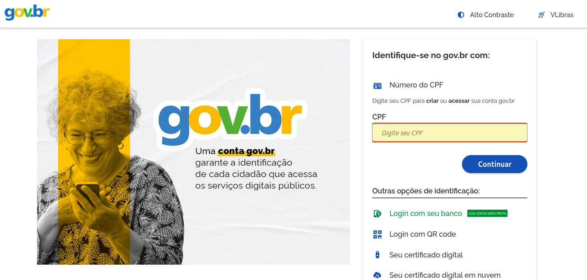
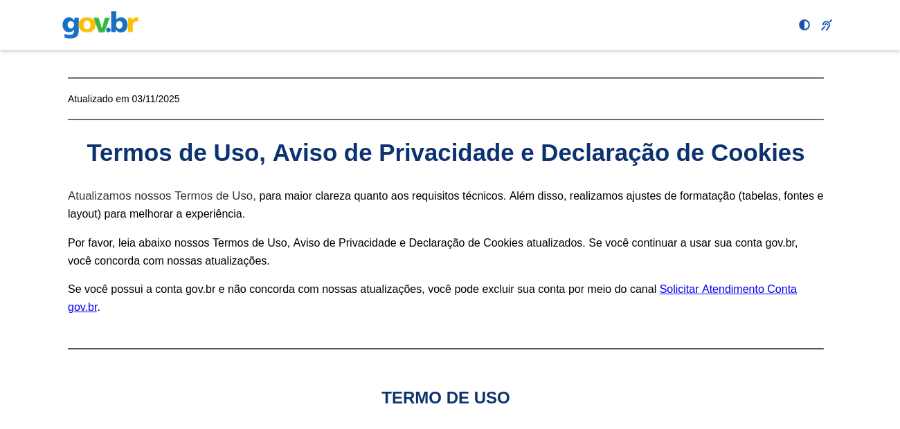
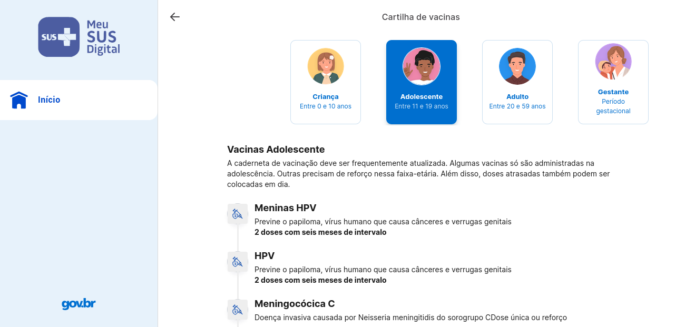

# Fluxo Selecionado para os Padrões de Projeto

---

## Participantes da SubEquipe 01

| Nome do Membro |
| :--- |
| [Artur Galdino](https://github.com/ArturFGaldino) |
| [Giovani Coelho](https://github.com/Gotc2607) |
| [João Leles](https://github.com/joaoleless) |
| [Nicole Jovita](https://github.com/nicolejovita) |

---

## Mapeamento do Fluxo

### Nome do Fluxo

Autenticação, Consentimento (LGPD) e Busca de Histórico Clínico no Meu SUS Digital

### Origem e Justificativa da Escolha

* **Artefato de origem:**
  * [Fluxo Selecionado para Modelagem (Entrega 2)](../../../2-Modelagem/Relatórios/2.1.1.SubEquipe_01/fluxograma.md)
  * [Diagrama de Pacotes — Modelagem Estática (Entrega 2)](../../../2-Modelagem/Relatórios/2.1.1.SubEquipe_01/ModelagemEstatica.md)
  * [Diagrama de Colaboração — Modelagem Dinâmica (Entrega 2)](../../../2-Modelagem/Relatórios/2.1.1.SubEquipe_01/ModelagemDinamica.md)
  * [BPMN 2.0 — Engenharia Reversa (Entrega 1)](../../../1-DesenhoDeSoftware/Relatórios/1.1.1.SubEquipe_01/1.1.1.3.BPMN.md)
  * [Rich Picture (Entrega 1)](../../../1-DesenhoDeSoftware/Relatórios/1.1.1.SubEquipe_01/1.1.1.1.Artefatos%20Generalistas.md#1-rich-picture---fluxo-geral-do-meu-sus-digital)
* **Motivo da escolha:**
  Este fluxo consolida a jornada central do cidadão no Meu SUS Digital: autenticação segura via Gov.br, governança de consentimento (LGPD) e consulta ao histórico de saúde do paciente mantido pela Rede Nacional de Dados em Saúde (RNDS).
  
  Ele foi escolhido para a aplicação do padrão **GoF Criacional (Factory Method)** porque a RNDS retorna dados clínicos com estruturas e regras de validação completamente heterogêneas (doses e lotes de vacinas, laudos laboratoriais e receitas de medicamentos). O padrão permite delegar a instanciação desses objetos a criadores especializados (`BuscadorDeVacinas`, `BuscadorDeExames`, `BuscadorDeMedicamentos`), mantendo a camada de apresentação desacoplada das respostas cruas da API e garantindo os princípios de Responsabilidade Única (SRP), Aberto/Fechado (OCP) e Variações Protegidas (GRASP).

### Passo a Passo do Fluxo

1. **Acesso e Redirecionamento (Gov.br):** O cidadão abre o aplicativo ou portal do Meu SUS Digital e aciona a opção de entrar. O aplicativo inicia o fluxo seguro de autorização baseado em OAuth 2.0 com extensão PKCE e redireciona o usuário para o provedor de identidade oficial do governo federal (Gov.br).
2. **Autenticação Segura:** O usuário preenche suas credenciais (CPF e senha ou certificado digital/login bancário) na interface do Gov.br e conclui a verificação em duas etapas (MFA). Após a validação com sucesso, o Gov.br retorna um token de sessão válido (JWT) assinado ao Meu SUS Digital, que verifica sua integridade via JWKS.
3. **Gestão de Consentimento (LGPD):** O sistema verifica se o cidadão já aceitou a versão vigente dos Termos de Uso e da Política de Privacidade. Caso haja pendência, exibe a tela de consentimento para coleta explícita da manifestação de vontade, registrando o aceite com hash imutável e timestamp para fins de conformidade legal.
4. **Navegação no Histórico Clínico (Hub "Minha Saúde"):** Com a sessão liberada e regularizada, o cidadão acessa o Hub principal e seleciona a categoria de dados clínicos que deseja consultar (por exemplo: *Vacinas*, *Exames Laboratoriais* ou *Medicamentos*).
5. **Busca na RNDS, Instanciação via Factory Method e Renderização:** O aplicativo despacha uma consulta assíncrona à Rede Nacional de Dados em Saúde (RNDS). O payload bruto recebido é processado pela hierarquia do padrão Factory Method, que instancia dinamicamente os registros clínicos correspondentes e renderiza as informações na interface (ex.: Carteira Nacional de Vacinação Digital). Em caso de falha de conexão com a rede, o sistema exibe mensagem amigável de indisponibilidade.

### Ponto de Aplicação do Padrão

O padrão de projeto **GoF Criacional Factory Method** é aplicado nos **Passos 4 e 5** do fluxo:

* **No Passo 4:** O componente orquestrador da interface (`SeletorDeHistorico` / `App.tsx`) identifica a categoria clínica solicitada pelo cidadão no Hub "Minha Saúde" e despacha o criador correspondente sem acoplamento direto com as classes concretas (*GRASP Controller & Indirection*).
* **No Passo 5:** A classe abstrata `BuscadorDeHistorico` (*Creator*) recebe a carga bruta retornada pela RNDS e coordena a rotina de processamento em lote `processarRegistros()`. Para cada item do payload, ela invoca o método fábrica abstrato `criarRegistroClinico()`, cuja implementação foi delegada para os criadores concretos especializados:
  * [`BuscadorDeVacinas`](file:///code/criacional/src/padrao/BuscadorDeVacinas.ts) (Versão 1 — [Artur Galdino](https://github.com/ArturFGaldino)): instancia objetos `CartaoVacina`;
  * [`BuscadorDeExames`](file:///code/criacional/src/padrao/BuscadorDeExames.ts) (Versão 2 — [Giovani Coelho](https://github.com/Gotc2607)): instancia objetos `ResultadoExame`;
  * [`BuscadorDeMedicamentos`](file:///code/criacional/src/padrao/BuscadorDeMedicamentos.ts) (Versão 3 — [João Leles](https://github.com/joaoleless)): instancia objetos `ReceitaMedicamento`.
* Todos os objetos criados realizam o contrato comum da interface `RegistroClinico` (*Product*), permitindo que a camada de visualização consuma e exiba os dados polimorficamente por meio de `.getCategoria()`, `.getResumo()` e `.getDetalhes()`.

O detalhamento da modelagem UML, do código-fonte em TypeScript/React e da execução com testes automatizados está documentado em:
* [GoFCriacional.md](../../../3-PadroesDeProjetos/Relatórios/3.1.1.SubEquipe_01/GoFCriacional.md)
* [Codigo.md](../../../3-PadroesDeProjetos/Relatórios/3.1.1.SubEquipe_01/Codigo.md)
* [Execucao.md](../../../3-PadroesDeProjetos/Relatórios/3.1.1.SubEquipe_01/Execucao.md)
* [IA.md](../../../3-PadroesDeProjetos/Relatórios/3.1.1.SubEquipe_01/IA.md)

---

## Interface do Sistema (Imagens Reais)

<strong>Legenda:</strong> Figura 1 - Tela inicial de redirecionamento e login federado via portal Gov.br (Passo 1 e 2)

 

<strong>Legenda:</strong> Figura 2 - Tela de governança de consentimento, Termos de Uso e Política de Privacidade nos termos da LGPD (Passo 3)

 

<strong>Legenda:</strong> Figura 3 - Interface oficial do Meu SUS Digital exibindo o histórico de registros clínicos consumidos da RNDS (Passos 4 e 5)

---

## Histórico de Versionamento

| Nome do Membro | Contribuição | Data | Commit |
| :--- | :--- | :--- | :--- |
| [Gustavo Fornaciari](https://github.com/GUGOFO) | Inicio do Teamplate do trabalho | 06/10/2026 | [18b6195](https://github.com/UnBArqDsw2026-2-Turma01/2026.2-T01-_G5_ProjetoGovernoEletronico_Entrega_03/tree/18b61958e419b67f95469d4a704ddcb9629b9803) |
| [Gustavo Fornaciari](https://github.com/GUGOFO) | Teamplate mais detalhado | 14/10/2026 | [7c66f78](https://github.com/UnBArqDsw2026-2-Turma01/2026.2-T01-_G5_ProjetoGovernoEletronico_Entrega_03/tree/7c66f78dc795f080bc43dc01f094e8976462d5b8) |
| [Artur Galdino](https://github.com/ArturFGaldino) | Preenchimento completo do fluxo selecionado para a Entrega 3 (origem, justificativa, passo a passo, ponto de aplicação do Factory Method, imagens reais e rastreabilidade) | 19/10/2026 | Em breve |