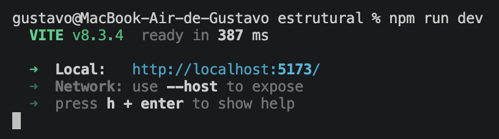
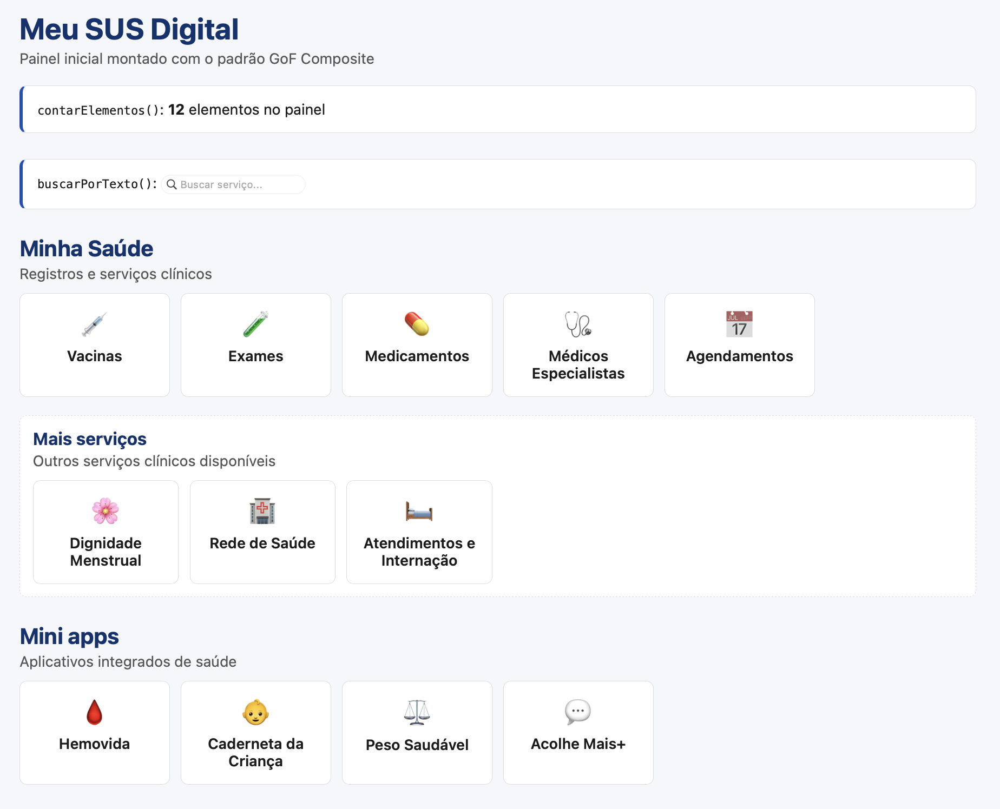
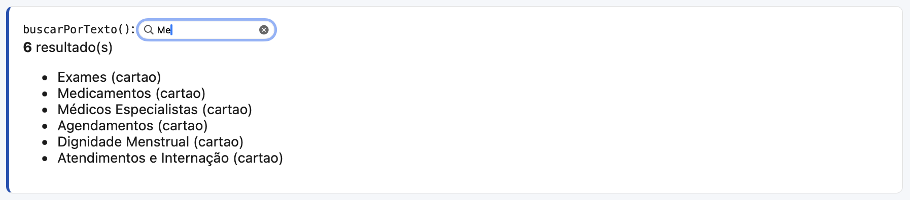
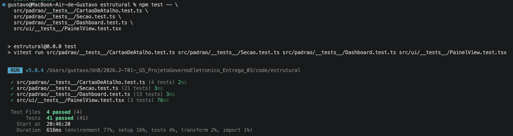
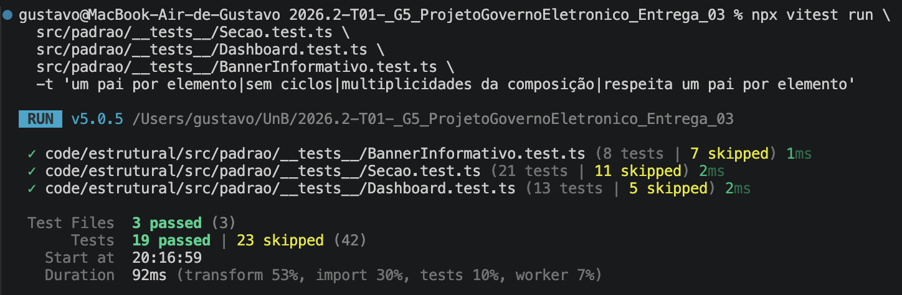
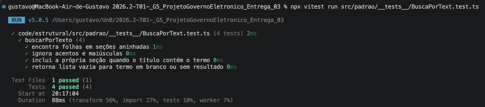
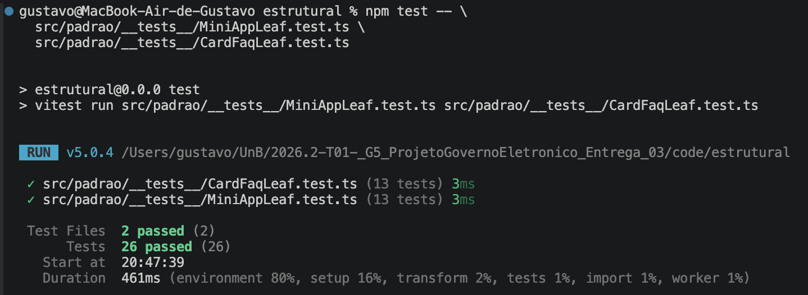
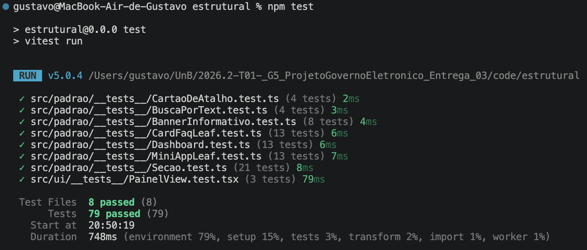
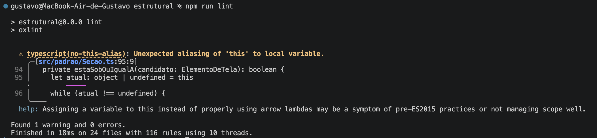
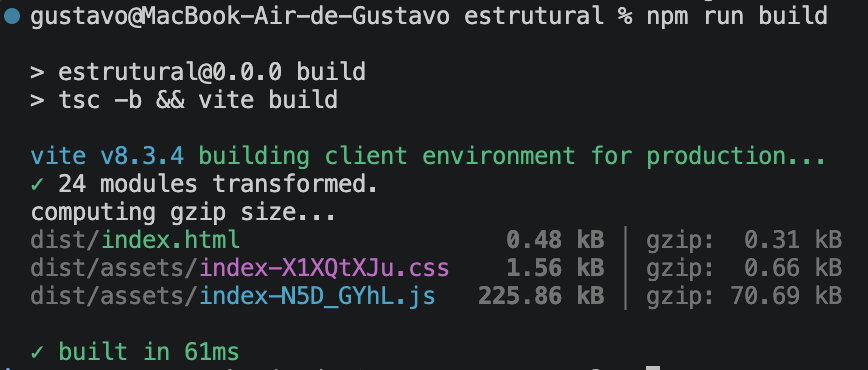

# Execução do padrão | GoF Estrutural

## 1. Objetivo e ambiente

Esta seção registra a execução do protótipo desenvolvido pela SubEquipe 02 para demonstrar o padrão GoF **Composite** na estrutura de apresentação do painel inspirado no Meu SUS Digital. O projeto foi implementado com React e TypeScript e utiliza dados simulados; não realiza integração real com a Rede Nacional de Dados em Saúde (RNDS).

A validação foi realizada no ambiente local com Node.js/npm, Vite e Vitest. Os comandos abaixo devem ser executados dentro da pasta `code/estrutural`, pois nela estão o `package.json` e a configuração de testes `vite.config.ts`.

```bash
cd code/estrutural
npm ci
npm run dev
```

O servidor informa o endereço local no terminal. Na captura feita em 19/10/2026, o Vite 8.3.4 iniciou em 387 ms e disponibilizou a aplicação em `http://localhost:5173/`.



## 2. Demonstração em vídeo

A equipe gravou um vídeo com os quatro integrantes da SubEquipe 02 executando a aplicação e explicando as respectivas contribuições. Inserir o link compartilhável antes da entrega final.

<iframe
  src="https://www.youtube.com/embed/ZQoBThfKVys"
  width="100%"
  height="500"
  title="Vídeo do YouTube"
  frameborder="0"
  allow="accelerometer; autoplay; clipboard-write; encrypted-media; gyroscope; picture-in-picture"
  allowfullscreen>
</iframe>

## 3. Evidências da aplicação

### 3.1. Painel Composite

A captura mostra o painel renderizado, dividido nas áreas “Minha Saúde”, “Mais serviços” e “Mini apps”. Também é possível observar os cartões de serviços e o indicador `contarElementos(): 12`, exibido pela aplicação no momento da captura.



### 3.2. Busca por texto

A busca foi executada com o termo `Me`. A interface apresentou seis resultados. Esse registro demonstra o comportamento observado na interface; os testes automatizados da busca complementam a evidência com cenários específicos.



## 4. Testes relacionados às contribuições individuais

Os comandos individuais abaixo selecionam arquivos ou cenários associados às contribuições de cada integrante na evolução do código. Como os testes são executados sobre a árvore de código atual, os resultados não significam que cada versão histórica tenha sido executada isoladamente.

| Integrante | Versão / contribuição | Resultado registrado | Evidência |
| --- | --- | --- | --- |
| Victor Leandro | V1 — estrutura base do Composite, folhas, composto e renderização do painel | **41 testes aprovados em 4 arquivos**, incluindo `CartaoDeAtalho`, `Secao`, `Dashboard` e `PainelView`. A execução foi repetida dentro de `code/estrutural`, carregando a configuração correta do Vitest. | [Log dos testes V1](../assets/subequipe02-padroes/execucao/testes-v1-victor.txt) |
| Gustavo Fornaciari | V2 — regras de composição, relação de pai e prevenção de ciclos | Na execução direcionada com filtro `-t`, **19 testes passaram e 23 foram ignorados**. Portanto, esse comando isolado cobriu apenas parte dos casos. A suíte geral descrita na Seção 5 passou integralmente. | [Captura dos testes filtrados V2](../assets/subequipe02-padroes/execucao/testes-v2-gustavo.png) |
| Julia Oliveira Patricio | V3 — busca por texto e busca recursiva | **4 testes aprovados**, cobrindo busca em seções aninhadas, tratamento de maiúsculas e acentos, inclusão da própria seção quando aplicável e retorno vazio para termo em branco ou sem resultado. | [Captura dos testes V3](../assets/subequipe02-padroes/execucao/testes-v3-julia.png) |
| Ana Beatriz | V4 — folhas `MiniAppLeaf` e `CardFaqLeaf` | **26 testes aprovados em 2 arquivos**: 13 em `MiniAppLeaf.test.ts` e 13 em `CardFaqLeaf.test.ts`. | [Log dos testes V4](../assets/subequipe02-padroes/execucao/testes-v4-ana.txt) |

### 4.1. Evidências visuais por integrante

As capturas abaixo são evidências diretas das execuções individuais que foram enviadas. Para Victor e Ana Beatriz, recebemos o resultado textual do terminal, mas não uma captura de tela; os links indicam os nomes e os locais em que as imagens poderão ser adicionadas posteriormente.

#### Victor Leandro — V1: estrutura base e renderização

A execução individual dos testes relacionados à estrutura base foi repetida dentro de `code/estrutural`, com a configuração correta do Vitest. O resultado foi de **41 testes aprovados em 4 arquivos**.



#### Gustavo Fornaciari — V2: regras de composição

A execução direcionada com filtro `-t` aprovou **19 testes e ignorou 23**. A captura abaixo registra esse resultado parcial; os casos ignorados não devem ser contados como aprovados por esse comando. A validação da suíte integrada, em contrapartida, aprovou todos os 79 testes.



#### Julia Oliveira Patricio — V3: busca por texto

A captura mostra os **4 testes aprovados** para `BuscaPorText.test.ts`, incluindo a busca em seções aninhadas, o tratamento de maiúsculas e acentos, a inclusão da própria seção quando aplicável e o retorno vazio quando não há termo ou correspondência.



#### Ana Beatriz — V4: novas folhas do Composite

Os resultados enviados indicam **26 testes aprovados em 2 arquivos**: 13 em `MiniAppLeaf.test.ts` e 13 em `CardFaqLeaf.test.ts`.



### 4.2. Comandos para reproduzir os testes individuais

Execute os comandos a partir de `code/estrutural`.

**Victor — estrutura base e renderização:**

```bash
npm test -- \
  src/padrao/__tests__/CartaoDeAtalho.test.ts \
  src/padrao/__tests__/Secao.test.ts \
  src/padrao/__tests__/Dashboard.test.ts \
  src/ui/__tests__/PainelView.test.tsx
```

**Gustavo — regras de composição:**

```bash
npm test -- \
  src/padrao/__tests__/Secao.test.ts \
  src/padrao/__tests__/Dashboard.test.ts \
  src/padrao/__tests__/BannerInformativo.test.ts \
  -t 'um pai por elemento|sem ciclos|multiplicidades da composição|respeita um pai por elemento'
```

> O filtro `-t` executa apenas testes cujos nomes correspondem aos termos informados. Os 23 casos ignorados nessa execução de Gustavo não são contabilizados como aprovados por esse comando. A aprovação da suíte completa é registrada separadamente na Seção 5.

**Julia — busca por texto:**

```bash
npm test -- src/padrao/__tests__/BuscaPorText.test.ts
```

**Ana Beatriz — novas folhas:**

```bash
npm test -- \
  src/padrao/__tests__/MiniAppLeaf.test.ts \
  src/padrao/__tests__/CardFaqLeaf.test.ts
```

## 5. Validação geral do estado final

Após integrar as contribuições, os comandos `npm test`, `npm run lint` e `npm run build` foram executados em `code/estrutural`, em 19/10/2026.

### 5.1. Suíte completa

A suíte geral foi aprovada: **8 arquivos de teste passaram, totalizando 79 testes aprovados e nenhuma falha**.

| Arquivo de teste | Testes aprovados |
| --- | ---: |
| `CartaoDeAtalho.test.ts` | 4 |
| `BuscaPorText.test.ts` | 4 |
| `Dashboard.test.ts` | 13 |
| `BannerInformativo.test.ts` | 8 |
| `Secao.test.ts` | 21 |
| `CardFaqLeaf.test.ts` | 13 |
| `MiniAppLeaf.test.ts` | 13 |
| `PainelView.test.tsx` | 3 |
| **Total** | **79** |

Resumo registrado pelo Vitest:

```text
Test Files  8 passed (8)
Tests       79 passed (79)
Duration    720ms
```

.

### 5.2. Lint

O comando `npm run lint` foi concluído com **0 erros e 1 aviso**. O aviso é `typescript(no-this-alias)`, em `src/padrao/Secao.ts:95`, relacionado ao armazenamento de `this` em uma variável local (`atual`). O lint não impediu a execução do build, mas o aviso fica registrado para avaliação e eventual correção.

.

### 5.3. Build de produção

O comando `npm run build` executou `tsc -b && vite build` e terminou com sucesso. O TypeScript e o Vite finalizaram sem erros de compilação; o Vite 8.3.4 transformou 24 módulos e gerou os artefatos de produção em `dist/`.

.

### 5.4. Comandos da validação final

```bash
npm test
npm run lint
npm run build
```

## Histórico de Versionamento

| Nome do membro | Contribuição | Data | Commit |
| --- | --- | --- | --- |
| [Gustavo Fornaciari](https://github.com/GUGOFO) | Estrutura inicial do documento de execução | 14/10/2026 | [7c66f78](https://github.com/UnBArqDsw2026-2-Turma01/2026.2-T01-_G5_ProjetoGovernoEletronico_Entrega_03/tree/7c66f78dc795f080bc43dc01f094e8976462d5b8) |
| [Gustavo Fornaciari](https://github.com/GUGOFO) | Registro das evidências de execução, testes da suíte integrada, lint e build | 19/10/2026 | [0ddc440](https://github.com/UnBArqDsw2026-2-Turma01/2026.2-T01-_G5_ProjetoGovernoEletronico_Entrega_03/tree/0ddc4403c379563ab9306193cc3927c50746f363) |