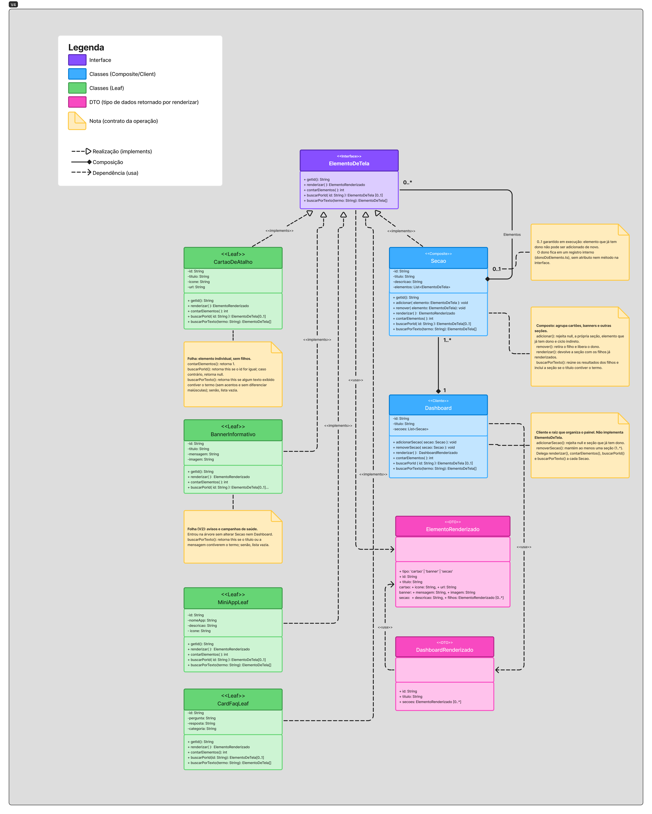
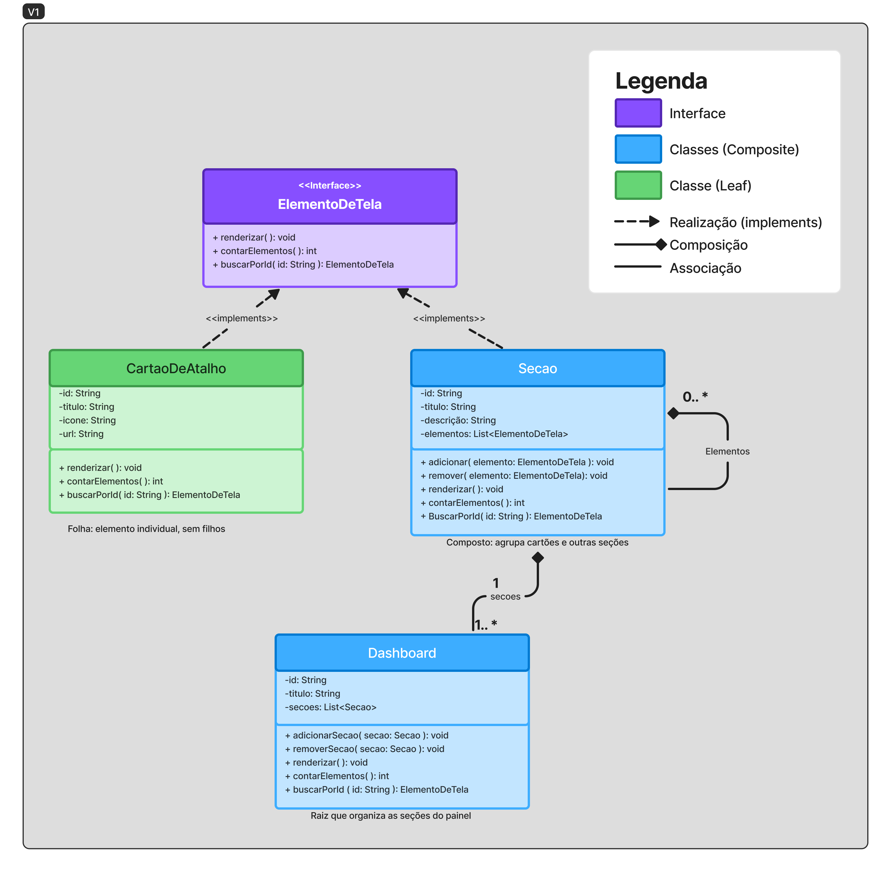
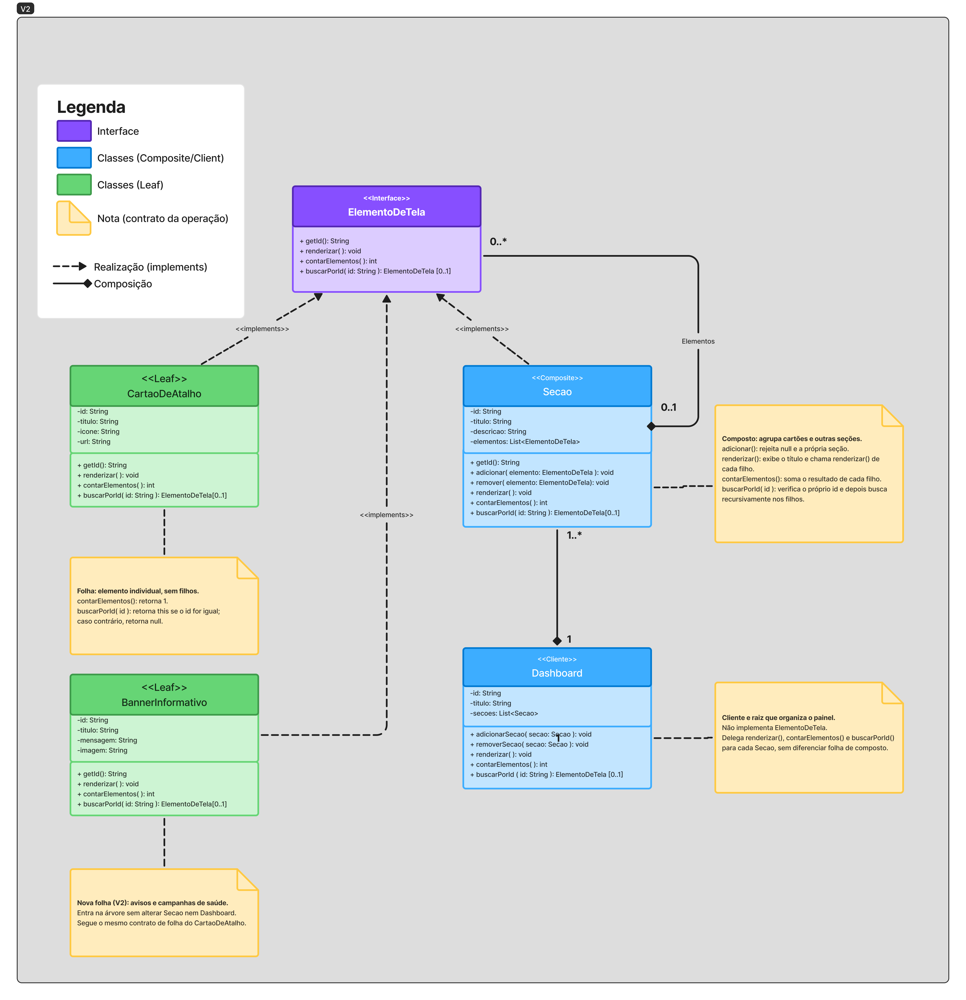
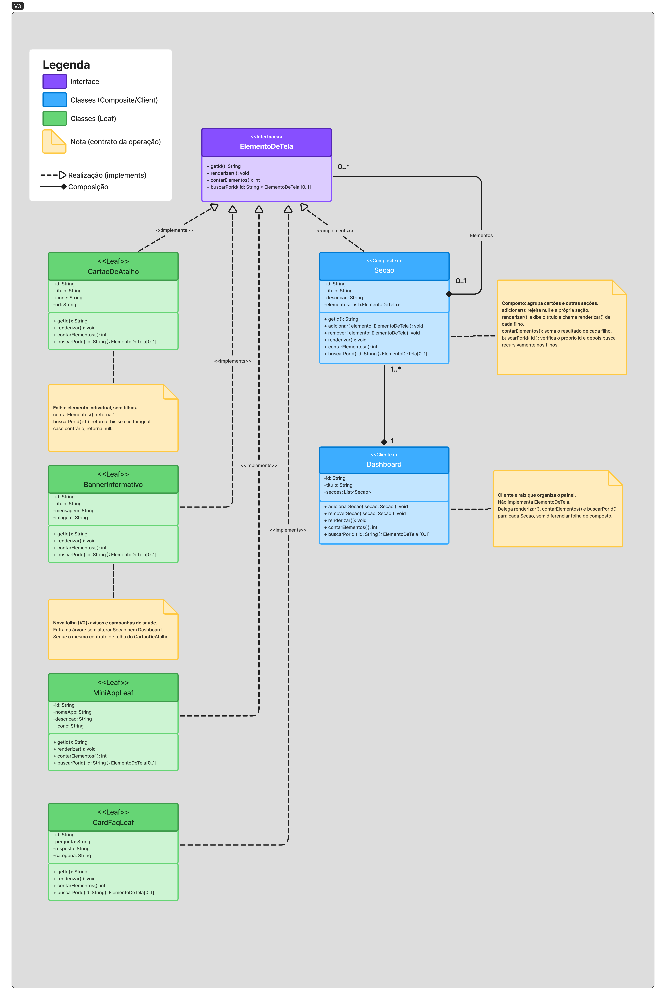

# GoF Estrutural | Composite

## Figma / Miro Usado

<iframe style="border: 1px solid rgba(0, 0, 0, 0.1);" width="800" height="450" src="https://embed.figma.com/board/kjXYSBRLXLl5yAYva4prVm/GoF-Estrutural?node-id=0-1&embed-host=share" allowfullscreen></iframe>

---

## Versão Final

<strong>Legenda:</strong> Modelagem final

---

## Participantes

| Nome do Membro |
| :--- |
| [Gustavo Fornaciari](https://github.com/GUGOFO) |
| [Ana Beatriz](https://github.com/AnnaBeatrizAraujo) |
| [Victor Leandro](https://github.com/Afrontoso) |
| [Julia Oliveira Patricio](https://github.com/juliapat18) |

---

## Fundamentação Teórica

### O que são os Padrões GoF Estruturais

Os padrões GoF (*Gang of Four*) estruturais descrevem maneiras de organizar classes e objetos para formar estruturas maiores, reduzindo o acoplamento e facilitando mudanças e manutenção. Diferenciam-se dos padrões criacionais, que tratam da criação de objetos, e dos comportamentais, que enfatizam a comunicação e a distribuição de responsabilidades entre objetos. Entre os padrões estruturais apresentados no material da disciplina estão Adapter, Bridge, Composite, Decorator, Facade, Flyweight e Proxy.

### O Padrão Escolhido

- **Nome e classificação:** Composite — GoF Estrutural.
- **Intenção:** compor objetos em estruturas hierárquicas de árvore e permitir que clientes tratem objetos individuais e composições por meio de uma interface comum.
- **Problema que resolve:** representar uma interface de dashboard com seções que contêm cartões de atalho sem precisar implementar operações de renderização e consulta de maneira independente para cada nível da hierarquia.
- **Solução proposta:** definir `ElementoDeTela` como interface comum, `CartaoDeAtalho` como folha (*Leaf*), `Secao` como composto (*Composite*) e `Dashboard` como raiz da composição.
- **Participantes:** `ElementoDeTela`, `CartaoDeAtalho`, `Secao` e `Dashboard` (a V2 acrescenta a folha `BannerInformativo`).
- **Consequências:** facilita percorrer e operar sobre a árvore de forma uniforme e permite acrescentar novos tipos de elementos. Em contrapartida, uma abstração muito genérica pode aumentar a complexidade e exige definir quais operações fazem sentido para folhas e compostos.
- **Quando usar:** quando a interface precisa organizar itens individuais e grupos de itens em níveis hierárquicos, tratando-os de forma uniforme.

---

## Contexto de Aplicação no Projeto

### Onde o Padrão será aplicado

O Composite será aplicado conceitualmente à **Navegação Principal e ao Dashboard Pós-Login do Meu SUS Digital**, conforme o escopo definido no template da entrega. A interface pode ser organizada em seções, como **Minha Saúde**, **Mini apps** e **Conteúdo**, com cartões de atalho dentro de cada seção.

### Rastreabilidade e Elos com Outros Artefatos

| Artefato relacionado | Link no repositório | Relação com o padrão |
| :--- | :--- | :--- |
| Rich Picture (Entrega 1) | [`RichPicture.md`](../../1-DesenhoDeSoftware/Relatórios/1.1.2.SubEquipe_02/RichPicture.md) | Contextualiza o cidadão, o Meu SUS Digital e as necessidades de acesso a serviços de saúde. Ajuda a justificar uma navegação que agrupe serviços de forma compreensível. |
| SIG / NFR Framework (Entrega 1) | [`SIG.md`](../../1-DesenhoDeSoftware/Relatórios/1.1.2.SubEquipe_02/SIG.md) | Registra preocupações de usabilidade, localização de dados, velocidade de acesso, segurança e privacidade. A organização hierárquica deve apoiar a localização de funções sem ignorar esses atributos. |
| BPMN (Entrega 1) | [`BPMN.md`](../../1-DesenhoDeSoftware/Relatórios/1.1.2.SubEquipe_02/BPMN.md) | Descreve, por engenharia reversa, o fluxo entre cidadão e sistema e os caminhos de acesso a serviços. O Composite trata da estrutura da interface que apresenta esses serviços, não substitui o fluxo BPMN. |
| Modelagem Estática — Diagrama de Pacotes (Entrega 2) | [`ModelagemEstatica.md`](../../2-Modelagem/Relatórios/2.1.2.SubEquipe_02/ModelagemEstatica.md) | Organiza o sistema em camadas de Apresentação, Aplicação, Domínio e Integração, além de um pacote transversal. A proposta Composite fica principalmente no contexto de apresentação; não altera por si só a arquitetura em camadas. |
| Modelagem Dinâmica — Diagrama de Atividades (Entrega 2) | [`ModelagemDinamica.md`](../../2-Modelagem/Relatórios/2.1.2.SubEquipe_02/ModelagemDinamica.md) | Descreve a navegação pós-login e as ações do usuário/sistema. A modelagem Composite representa a estrutura dos elementos exibidos, enquanto o diagrama de atividades representa o fluxo de comportamento. |
| Fluxograma / fluxo de interface (Entrega 3) | [`fluxograma.md`](./fluxograma.md) | Deve ligar os passos de navegação às seções e cartões correspondentes. A rastreabilidade específica dos passos será completada quando o fluxo de V1 estiver preenchido. |

---

## Modelagem

### Versão 1

**Legenda:** Figura 1 — Diagrama UML inicial do padrão Composite aplicado conceitualmente ao Dashboard Pós-Login do Meu SUS Digital. ElementoDeTela define a interface comum; CartaoDeAtalho representa a folha (Leaf); Secao representa o composto (Composite), agrupando elementos da interface; e Dashboard organiza as seções de nível superior. As setas tracejadas indicam realização de interface e os losangos preenchidos indicam composição.

#### O que foi feito

A V1 estabelece somente os participantes essenciais do padrão: `ElementoDeTela` define operações comuns; `CartaoDeAtalho` representa uma folha; `Secao` agrupa elementos por meio de uma coleção; e `Dashboard` mantém as seções de nível superior. O diagrama utiliza interface UML, operações, atributos, relações de implementação e a relação de composição entre a seção e seus elementos.

O objetivo desta primeira versão é validar a estrutura básica e manter o modelo simples o suficiente para evoluir nas próximas iterações. Ainda não são especificados detalhes de implementação, permissões, persistência, integração com serviços externos, estados de carregamento ou regras completas de navegação. As operações `renderizar`, `contarElementos` e `buscarPorId` são propostas conceituais para ilustrar o tratamento uniforme da árvore; seus contratos e retornos deverão ser refinados junto com o código.

### Versão 2

**Legenda:** Figura 2 — Diagrama UML revisado do padrão Composite. A composição passa a ligar `Secao` à interface `ElementoDeTela`, permitindo que uma seção contenha tanto cartões quanto outras seções. Foi adicionada a folha `BannerInformativo`, que mostra a inclusão de um novo tipo de elemento sem alterar o composto. `Dashboard` é explicitado como cliente e raiz da estrutura, e as notas UML descrevem o contrato das operações em cada participante.

#### O que foi feito

A V2 revisou a V1 com foco na **consistência UML** e nos **contratos das operações**, conforme as melhorias previstas para esta versão. A estrutura geral foi mantida, com o acréscimo de apenas uma classe folha, para que a V3 e a V4 possam evoluir o modelo em direção à interface real e ao código.

| # | Problema na V1 | Alteração na V2 | Justificativa |
| :--- | :--- | :--- | :--- |
| 1 | A composição "Elementos" era um auto-relacionamento de `Secao` com `Secao`, indicando que uma seção só conteria outras seções. | A composição passou a sair de `Secao` (losango) e chegar em `ElementoDeTela`, com multiplicidade `0..1` no lado da seção e `0..*` no lado dos elementos. | No Composite, o composto agrega o **componente** (a interface), e não a si mesmo. Assim, uma seção pode conter cartões e outras seções, o que responde à dúvida da V1 sobre seções aninhadas. O `0..1` indica que cada elemento pertence a no máximo uma seção (seções de nível superior pertencem ao `Dashboard`). |
| 2 | Na relação `Dashboard`–`Secao`, o losango estava do lado da `Secao` e as multiplicidades estavam invertidas. | O losango foi movido para o lado do `Dashboard`, com `1` no lado do `Dashboard` e `1..*` no lado da `Secao`. | O losango fica no lado do **todo**. É o `Dashboard` que possui as seções; quando ele deixa de existir, suas seções também deixam. |
| 3 | `Dashboard` tinha as mesmas operações da interface, mas não a implementava, sem indicar seu papel no padrão. | `Dashboard` recebeu o estereótipo `<<Client>>` e passou a ser descrito como raiz da composição, que delega as operações às seções. | Isso resolve a dúvida registrada na V1: o `Dashboard` não é um elemento de tela aninhável, mas o ponto de entrada que usa a árvore. Manter a interface apenas para `CartaoDeAtalho` e `Secao` deixa os papéis de *Leaf* e *Composite* mais claros. |
| 4 | Os contratos das operações não estavam definidos, principalmente para a folha. | Foram adicionadas notas UML com o comportamento de cada operação na folha, no composto e no cliente. | Deixa explícito o tratamento uniforme e recursivo, que é a ideia central do padrão, e serve de base para a implementação do código V1. |
| 5 | `buscarPorId` não indicava o que acontece quando o id não é encontrado, e não havia uma forma de consultar o id de um elemento pela interface. | O retorno passou a ser `ElementoDeTela [0..1]`, e a interface ganhou `getId(): String`. | A busca pode não encontrar nada, e `remover` e `buscarPorId` precisam identificar os elementos pela interface comum, sem conhecer a classe concreta. |
| 6 | Pequenas inconsistências de escrita (`BuscarPorId`, `descrição`) e item "Associação" na legenda sem uso no diagrama. | A nomenclatura foi padronizada em camelCase sem acentos (`buscarPorId`, `descricao`), e a legenda foi atualizada (remoção de "Associação", inclusão de "Nota" e "Multiplicidade"). | Mantém o diagrama coerente com a futura implementação em TypeScript e evita elementos de legenda que não aparecem no modelo. |
| 7 | Havia apenas um tipo de folha (`CartaoDeAtalho`), o que não mostrava uma das principais consequências do padrão: a facilidade de incluir novos tipos de elemento. | Foi adicionada a folha `BannerInformativo` (`-id`, `-titulo`, `-mensagem`, `-imagem`), que representa avisos e campanhas de saúde exibidos no painel e também realiza `ElementoDeTela`. As duas folhas compartilham a mesma seta de realização. | Como `Secao` e `Dashboard` dependem apenas da interface, o novo elemento entra na árvore sem nenhuma alteração nessas classes. Isso evidencia no modelo o princípio aberto/fechado e o tratamento uniforme que motivaram a escolha do Composite. |

**Contratos das operações definidos na V2:**

- **`CartaoDeAtalho` (Leaf):** `renderizar()` exibe o próprio cartão (ícone, título e link); `contarElementos()` retorna `1`; `buscarPorId(id)` retorna o próprio cartão se o id for igual, ou `null` caso contrário. A folha não possui `adicionar`/`remover`.
- **`BannerInformativo` (Leaf):** segue o mesmo contrato do `CartaoDeAtalho`; `renderizar()` exibe a imagem, o título e a mensagem do aviso.
- **`Secao` (Composite):** `adicionar(elemento)` insere um filho e não aceita `null` nem a própria seção; `remover(elemento)` retira o filho, caso exista; `renderizar()` exibe o título da seção e chama `renderizar()` de cada filho; `contarElementos()` retorna a soma de `contarElementos()` dos filhos; `buscarPorId(id)` verifica o próprio id e, em seguida, busca recursivamente nos filhos.
- **`Dashboard` (Client/raiz):** delega `renderizar`, `contarElementos` e `buscarPorId` para cada `Secao` da lista, sem diferenciar folhas e compostos.

Ficaram para as próximas versões: associar as seções e os cartões às telas reais do Meu SUS Digital (V3), tratar a prevenção de ciclos na árvore com mais detalhes e validar o modelo com o código (V4).

### Versão 3

**Legenda:** Figura 3 — Diagrama UML do padrão Composite com foco na extensibilidade da interface do Meu SUS Digital. A versão inclui duas novas classes concretas, `MiniAppLeaf` e `CardFaqLeaf`, que permitem representar diferentes componentes visuais sem alterar a estrutura das classes existentes.

#### O que foi feito

Na V3, o diagrama foi ampliado com duas novas classes folha (`Leaf`), aproximando a estrutura do padrão Composite dos componentes presentes na interface do Meu SUS Digital e facilitando sua implementação com React e TypeScript.

- **`MiniAppLeaf`**: representa os cartões dos miniaplicativos disponíveis na plataforma, como *Acolhe Mais+*, *Peso Saudável* e *Equidade SUS*. Seus atributos são `nomeApp`, `descricao` e `icone`.

- **`CardFaqLeaf`**: representa os cartões de perguntas frequentes, que apresentam dúvidas e respostas para orientar os usuários. Seus atributos são `pergunta`, `resposta` e `categoria`.

A inclusão dessas classes demonstra como o padrão Composite permite adicionar novos tipos de componentes sem precisar modificar as classes que já existem. Tanto `Secao` quanto `Dashboard` continuam trabalhando com os elementos por meio da interface comum `ElementoDeTela`, mantendo a organização e a flexibilidade da estrutura.

Dessa forma, a V3 evidencia o Princípio Aberto/Fechado (OCP), segundo o qual o sistema deve permitir a inclusão de novas funcionalidades sem exigir alterações constantes no código existente. 

### Versão 4

**Legenda:** Figura 4 — Diagrama UML consolidado do padrão Composite aplicado ao Dashboard Pós-Login do Meu SUS Digital. A versão alinha o modelo ao código: `renderizar()` retorna os tipos `ElementoRenderizado` e `DashboardRenderizado` (`<<DTO>>`, ligados por dependência `<<usa>>`), as notas registram as regras de `adicionar()` e `adicionarSecao()` garantidas em execução e a operação `buscarPorTexto()` passa a fazer parte da interface comum. As setas tracejadas com ponta vazada indicam realização, as tracejadas abertas indicam dependência e os losangos preenchidos indicam composição.

#### O que foi feito

A V4 consolida o modelo depois das versões de código V1, V2 e V3, validadas localmente com testes. A estrutura de participantes foi mantida: a interface `ElementoDeTela`, as folhas `CartaoDeAtalho`, `BannerInformativo`, `MiniAppLeaf` e `CardFaqLeaf`, o composto `Secao` e o cliente `Dashboard`. As alterações registram no diagrama o que o código passou a garantir e a operação nova de busca, conforme [Codigo.md](./Codigo.md).

| # | Ponto na V3 | Alteração na V4 | Justificativa |
| :--- | :--- | :--- | :--- |
| 1 | `renderizar()` retornava `void` no diagrama, enquanto o código devolve uma descrição do elemento. | `renderizar()` passa a retornar `ElementoRenderizado`, e `Dashboard.renderizar()` retorna `DashboardRenderizado`. Os dois tipos entram como `<<DTO>>`, ligados por dependência (`<<usa>>`). | Mantém o núcleo do padrão sem dependência de React: a recursão fica em `padrao/` e a camada `ui/` apenas desenha a descrição recebida (Código V1). |
| 2 | A multiplicidade `0..1` do lado do elemento e a rejeição de ciclos eram apenas notação, e o Código V1 as registrava como limitações. | As notas de `Secao.adicionar()` e da composição passam a listar as rejeições garantidas: `null`, a própria seção, elemento que já tem dono e ciclo indireto. O dono de cada elemento fica em um registro interno do código (`donoDoElemento.ts`), que não aparece como classe porque a interface não ganha atributo nem método. | O Código V2 passou a respeitar o `0..1`: quem já pertence a uma seção ou painel não pode ser adicionado de novo, e a árvore não admite ciclos. |
| 3 | A multiplicidade `1..*` do `Dashboard` e a operação `removerSecao()` não estavam relacionadas. | A nota do `Dashboard` registra que `adicionarSecao()` rejeita `null` e seção que já tem dono, e que `removerSecao()` mantém ao menos uma seção. | O Código V2 impede remover a última seção, tornando o `1..*` uma regra em execução. |
| 4 | A busca existia apenas por id. | Inclusão de `buscarPorTexto(termo): ElementoDeTela [0..*]` em `ElementoDeTela` e em todos os participantes. Folhas retornam a si mesmas quando um texto exibido contém o termo; `Secao` e `Dashboard` propagam a busca recursivamente. | Um campo de busca precisa localizar elementos pelo texto exibido. A operação mantém o tratamento uniforme: o cliente busca na árvore sem saber se cada nó é folha ou composição. |

**Estrutura dos tipos acrescentados na V4:**

- **`ElementoRenderizado` (DTO):** `tipo` (`'cartao'`, `'banner'` ou `'secao'`), `id` e `titulo`, mais os campos de cada tipo: `icone` e `url` (cartão), `mensagem` e `imagem` (banner), `descricao` e `filhos: ElementoRenderizado [0..*]` (seção).
- **`DashboardRenderizado` (DTO):** `id`, `titulo` e `secoes: ElementoRenderizado [0..*]`.

**Contratos acrescentados ou alterados na V4:**

- **`ElementoDeTela` (Component):** `buscarPorTexto(termo): ElementoDeTela [0..*]`.
- **Folhas:** `buscarPorTexto(termo)` retorna a si mesma, em uma lista, quando algum texto exibido contém o termo (sem diferenciar acentos nem maiúsculas), ou uma lista vazia caso contrário. Em `CartaoDeAtalho` o texto é o título; em `BannerInformativo`, o título e a mensagem.
- **`Secao` (Composite):** `buscarPorTexto(termo)` concatena os resultados dos filhos e inclui a própria seção quando o título contém o termo. `adicionar(elemento)` rejeita `null`, a própria seção, elemento que já tem dono e ciclo indireto. `remover(elemento)` libera o dono.
- **`Dashboard` (Client/raiz):** `buscarPorTexto(termo)` delega a busca a cada seção de nível superior. `adicionarSecao(secao)` rejeita `null` e seção que já tem dono. `removerSecao(secao)` mantém ao menos uma seção.

#### Limitações e decisões finais

- O dono de cada elemento fica em um registro externo às classes (`donoDoElemento.ts`). A decisão evita acrescentar atributo ou método à interface, mas deixa parte do estado do modelo fora do diagrama.
- A descrição retornada por `renderizar()` é uma união fechada de três tipos. Incluir uma folha nova exige acrescentar uma variante ao tipo, o que enfraquece, na camada de renderização, o princípio aberto/fechado destacado na V3.
- Acrescentar uma operação à interface obriga todas as folhas a implementá-la. É o custo, já citado na fundamentação teórica, de uma abstração muito genérica, e foi aceito porque a busca por texto é necessária à interface.
- A unicidade dos ids na árvore não é verificada: se dois elementos tiverem o mesmo id, `buscarPorId()` retorna o primeiro encontrado.
- As rotas dos cartões continuam simuladas: o clique não navega para outra tela.

#### Conferência modelo × código

O Código V1 implementou o item 1, o Código V2 implementou os itens 2 e 3 e o Código V3 implementa o item 4, com `buscarPorTexto()` em `CartaoDeAtalho`, `BannerInformativo`, `Secao` e `Dashboard`, busca insensível a acentos e maiúsculas e campo de busca na interface. As folhas `MiniAppLeaf` e `CardFaqLeaf` constam no modelo, mas ainda não foram implementadas no código, e esta é a diferença entre a V4 e a implementação. Os detalhes e os testes estão em [Codigo.md](./Codigo.md).

---

## Metodologia

A modelagem parte dos artefatos produzidos nas entregas anteriores da SubEquipe 02. O Rich Picture e o SIG ajudam a recuperar o contexto e as preocupações de qualidade; o BPMN registra os processos observados por engenharia reversa; e os diagramas de pacotes e atividades descrevem, respectivamente, a organização lógica e o fluxo de navegação.

A primeira versão foi mantida em nível conceitual, usando um diagrama de classes UML para representar os papéis do Composite. O desenho pode ser importado para o Figma e ajustado visualmente. Nas próximas versões, o grupo deverá revisar o diagrama em conjunto, relacionar as classes às telas/fluxos identificados e validar a consistência entre modelo, código e execução local. A evolução deve ser registrada por commits e Pull Requests, conforme o fluxo de trabalho discutido pela subequipe.

**Registros do trabalho em equipe:** [Ata de reunião de 14/10/2026](../../../Atas/Entrega3/AtasSub2/Ata-14-10.md). Incluir links para as conversas de IA, capturas de tela, reuniões e PRs efetivamente utilizados, quando disponíveis.

---

## Embasamento teórico para criação

1. GAMMA, Erich; HELM, Richard; JOHNSON, Ralph; VLISSIDES, John. *Design Patterns: Elements of Reusable Object-Oriented Software*. Reading: Addison-Wesley, 1995.
2. SERRANO, Milene. *Arquitetura e Desenho de Software — Aula: GoFs Estruturais*. Material de aula, Universidade de Brasília, s.d. (slides fornecidos à equipe).
3. FREEMAN, Eric et al. *Head First Design Patterns*. 2. ed. Sebastopol: O’Reilly Media, 2020.

---

## Histórico de Versionamento

| Nome do Membro | Contribuição | Data | Commit |
| :--- | :--- | :--- | :--- |
| [Gustavo Fornaciari](https://github.com/GUGOFO) | Inicio do Teamplate do trabalho | 06/10/2026 | [18b6195](https://github.com/UnBArqDsw2026-2-Turma01/2026.2-T01-_G5_ProjetoGovernoEletronico_Entrega_03/tree/18b61958e419b67f95469d4a704ddcb9629b9803) |
| [Gustavo Fornaciari](https://github.com/GUGOFO) | Teamplate mais detalhado | 14/10/2026 | [7c66f78](https://github.com/UnBArqDsw2026-2-Turma01/2026.2-T01-_G5_ProjetoGovernoEletronico_Entrega_03/tree/7c66f78dc795f080bc43dc01f094e8976462d5b8) |
| [Gustavo Fornaciari](https://github.com/GUGOFO) | Versão 1 | 15/10/2026 | [d0c9c93](https://github.com/UnBArqDsw2026-2-Turma01/2026.2-T01-_G5_ProjetoGovernoEletronico_Entrega_03/tree/d0c9c93a69658413b70bb7395db5c5d9bdd26a84) |
| [Victor Leandro](https://github.com/Afrontoso) | Versão 2 | 15/10/2026 | [1aed3f4](https://github.com/UnBArqDsw2026-2-Turma01/2026.2-T01-_G5_ProjetoGovernoEletronico_Entrega_03/tree/1aed3f4e382a5fc9601bc0377684a12e2586e436) |
| [Ana Beatriz](https://github.com/AnnaBeatrizAraujo) | Versão 3 | 16/10/2026 | [f4c335b](https://github.com/UnBArqDsw2026-2-Turma01/2026.2-T01-_G5_ProjetoGovernoEletronico_Entrega_03/commit/f4c335b211615e4335c070de2c01479d6c1ed358) |
| [Julia Oliveira Patricio](https://github.com/juliapat18) | Versão 4 | 17/10/2026 | [HASH](https://github.com/UnBArqDsw2026-2-Turma01/2026.2-T01-_G5_ProjetoGovernoEletronico_Entrega_03/commit/HASH) |

---

## Melhorias previstas para as próximas versões

- **V2 — consistência UML:** revisar se `Dashboard` deve implementar `ElementoDeTela` ou atuar apenas como cliente/raiz; explicitar multiplicidades e composições; definir se `Secao` pode conter outra `Secao`.
- **V2 — operações:** detalhar contratos de `adicionar`, `remover`, `renderizar`, `contarElementos` e `buscarPorId`, incluindo o comportamento de uma folha.
- **V3 — alinhamento com a interface:** relacionar os nomes das seções e cartões às telas e aos fluxos observados nas entregas anteriores; registrar evidências e limites da engenharia reversa.
- **V3 — qualidade:** discutir acessibilidade/usabilidade e como a hierarquia facilita localizar serviços, sem afirmar ganhos de desempenho sem medição.
- **V4 — validação com código:** conferir se as classes implementadas correspondem ao diagrama; documentar testes de composição, busca, remoção e renderização recursiva.
- **V4 — rastreabilidade completa:** substituir referências genéricas por links/IDs específicos de telas, passos de fluxo, requisitos ou issues; verificar os caminhos dos links no repositório.
- **Todas as versões:** registrar autor, data, commit/PR, motivação das mudanças e uma imagem exportada do Figma.
