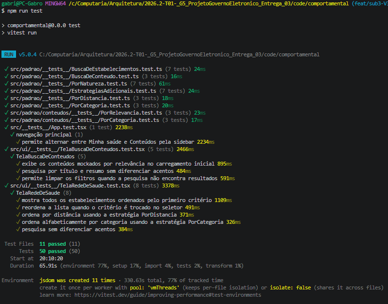

# Execução do padrão | GoF Comportamental

## Demonstração

A demonstração deve mostrar o padrão **Strategy** em execução no fluxo **Acesso à Rede de Saúde e Consulta de Conteúdo**, usando o mini-projeto independente da subequipe.

- **Execução local:** seguir as instruções de [Codigo.md](./3-PadroesDeProjetos/Relatórios/3.1.3.SubEquipe_03/Codigo.md).
- **Modo offline:** `npm run build && npm run preview` testado previamente, sem chamadas a API real (dados simulados em `dominio/`).

### Trecho de Davi — núcleo (CriterioDeBusca, BuscaDeEstabelecimentos)

Demo isolada (fora de `src/ui/`) usando `BuscaDeEstabelecimentos.definirCriterio()`/`buscar()` direto, gravada trocando o critério em tempo de execução.

<video width="640" height="400" controls>
  <source src="/3-PadroesDeProjetos/Relatórios/assets/subequipe03-padroes/execucao/v1-nucleo-strategy-troca-criterio.webm" type="video/webm">
</video>

<center><strong>Legenda:</strong> Vídeo — troca de critério (distância → natureza → categoria → distância) via <code>BuscaDeEstabelecimentos</code>, núcleo real do padrão Strategy em execução.</center>

## Evidências

Resultado da suíte de testes automatizados do núcleo (`npm test` em `code/comportamental/`), que também comprova a execução do padrão:

```
 RUN  v5.0.4 code/comportamental

 Test Files  1 passed (1)
      Tests  7 passed (7)
```

Cobre: delegação da ordenação ao critério atual, troca de estratégia em tempo de execução, não mutação da lista original, repasse exato da referência à estratégia, lista vazia, ordenação real fim a fim e uso do critério inicial do construtor. Detalhamento em [Codigo.md](./3-PadroesDeProjetos/Relatórios/3.1.3.SubEquipe_03/Codigo.md#testes).

### Trecho de Gabriel - Fluxo de Conteudos

<iframe width="100%" height="500" src=https://youtu.be/uOvFTHGM2QI" title="Apresentação da Entrega 3" frameborder="0" allow="accelerometer; autoplay; clipboard-write; encrypted-media; gyroscope; picture-in-picture; web-share" allowfullscreen></iframe>

<center><a href="https://youtu.be/uOvFTHGM2QI">link caso o video não carregue</a></center>

<center><strong>Legenda:</strong> Vídeo - troca de critério do fluxo de  conteudos via <code>BuscaDeConteudos</code>, núcleo real do padrão Strategy em execução.</center>

## Evidências

Resultado da suíte de testes automatizados do núcleo (`npm run test` em `code/comportamental/`), que também comprova a execução do padrão:



### Trecho de Yasmim - Tela da Rede de Saúde

<iframe width="100%" height="500" src="https://www.youtube.com/embed/ofWG9QquDRA" title="Execução do Strategy na Tela da Rede de Saúde" frameborder="0" allow="accelerometer; autoplay; clipboard-write; encrypted-media; gyroscope; picture-in-picture; web-share" allowfullscreen></iframe>

<center><a href="https://youtu.be/ofWG9QquDRA">link caso o video não carregue</a></center>

<center><strong>Legenda:</strong> Vídeo - troca de critério de ordenação dos estabelecimentos na <code>TelaRedeDeSaude</code>, padrão Strategy em execução na interface.</center>

## Histórico de Versionamento

| Nome do Membro                                  | Contribuição                                     | Data       | Commit                                                                                                                                                   |
| :---------------------------------------------- | :----------------------------------------------- | :--------- | :------------------------------------------------------------------------------------------------------------------------------------------------------- |
| [Gustavo Fornaciari](https://github.com/GUGOFO) | Teamplate mais detalhado                         | 14/10/2026 | [7c66f78](https://github.com/UnBArqDsw2026-2-Turma01/2026.2-T01-_G5_ProjetoGovernoEletronico_Entrega_03/tree/7c66f78dc795f080bc43dc01f094e8976462d5b8)   |
| [Gabriel Mota](https://github.com/Gabro-MO)     | Adição do video de execução e evidencia de teste | 17/10/2026 | [55383e5](https://github.com/UnBArqDsw2026-2-Turma01/2026.2-T01-_G5_ProjetoGovernoEletronico_Entrega_03/commit/55383e5e1e2ac128da56a286a21a02faba316a8a) |
| [Yasmim de Souza Santos](https://github.com/eii-yahs) | Adição do vídeo de execução da Tela da Rede de Saúde | 19/10/2026 | [Preencher]() |
