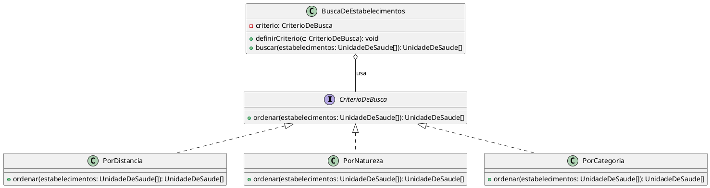

# GoF Comportamental | Strategy

## Figma / Miro Usado

<iframe 
  width="768" 
  height="432" 
  src="" 
  frameborder="0" 
  scrolling="no" 
  allow="fullscreen; clipboard-read; clipboard-write" 
  allowfullscreen>
</iframe>

---

## Versão Final

<strong>Legenda:</strong> [PREENCHER: legenda da imagem]

---

## Participantes

| Nome do Membro |
| :--- |
| [Davi Ursulino de Oliveira](https://github.com/DaviUrsulino) |
| [Gabriel Mota Oliveira](https://github.com/Gabro-MO) |
| [Yasmim de Souza Santos](https://github.com/eii-yahs) |
---

## Fundamentação Teórica

### O que são os Padrões GoF Comportamentais

Padrões comportamentais tratam da forma como objetos e classes se comunicam e distribuem responsabilidade entre si para executar um algoritmo ou um comportamento, sem fixar essa responsabilidade numa única classe rígida. Diferente dos padrões criacionais (que tratam da forma como objetos são instanciados) e dos estruturais (que tratam de como classes e objetos se compõem em estruturas maiores), os comportamentais focam no fluxo de controle e na troca de mensagens entre os participantes, visando flexibilidade na forma como um comportamento pode variar em tempo de execução.

### O Padrão Escolhido

* **Nome e classificação:** Strategy — GoF Comportamental.
* **Intenção:** Definir uma família de algoritmos, encapsular cada um deles numa classe própria e torná-los intercambiáveis, permitindo que o algoritmo varie independentemente dos clientes que o utilizam.
* **Problema que resolve:** Evita que uma classe cliente concentre múltiplos condicionais (`if`/`switch`) para decidir, em tempo de execução, qual variação de um algoritmo aplicar — o que tornaria a classe difícil de estender sem modificá-la a cada novo critério.
* **Solução proposta:** Extrair cada variação do algoritmo para uma classe concreta que implementa uma interface comum (a estratégia); o objeto que usa o algoritmo (o contexto) mantém uma referência a essa interface e delega a execução a ela, podendo trocar a estratégia concreta em tempo de execução.
* **Estrutura e participantes do padrão:** `Strategy` (interface comum do algoritmo), `ConcreteStrategy` (cada implementação concreta do algoritmo) e `Context` (mantém a referência à estratégia atual e delega a execução a ela, sem conhecer os detalhes de cada implementação concreta).
* **Consequências (vantagens e desvantagens):** Vantagem: elimina condicionais, permite adicionar novas estratégias sem alterar o contexto (aberto/fechado) e facilita testar cada algoritmo isoladamente. Desvantagem: aumenta o número de classes no sistema, e o cliente precisa conhecer as estratégias disponíveis para escolher a correta.
* **Quando usar:** quando existem várias variações de um mesmo algoritmo, quando se quer evitar condicionais extensos para selecionar comportamento, ou quando o comportamento de uma classe precisa mudar dinamicamente em tempo de execução.

---

## Contexto de Aplicação no Projeto

### Onde o Padrão foi Aplicado

O padrão foi aplicado na listagem de estabelecimentos próximos do fluxo **Acesso à Rede de Saúde**, detalhado em [fluxograma.md](./fluxograma.md) — montado usando como referência o Rich Picture da Base. A lista de estabelecimentos pode ser organizada por critérios diferentes e intercambiáveis: distância, natureza (estadual, municipal, pública, privada) e categoria. Cada critério é encapsulado numa estratégia concreta (`PorDistancia`, `PorNatureza`, `PorCategoria`), todas implementando a interface `CriterioDeBusca`, e o contexto `BuscaDeEstabelecimentos` delega a ordenação à estratégia selecionada pelo usuário na interface, trocando-a em tempo de execução sem precisar de condicionais para cada critério.

### Rastreabilidade e Elos com Outros Artefatos

| Artefato relacionado | Link | Relação com o padrão |
| :--- | :--- | :--- |
| Diagrama de Classes (Entrega 2, Modelagem Estática) | [ModelagemEstatica.md](https://github.com/UnBArqDsw2026-2-Turma01/2026.2-T01-_G5_ProjetoGovernoEletronico_Entrega_02/blob/main/docs/2-Modelagem/Relat%C3%B3rios/2.1.3.SubEquipe_03/ModelagemEstatica.md) | A entidade `UnidadeDeSaude` da Entrega 2 é o objeto ordenado pelas estratégias concretas deste padrão. |
| Diagrama de Colaboração (Entrega 2, Modelagem Dinâmica) | [ModelagemDinamica.md](https://github.com/UnBArqDsw2026-2-Turma01/2026.2-T01-_G5_ProjetoGovernoEletronico_Entrega_02/blob/main/docs/2-Modelagem/Relat%C3%B3rios/2.1.3.SubEquipe_03/ModelagemDinamica.md) | O fluxo de busca por unidade de saúde modelado na Entrega 2 é o cenário de uso que originou a necessidade de critérios de ordenação intercambiáveis. |
| Rich Picture (Base da Entrega 1) | ver [fluxograma.md](./fluxograma.md) | Referência usada para montar o fluxo de origem desta entrega, conforme orientação do grupo. |
| Código do núcleo (`CriterioDeBusca`, `BuscaDeEstabelecimentos`) | [PR #16](https://github.com/UnBArqDsw2026-2-Turma01/2026.2-T01-_G5_ProjetoGovernoEletronico_Entrega_03/pull/16) | Implementação dos participantes `Strategy` e `Context` descritos nesta modelagem. |

---

## Modelagem

### Versão 1

<strong>Legenda:</strong> Diagrama de Classes genérico do padrão Strategy, com os participantes do GoF e sua correspondência com o domínio do Meu SUS Digital.

<strong>Link Editável:</strong> <a href="https://viewer.diagrams.net/?tags=%7B%7D&lightbox=1&highlight=0000ff&edit=_blank&layers=1&nav=1&dark=auto#R7Vhdb9owFP01kboHqnwU1tcGaPewTZWyj8fJxJfEmmNnjsNHf/2uExsSAtWkdaOVkJDA51xf28fnmjheNC02S8bBC/1cVtqLZl4YkrK8poxkihTVtQCNEPKFpGzJgLYxoR9ORoE/CsYtSzIQtvuUk5pCC69AVUyKlgiufYNGcy+a2vwYIkgBLf8Ng4l8AAGKpSTRimjItj+SejH/VbMS/KhNyuwcKhsxWgUjSlZsl7zYPChS5p8kBY7xdNPG3/p+m4BuW2DigEy5nMEeSNiTnVjgwmpGoeoFaim5ZmUfTKUQkOoeRpSS637YUvL+qCWqOACSlPAh+p1RnbvZuWUY4gOwLLdDv3dEQVywBaqcULnuQI1uSkrtFJwC5x2t2373J9jdxNTOBc93SBXTuMvSuoTw2i7RCyccM8TumwmMW5IU/TTJLOG+vTDCnYniqU02g7iuUtJhRqNOwwvx40tFQRB1BZUmC+CQsgLnLHFn7pD9KhglFGaQNB4ex9549u40ZcXUW7dD1ZoVnAhsxUspdGKZANuEs8wUQgpmSQhgbWj0Ob+zhJYlomnOOP1ItrI2QuIk05+uFedSsSdMS7jNibTS1qe40G5EYnraMAUVxjy63TFipJJzUlZs0czPIAVRGROx1FoWFlrnKGxSGvWj2RpLyoygCzf6rsQ1bE76IOhWJcgCtNpiiO0QTawhbUXe2OZ6b28s2xbLe862VWUrKttl3psOf1jfHffgojXLgQEbC81gfmiPE6YamXJ3Zm58ctqNrQEpLJlgyoVdpUe7WdOtJM72MEMz8YuDX6eDg9s/tHDgv4CHS6lmDDUUKRta+bFHXg7Ft2Kpm76jomOHYvSPDkU01GeiawVPR/205y52ejMn1O34rH6amod01OyooTrkxVFvxVHvozOeUBAMfFRXZLCnIOiduXJhS5YgnOwOw/tnIQX9krMddc/MmI2EA7mADm5mB2Lh4LJWKQyeLTF1Bnp47Rmqq4ATzVb9gf5KqvA5WRZcGq/FlFR5c603y0X+JXUYPp+cU47oFcjR/3c9pxo3r0CNg/+G/ycHNvdvOxqu88rIge4l1T6oeVcWzX8D">Abrir e editar no draw.io</a>

Esta V1 é a versão **genérica** do padrão (participantes do GoF 1:1 com os papéis clássicos da literatura, sem lógica real ainda): `CriterioDeBusca` corresponde ao papel `Strategy` (interface comum), `PorDistancia`/`PorNatureza`/`PorCategoria` correspondem aos `ConcreteStrategy` (cada um encapsulando uma regra de ordenação diferente), e `BuscaDeEstabelecimentos` corresponde ao `Context` (mantém a referência à estratégia atual e delega a ela a responsabilidade de ordenar, sem decidir o critério por condicionais). A relação de composição fraca (`o--`) entre o contexto e a interface representa que o contexto depende da abstração, não de uma implementação concreta — é essa inversão de dependência que permite trocar o critério em tempo de execução sem alterar `BuscaDeEstabelecimentos`.

Esta V1 já corresponde 1:1 ao código do núcleo implementado em [Codigo.md](./Codigo.md) (PR #16): `CriterioDeBusca.ts` e `BuscaDeEstabelecimentos.ts` seguem exatamente esta estrutura.

### Versão 2

<strong>Legenda:</strong> [PREENCHER: legenda da imagem]

[PREENCHER] O que foi modificado e por que foi modificado.

### Versão 3

<strong>Legenda:</strong> [PREENCHER: legenda da imagem]

[PREENCHER] O que foi modificado e por que foi modificado.

---

## Metodologia

[PREENCHER] Explicar qual a metodologia seguida pela equipe para fazer este trabalho (modelagem, código e execução) e, caso tenha alguma particularidade, explicar ela.

"Seguindo a geral e --extra da subequipe--..."

Registros do trabalho em equipe (atas, vídeos de reuniões, checklists): [PREENCHER: links]

---

### Embasamento teórico para criação:

1. GAMMA, Erich et al. Padrões de Projeto: soluções reutilizáveis de software orientado a objetos. Porto Alegre: Bookman, 2000.
2. SERRANO, Milene. Material de aula sobre padrões GoF Comportamentais (Strategy e Template Method), disciplina de Arquitetura e Desenho de Software, UnB, 2026.

---

## Histórico de Versionamento

| Nome do Membro | Contribuição | Data | Commit |
| :--- | :--- | :--- | :--- |
| [Gustavo Fornaciari](https://github.com/GUGOFO) | Inicio do Teamplate do trabalho | 06/10/2026 | [18b6195](https://github.com/UnBArqDsw2026-2-Turma01/2026.2-T01-_G5_ProjetoGovernoEletronico_Entrega_03/tree/18b61958e419b67f95469d4a704ddcb9629b9803) |
| [Gustavo Fornaciari](https://github.com/GUGOFO) | Teamplate mais detalhado | 14/10/2026 | [7c66f78](https://github.com/UnBArqDsw2026-2-Turma01/2026.2-T01-_G5_ProjetoGovernoEletronico_Entrega_03/tree/7c66f78dc795f080bc43dc01f094e8976462d5b8) |
| [Davi Ursulino de Oliveira](https://github.com/DaviUrsulino) | Fundamentação do Strategy e Modelagem V1 (genérica) do GoF Comportamental | 15/10/2026 | *(preencher no commit)* |