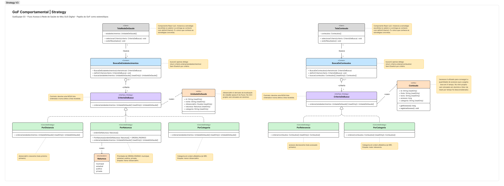
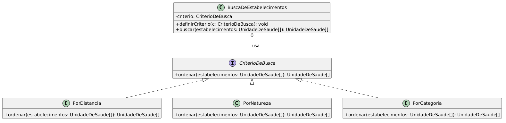
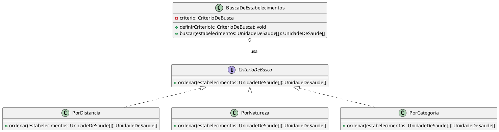
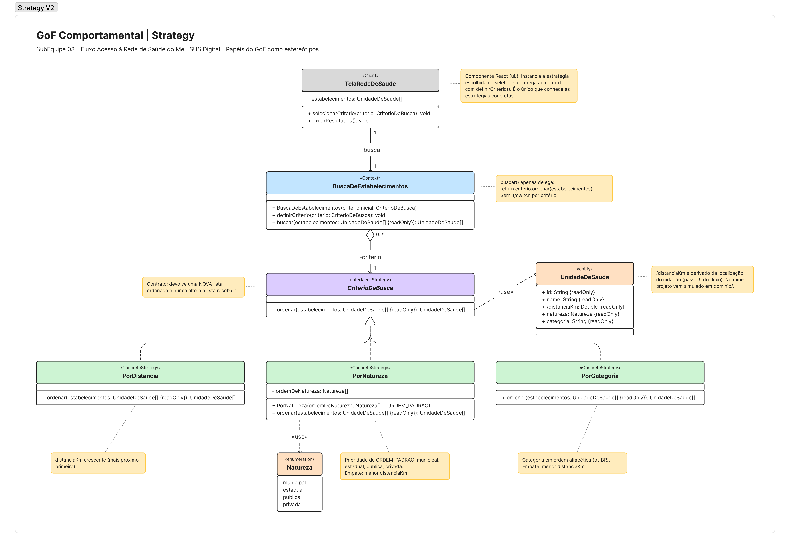

# GoF Comportamental | Strategy

## Figma / Miro Usado

<iframe 
  width="768" 
  height="432" 
  src="https://embed.figma.com/board/7x87f2SoZBkPkXK6OGR0R4/GoF-Comportamental---Strategy-V3--SubEquipe-03---Copy-?node-id=0-1&embed-host=share" 
  frameborder="0" 
  scrolling="no" 
  allow="fullscreen; clipboard-read; clipboard-write" 
  allowfullscreen>
</iframe>

---

## Versão Final

<strong>Legenda:</strong> Diagrama de Classes aplicado do padrão Strategy ao fluxo Acesso à Rede de Saúde do Meu SUS Digital e ao fluxo de Acesso à Conteúdos. Os papéis do GoF aparecem como estereótipos, a tela React entra como cliente, a entidade <code>UnidadeDeSaude</code>, <code>Conteudo</code> e a enumeração <code>Natureza</code> mostram os dados que cada estratégia ordena, e as notas registram o contrato de cada operação.

---

## Participantes

| Nome do Membro                                               |
| :----------------------------------------------------------- |
| [Davi Ursulino de Oliveira](https://github.com/DaviUrsulino) |
| [Gabriel Mota Oliveira](https://github.com/Gabro-MO)         |
| [Yasmim de Souza Santos](https://github.com/eii-yahs)        |

---

## Fundamentação Teórica

### O que são os Padrões GoF Comportamentais

Padrões comportamentais tratam da forma como objetos e classes se comunicam e distribuem responsabilidade entre si para executar um algoritmo ou um comportamento, sem fixar essa responsabilidade numa única classe rígida. Diferente dos padrões criacionais (que tratam da forma como objetos são instanciados) e dos estruturais (que tratam de como classes e objetos se compõem em estruturas maiores), os comportamentais focam no fluxo de controle e na troca de mensagens entre os participantes, visando flexibilidade na forma como um comportamento pode variar em tempo de execução.

### O Padrão Escolhido

- **Nome e classificação:** Strategy - GoF Comportamental.
- **Intenção:** Definir uma família de algoritmos, encapsular cada um deles numa classe própria e torná-los intercambiáveis, permitindo que o algoritmo varie independentemente dos clientes que o utilizam.
- **Problema que resolve:** Evita que uma classe cliente concentre múltiplos condicionais (`if`/`switch`) para decidir, em tempo de execução, qual variação de um algoritmo aplicar — o que tornaria a classe difícil de estender sem modificá-la a cada novo critério.
- **Solução proposta:** Extrair cada variação do algoritmo para uma classe concreta que implementa uma interface comum (a estratégia); o objeto que usa o algoritmo (o contexto) mantém uma referência a essa interface e delega a execução a ela, podendo trocar a estratégia concreta em tempo de execução.
- **Estrutura e participantes do padrão:** `Strategy` (interface comum do algoritmo), `ConcreteStrategy` (cada implementação concreta do algoritmo) e `Context` (mantém a referência à estratégia atual e delega a execução a ela, sem conhecer os detalhes de cada implementação concreta).
- **Consequências (vantagens e desvantagens):**
  - Vantagem: elimina condicionais, permite adicionar novas estratégias sem alterar o contexto (aberto/fechado) e facilita testar cada algoritmo isoladamente.
  - Desvantagem: aumenta o número de classes no sistema, e o cliente precisa conhecer as estratégias disponíveis para escolher a correta.
- **Quando usar:** quando existem várias variações de um mesmo algoritmo, quando se quer evitar condicionais extensos para selecionar comportamento, ou quando o comportamento de uma classe precisa mudar dinamicamente em tempo de execução.

---

## Contexto de Aplicação no Projeto

### Onde o Padrão foi Aplicado

O padrão foi aplicado na listagem de estabelecimentos próximos do fluxo **Acesso à Rede de Saúde** e na listagem de conteúdos do fluxo **Acesso a Conteúdos**, detalhados na seção [Fluxograma](./fluxograma.md), montado usando como referência os Rich Picture da Base. A lista de estrategias de busca pode ser organizada por critérios diferentes e intercambiáveis, no caso das redes de saúde: distância, natureza (estadual, municipal, pública, privada) e categoria, e no caso dos conteúdos: relevância (quantidade de acessos recentes) e categorias. Cada critério é encapsulado numa estratégia concreta (`PorDistancia`, `PorNatureza`, `PorCategoria`, `PorRelevancia`), todas implementando a interface de `CriterioDeBusca` para ambos os contextos, e o contexto `BuscaDeEstabelecimentos` e `BuscaDeConteudos` delega a ordenação à estratégia selecionada pelo usuário na interface, trocando-a em tempo de execução sem precisar de condicionais para cada critério.

### Rastreabilidade e Elos com Outros Artefatos

| Artefato relacionado                                    | Link                                                                                                                                                                                                    | Relação com o padrão                                                                                                                                 |
| :------------------------------------------------------ | :------------------------------------------------------------------------------------------------------------------------------------------------------------------------------------------------------ | :--------------------------------------------------------------------------------------------------------------------------------------------------- |
| Diagrama de Classes (Entrega 2, Modelagem Estática)     | [Modelagem Estatica](https://github.com/UnBArqDsw2026-2-Turma01/2026.2-T01-_G5_ProjetoGovernoEletronico_Entrega_02/blob/main/docs/2-Modelagem/Relat%C3%B3rios/2.1.3.SubEquipe_03/ModelagemEstatica.md)  | A entidade `UnidadeDeSaude` da Entrega 2 é o objeto ordenado pelas estratégias concretas deste padrão.                                               |
| Diagrama de Colaboração (Entrega 2, Modelagem Dinâmica) | [Modelagem Dinamica ](https://github.com/UnBArqDsw2026-2-Turma01/2026.2-T01-_G5_ProjetoGovernoEletronico_Entrega_02/blob/main/docs/2-Modelagem/Relat%C3%B3rios/2.1.3.SubEquipe_03/ModelagemDinamica.md) | O fluxo de busca por unidade de saúde modelado na Entrega 2 é o cenário de uso que originou a necessidade de critérios de ordenação intercambiáveis. |
| Rich Picture (Base da Entrega 1)                        | [Fluxograma](./fluxograma.md)                                                                                                                                                                           | Referência usada para montar o fluxo de origem desta entrega, conforme orientação do grupo.                                                          |

---

## Modelagem

### Versão 1

<strong>Legenda:</strong> Diagrama de Classes genérico do padrão Strategy, com os participantes do GoF e sua correspondência com o domínio do Meu SUS Digital.

<strong>Link Editável:</strong> <a href="https://viewer.diagrams.net/?tags=%7B%7D&lightbox=1&highlight=0000ff&edit=_blank&layers=1&nav=1&dark=auto#R7Vhdb9owFP01kboHqnwU1tcGaPewTZWyj8fJxJfEmmNnjsNHf/2uExsSAtWkdaOVkJDA51xf28fnmjheNC02S8bBC/1cVtqLZl4YkrK8poxkihTVtQCNEPKFpGzJgLYxoR9ORoE/CsYtSzIQtvuUk5pCC69AVUyKlgiufYNGcy+a2vwYIkgBLf8Ng4l8AAGKpSTRimjItj+SejH/VbMS/KhNyuwcKhsxWgUjSlZsl7zYPChS5p8kBY7xdNPG3/p+m4BuW2DigEy5nMEeSNiTnVjgwmpGoeoFaim5ZmUfTKUQkOoeRpSS637YUvL+qCWqOACSlPAh+p1RnbvZuWUY4gOwLLdDv3dEQVywBaqcULnuQI1uSkrtFJwC5x2t2373J9jdxNTOBc93SBXTuMvSuoTw2i7RCyccM8TumwmMW5IU/TTJLOG+vTDCnYniqU02g7iuUtJhRqNOwwvx40tFQRB1BZUmC+CQsgLnLHFn7pD9KhglFGaQNB4ex9549u40ZcXUW7dD1ZoVnAhsxUspdGKZANuEs8wUQgpmSQhgbWj0Ob+zhJYlomnOOP1ItrI2QuIk05+uFedSsSdMS7jNibTS1qe40G5EYnraMAUVxjy63TFipJJzUlZs0czPIAVRGROx1FoWFlrnKGxSGvWj2RpLyoygCzf6rsQ1bE76IOhWJcgCtNpiiO0QTawhbUXe2OZ6b28s2xbLe862VWUrKttl3psOf1jfHffgojXLgQEbC81gfmiPE6YamXJ3Zm58ctqNrQEpLJlgyoVdpUe7WdOtJM72MEMz8YuDX6eDg9s/tHDgv4CHS6lmDDUUKRta+bFHXg7Ft2Kpm76jomOHYvSPDkU01GeiawVPR/205y52ejMn1O34rH6amod01OyooTrkxVFvxVHvozOeUBAMfFRXZLCnIOiduXJhS5YgnOwOw/tnIQX9krMddc/MmI2EA7mADm5mB2Lh4LJWKQyeLTF1Bnp47Rmqq4ATzVb9gf5KqvA5WRZcGq/FlFR5c603y0X+JXUYPp+cU47oFcjR/3c9pxo3r0CNg/+G/ycHNvdvOxqu88rIge4l1T6oeVcWzX8D">Abrir e editar no draw.io</a>

Esta V1 é a versão **genérica** do padrão (participantes do GoF 1:1 com os papéis clássicos da literatura, sem lógica real ainda): `CriterioDeBusca` corresponde ao papel `Strategy` (interface comum), `PorDistancia`/`PorNatureza`/`PorCategoria` correspondem aos `ConcreteStrategy` (cada um encapsulando uma regra de ordenação diferente), e `BuscaDeEstabelecimentos` corresponde ao `Context` (mantém a referência à estratégia atual e delega a ela a responsabilidade de ordenar, sem decidir o critério por condicionais). A relação de composição fraca (`o--`) entre o contexto e a interface representa que o contexto depende da abstração, não de uma implementação concreta, é essa inversão de dependência que permite trocar o critério em tempo de execução sem alterar `BuscaDeEstabelecimentos`.

Esta V1 já corresponde 1:1 ao código do núcleo implementado em [Codigo.md](./Codigo.md) (PR #16): `CriterioDeBusca.ts` e `BuscaDeEstabelecimentos.ts` seguem exatamente esta estrutura.

### Versão 2

<strong>Legenda:</strong> Diagrama de Classes aplicado do padrão Strategy ao fluxo Acesso à Rede de Saúde do Meu SUS Digital. Os papéis do GoF aparecem como estereótipos, a tela React entra como cliente, a entidade <code>UnidadeDeSaude</code> e a enumeração <code>Natureza</code> mostram os dados que cada estratégia ordena, e as notas registram o contrato de cada operação.

<strong>Link Editável:</strong> <a href="https://www.figma.com/board/KjhCriWzChhMM8win6Swk8?node-id=2-2">Abrir e editar no FigJam</a>

<iframe style="border: 1px solid rgba(0, 0, 0, 0.1);" width="800" height="450" src="https://embed.figma.com/board/KjhCriWzChhMM8win6Swk8/GoF-Comportamental---Strategy-V2--SubEquipe-03-?node-id=2-2&embed-host=share" allowfullscreen></iframe>

#### O que foi feito

A V1 mostrava o Strategy de forma genérica: os papéis do GoF estavam lá, mas quase nada do Meu SUS Digital. Na V2, o objetivo foi aplicar o padrão ao nosso fluxo de Rede de Saúde, de um jeito que quem fosse programar as estratégias concretas e a tela conseguisse se guiar só pelo diagrama.

O primeiro passo foi mostrar os dados que as estratégias ordenam. Na V1, `UnidadeDeSaude` aparecia apenas como tipo dos parâmetros, então não dava para saber se a ordenação era por distância, por nome ou por outra coisa. Trouxemos essa classe da Modelagem Estática da Entrega 2 e ficamos só com o que o padrão usa: `id`, `nome`, `distanciaKm`, `natureza` e `categoria`. O `tipo` da Entrega 2 virou `categoria`, com os mesmos valores, como Hospital e UBS. Endereço, latitude e longitude ficaram de fora porque nenhuma estratégia precisa deles. A natureza ganhou uma enumeração própria, `Natureza`, com os quatro valores que o app mostra. Já a distância foi marcada como atributo derivado (`/distanciaKm`), porque no app real ela não é fixa: depende da localização que o cidadão autoriza no passo 6 do [fluxograma](./fluxograma.md). No mini-projeto esse valor é simulado, já que tudo precisa rodar offline.

Também faltava na V1 quem escolhe a estratégia. Segundo Gamma et al., é o cliente que cria a estratégia concreta e a entrega ao contexto. No nosso caso, esse papel é da tela React com o seletor de critério, que chamamos de `TelaRedeDeSaude` e que corresponde ao `:TelaBusca` do Diagrama de Colaboração da Entrega 2. Ela é a única classe que conhece `PorDistancia`, `PorNatureza` e `PorCategoria`, o que mostra uma desvantagem que o próprio livro aponta: o cliente precisa saber quais estratégias existem. Para facilitar a leitura, cada classe também recebeu o estereótipo do seu papel no padrão (`<<Client>>`, `<<Context>>`, `<<Strategy>>` e `<<ConcreteStrategy>>`).

Por fim, as três estratégias concretas deixaram de ser caixas iguais e cada uma ganhou a sua regra. `PorDistancia` ordena do mais perto para o mais longe, `PorCategoria` ordena por categoria em ordem alfabética e `PorNatureza` segue uma ordem de prioridade guardada no atributo `ordemDeNatureza`. Essa ordem precisa ser explícita porque a natureza não tem uma sequência natural; em ordem alfabética, "privada" viria antes de "publica". Como ela chega pelo construtor, dá para usar outra ordem sem alterar a classe, seguindo o princípio aberto/fechado. `PorNatureza` e `PorCategoria` desempatam pela distância, para o cidadão ver primeiro o que está mais perto. Os detalhes de cada regra estão nos contratos abaixo.

**Contratos das operações**

Além do desenho, a V2 define como cada operação deve funcionar, para o código das fatias que faltam sair igual ao modelo:

- **`CriterioDeBusca.ordenar()`:** recebe a lista de estabelecimentos e devolve uma lista nova, com os mesmos itens em outra ordem. Ela só ordena, não filtra, então nenhum estabelecimento some do resultado. Se a lista vier vazia, volta vazia.
- **`PorDistancia`:** do mais perto para o mais longe.
- **`PorNatureza`:** segue a ordem guardada em `ordemDeNatureza` e, dentro de cada natureza, vai do mais perto para o mais longe. Por padrão, a ordem é municipal, estadual, publica e privada. Colocamos as municipais primeiro porque a atenção básica, como as UBS, é a porta de entrada do SUS e fica a cargo dos municípios. As privadas ficam por último porque o app é voltado à rede pública. Essa ordem foi uma escolha nossa e ainda pode mudar.
- **`PorCategoria`:** agrupa por categoria em ordem alfabética, comparando em português para acertar os acentos (como em "Clínica"). Dentro de cada categoria, vai do mais perto para o mais longe.
- **`BuscaDeEstabelecimentos`:** já nasce com um critério, que pode ser trocado a qualquer momento com `definirCriterio()`. O `buscar()` só repassa a lista para o critério atual, sem nenhum `if` ou `switch` escolhendo o critério.
- **`TelaRedeDeSaude`:** guarda a lista de estabelecimentos simulados. Quando o cidadão escolhe um critério no seletor, a tela cria a estratégia certa, entrega ao contexto com `definirCriterio()` e mostra o que `buscar()` devolver.

**Mapeamento V2 → código**

Os nomes do diagrama são os mesmos do código, como combinamos no plano da entrega. Hoje a situação é esta:

| Elemento da V2                  | Arquivo em `code/comportamental/src/`               | Situação                                                                                               |
| :------------------------------ | :-------------------------------------------------- | :----------------------------------------------------------------------------------------------------- |
| `CriterioDeBusca`               | `padrao/CriterioDeBusca.ts`                         | Pronto (PR #16) e igual ao diagrama.                                                                   |
| `BuscaDeEstabelecimentos`       | `padrao/BuscaDeEstabelecimentos.ts`                 | Pronto (PR #16). O construtor e o `readonly` já existiam no código; a V2 só passou a mostrar os dois.  |
| `UnidadeDeSaude` e `Natureza`   | `dominio/UnidadeDeSaude.ts`                         | Pronto. Por enquanto, a `Natureza` é um tipo união dentro da interface.                                |
| `PorDistancia` e `PorCategoria` | `padrao/PorDistancia.ts` e `padrao/PorCategoria.ts` | Falta implementar.                                                                                     |
| `PorNatureza`                   | `padrao/PorNatureza.ts`                             | Falta implementar. Para tipar `ordemDeNatureza`, o tipo `Natureza` vai precisar ser exportado à parte. |
| `TelaRedeDeSaude`               | `ui/TelaRedeDeSaude.tsx`                            | Falta implementar.                                                                                     |

### Versão 3

<strong>Legenda:</strong> Diagrama de Classes aplicado do padrão Strategy ao fluxo Acesso à Rede de Saúde do Meu SUS Digital e ao fluxo de Acesso à Conteúdos. Os papéis do GoF aparecem como estereótipos, a tela React entra como cliente, a entidade <code>UnidadeDeSaude</code>, <code>Conteudo</code> e a enumeração <code>Natureza</code> mostram os dados que cada estratégia ordena, e as notas registram o contrato de cada operação.

<strong>Link Editável:</strong> <a href="https://www.figma.com/board/7x87f2SoZBkPkXK6OGR0R4/GoF-Comportamental---Strategy-V3--SubEquipe-03---Copy-?node-id=0-1&t=DrgNx7EWDUQ1BMgr-1">Abrir e editar no FigJam</a>

<iframe style="border: 1px solid rgba(0, 0, 0, 0.1);" width="800" height="450" src="https://embed.figma.com/board/7x87f2SoZBkPkXK6OGR0R4/GoF-Comportamental---Strategy-V3--SubEquipe-03---Copy-?node-id=0-1&embed-host=share" allowfullscreen></iframe>

A V3 é a versão **final** do padrão ela adiciona o fluxo de Conteudos ao GoF, onde foram adicionados: um segundo `CriterioDeBusca` e `BuscaDeConteudos`, que correspondem ao `Context` e ao papel `Strategy`, para a `TelaConteudo`, duas estratégias de busca, `PorRelevancia`/`PorCategoria`, que correspondem aos `ConcreteStrategy`, sendo `porRelevancia` feito atraves do numero de acessos que um conteúdo teve em X tempo (dentro do codigo o _"reset"_ do número de acessos após X tempo foi desconsiderado), e a entidade `Conteudo` usada para mostrar os dados que a estratégia ordena (`texto: String` foi utilizado como valor genérico para o conteudo presente na pagina de um determinado `Conteudo`).

---

## Metodologia

A modelagem parte dos artefatos produzidos nas entregas anteriores da SubEquipe 03. O Rich Picture e o SIG ajudam a recuperar o contexto e as preocupações de qualidade, o BPMN registra os processos observados por engenharia reversa, e os diagramas de classes e colaboração ajudam a descrever o GoF comportamental e o codigo .

A SubEquipe 03 também adotou uma metodologia iterativa e incremental:

1. **Divisão Funcional:** Em vez de realizar todo o trabalho de forma monolítica ou dispersa, nos o dividimos em tarefas menores para cada membro da equipe.
2. **Atuação nos Três Focos Obrigatórios:** Cada membro é diretamente responsável pelos 3 focos de sua versão: **Modelagem UML**, **Código Fonte**.
3. **Padrão de Qualidade e Isolamento:** O código foi construído em repositório desacoplado (`code/criacional/`), garantindo execução offline e testes automatizados sem acoplamento a serviços externos.

---

### Embasamento teórico para criação:

1. GAMMA, Erich et al. Padrões de Projeto: soluções reutilizáveis de software orientado a objetos. Porto Alegre: Bookman, 2000.
2. SERRANO, Milene. Material de aula sobre padrões GoF Comportamentais (Strategy e Template Method), disciplina de Arquitetura e Desenho de Software, UnB, 2026.
3. OBJECT MANAGEMENT GROUP. OMG Unified Modeling Language (OMG UML), Version 2.5.1. 2017. Disponível em: https://www.omg.org/spec/UML/2.5.1. Acesso em: 17 out. 2026.
4. MARTIN, Robert C. Agile Software Development: Principles, Patterns, and Practices. Upper Saddle River: Prentice Hall, 2002.

---

## Histórico de Versionamento

| Nome do Membro                                               | Contribuição                                                                                                               | Data       | Commit                                                                                                                                                   |
| :----------------------------------------------------------- | :------------------------------------------------------------------------------------------------------------------------- | :--------- | :------------------------------------------------------------------------------------------------------------------------------------------------------- |
| [Gustavo Fornaciari](https://github.com/GUGOFO)              | Inicio do Teamplate do trabalho                                                                                            | 06/10/2026 | [18b6195](https://github.com/UnBArqDsw2026-2-Turma01/2026.2-T01-_G5_ProjetoGovernoEletronico_Entrega_03/tree/18b61958e419b67f95469d4a704ddcb9629b9803)   |
| [Gustavo Fornaciari](https://github.com/GUGOFO)              | Teamplate mais detalhado                                                                                                   | 14/10/2026 | [7c66f78](https://github.com/UnBArqDsw2026-2-Turma01/2026.2-T01-_G5_ProjetoGovernoEletronico_Entrega_03/tree/7c66f78dc795f080bc43dc01f094e8976462d5b8)   |
| [Davi Ursulino de Oliveira](https://github.com/DaviUrsulino) | Fundamentação do Strategy e Modelagem V1 (genérica) do GoF Comportamental                                                  | 15/10/2026 | [ebbb874](https://github.com/UnBArqDsw2026-2-Turma01/2026.2-T01-_G5_ProjetoGovernoEletronico_Entrega_03/commit/ebbb874c650efc584b68c97fc3975d298f098715) |
| [Yasmim de Souza Santos](https://github.com/eii-yahs)        | Modelagem V2 (aplicada) do GoF Comportamental: diagrama de classes, quadro editável no FigJam e justificativa das mudanças | 17/10/2026 | [a0b244f](https://github.com/UnBArqDsw2026-2-Turma01/2026.2-T01-_G5_ProjetoGovernoEletronico_Entrega_03/commit/a0b244febf6729b1e2c3c212b078e15841d24ba1) |
| [Gabriel Mota](https://github.com/Gabro-MO) | Modelagem V3 do GoF comportamental com adição do fluxo de Conteúdos, correção do padrão escolhido e adição da metodologia utilizada | 17/10/2026 | [1bb7c5b](https://github.com/UnBArqDsw2026-2-Turma01/2026.2-T01-_G5_ProjetoGovernoEletronico_Entrega_03/commit/1bb7c5bbf4108f74acb75399f27e8bfdeb695407) |
