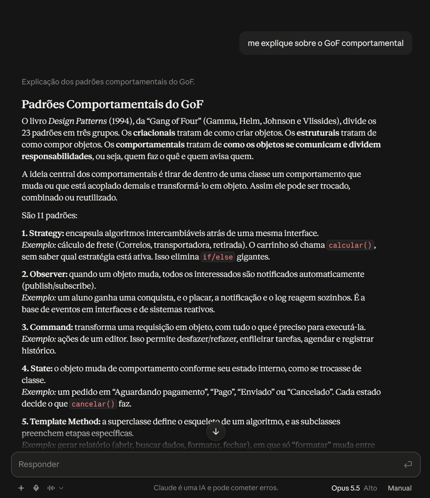
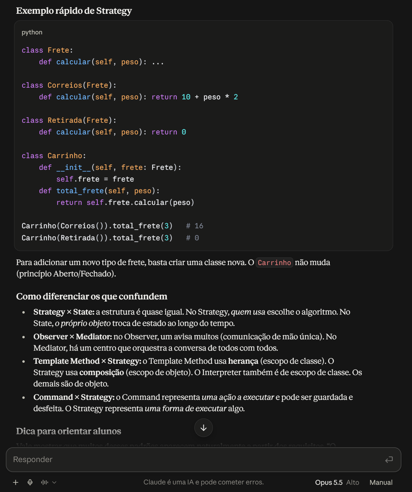
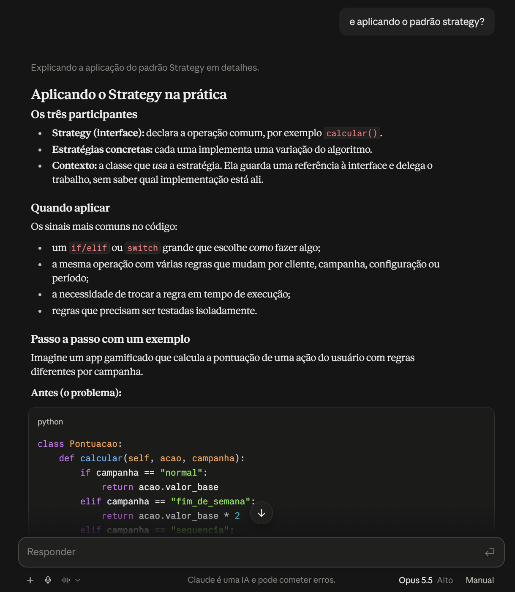
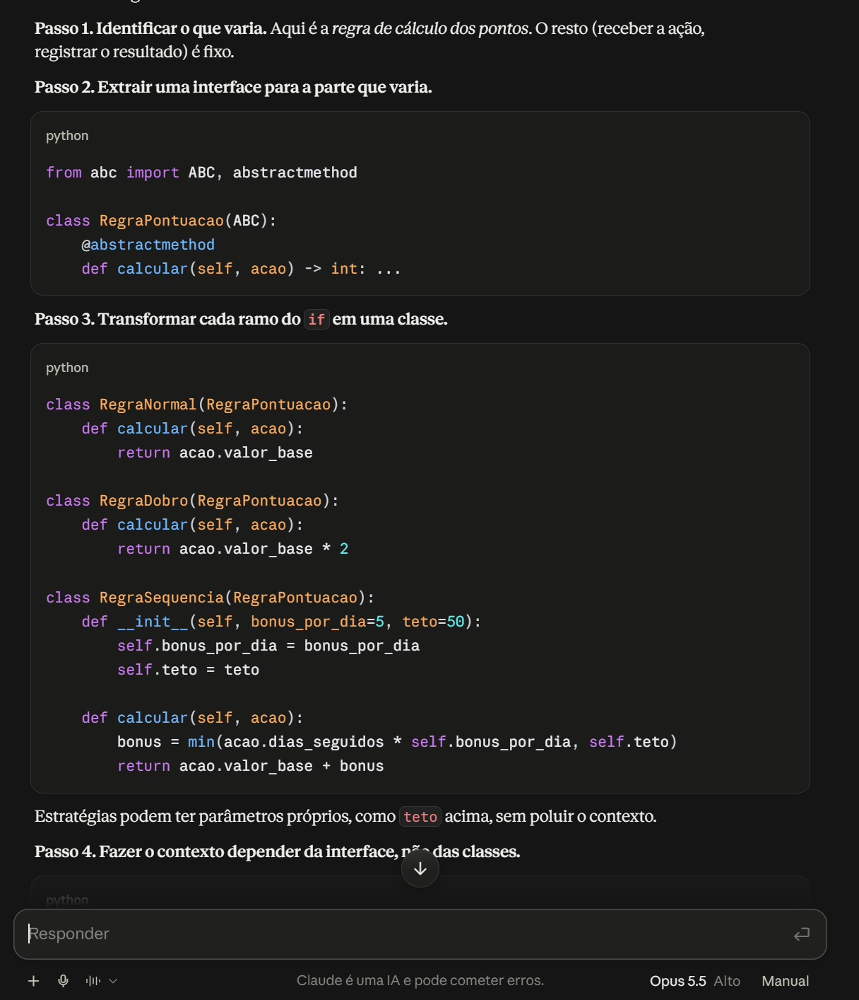
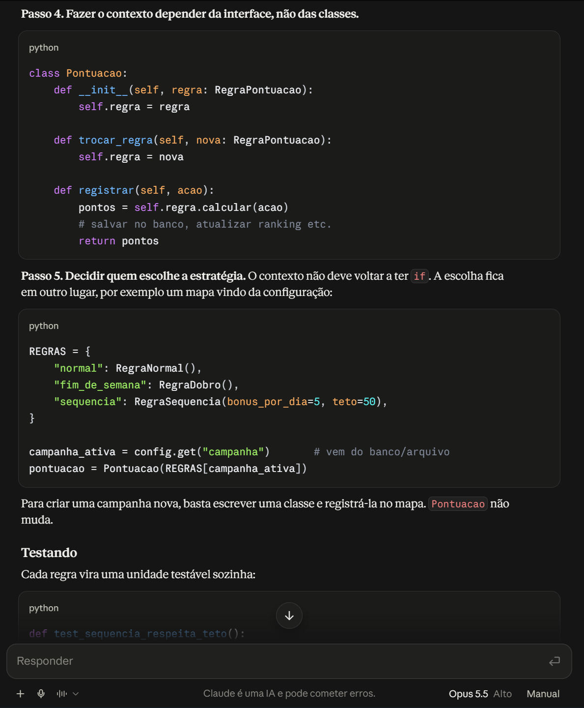
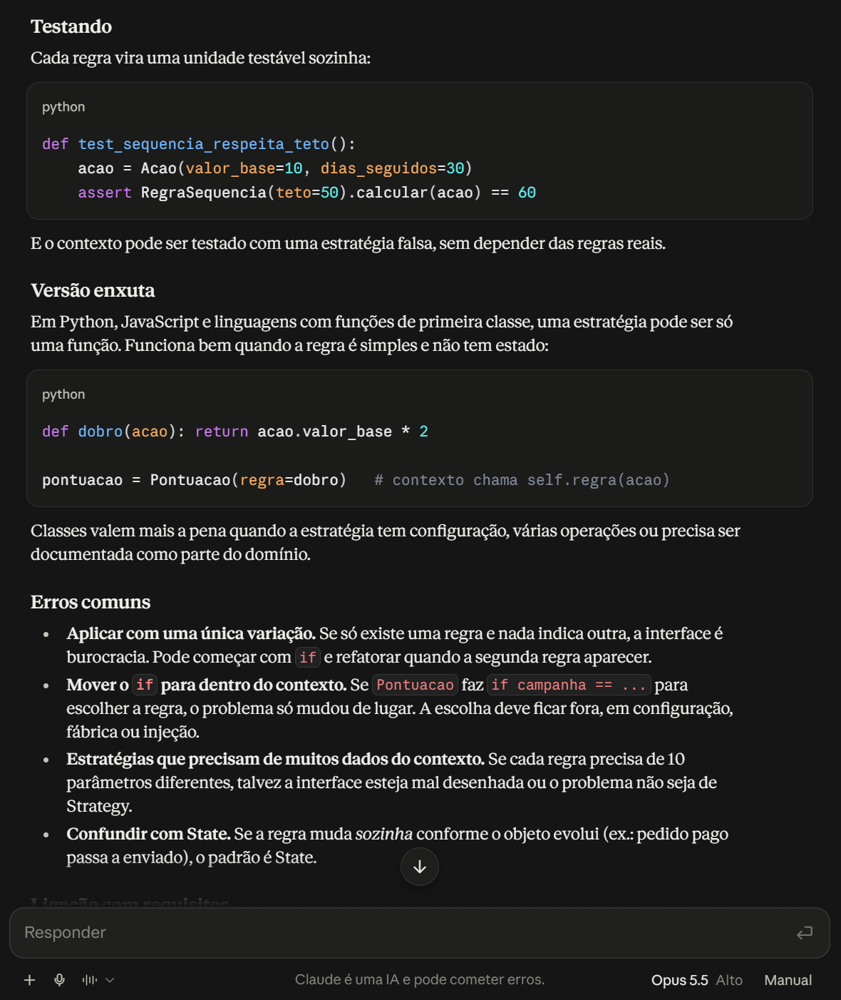

# Uso de Inteligência Artificial Generativa | GoF Comportamental

---

## 1. Descrição e Objetivo

Este documento registra o apoio e o uso de ferramentas de IA Generativa na entrega de Padrões de Projeto (GoF Comportamental — Strategy) pela SubEquipe 03, com transparência, senso crítico e rastreabilidade: o que foi pedido, o que foi obtido e o que foi mantido, corrigido ou descartado.

---

## 2. Metodologia do Foco

A coleta de depoimentos e dados de uso ocorre de forma assíncrona e individual, dentro da responsabilidade de cada integrante (modelagem, código ou execução).

### Ferramentas Empregadas

* **Claude (Sonnet, via Claude Code):** usado como revisor de código do núcleo do padrão Strategy (`CriterioDeBusca`, `BuscaDeEstabelecimentos`), verificando aderência a SOLID, clean code e corretude de compilação/testes.
* **Claude (Opus 5.5):** usado por Yasmim Santos como apoio de estudo para a modelagem V2, explicando os padrões GoF Comportamentais e como aplicar o Strategy passo a passo (Experimento 02), e para aperfeiçoar o visual do diagrama de classes V2 no FigJam.

---

## 3. Experimentos com IA Generativa nesta Entrega

### Experimento 01: Revisão do núcleo do padrão Strategy (código)

#### Objetivo:

Pedir ao Claude uma revisão crítica do núcleo já implementado (`CriterioDeBusca` e `BuscaDeEstabelecimentos`), verificando aderência a SOLID, clean code (sem comentários desnecessários) e cobertura de testes, antes de considerar a responsabilidade pronta para PR.

#### Prompt Utilizado:

```
Revise o núcleo do padrão Strategy implementado em code/comportamental/src/padrao/
(CriterioDeBusca.ts e BuscaDeEstabelecimentos.ts). Verifique aderência aos
princípios SOLID, ausência de comentários desnecessários, cobertura de testes e
execute a suíte de verificação (tsc, oxlint, npm test) antes de aprovar como
pronto para revisão da equipe.
```


<center><strong>Legenda:</strong> Prompt e resposta do Claude revisando o núcleo do padrão Strategy.</center>

#### Resultado Obtido:

Numa primeira passada, ao rodar `tsc -b --noEmit`, `oxlint` e `npm test` sobre o código recém-implementado, o Claude encontrou um erro real de compilação: o teste usava `constructor(private readonly resultado: UnidadeDeSaude[])` (parameter property), que o `tsconfig.json` do projeto rejeita por ter `erasableSyntaxOnly` habilitado. A IA corrigiu isso declarando o campo manualmente no construtor, aplicou `readonly UnidadeDeSaude[]` nas assinaturas de `CriterioDeBusca.ordenar`, `BuscaDeEstabelecimentos.buscar` e no array de dados simulados (reforçando em tipo a imutabilidade já testada em runtime), e acrescentou 4 testes novos (lista exata repassada à estratégia via `vi.fn()`, lista vazia, ordenação real com uma estratégia concreta de teste, e uso do critério inicial do construtor), subindo a suíte de 3 para 7 testes.

Com o prompt formal acima (print da Figura 1), foi pedida uma segunda passada de confirmação: a IA reexecutou toda a suíte de verificação (resultado no print) e apresentou um checklist explícito de SOLID (SRP, OCP, LSP/ISP, DIP) e de ausência de comentários, aprovando o núcleo para revisão da equipe.

#### Análise Crítica e Intervenção Humana:

A IA acertou ao não aceitar a implementação como "perfeita" sem rodar o compilador — o erro do `erasableSyntaxOnly` só foi encontrado porque ela executou `tsc -b` de verdade, não porque inspecionou o código visualmente. Isso evitou subir um código que quebraria o build do grupo. As sugestões de `readonly` e de testes adicionais foram aceitas porque são coerentes com o contrato já pretendido pela classe (imutabilidade, delegação pura ao Strategy) e não mudam o comportamento, só o reforçam. Como ponto de atenção: a IA não decide sozinha o que está "pronto" — a revisão foi direcionada pelo pedido explícito de rodar o build/testes e checar SOLID, e o commit final continua sendo decisão humana, não automática.

### Experimento 02: Estudo do GoF Comportamental e da aplicação do Strategy (modelagem)

#### Objetivo:

Usar o Claude como apoio de estudo para a Versão 2 do diagrama de classes, que é a versão aplicada do Strategy ao fluxo Acesso à Rede de Saúde. O experimento foi conduzido por Yasmim Santos com o **Claude** (Opus 5.5) e tinha dois objetivos: (i) revisar o que são os padrões GoF Comportamentais e como o Strategy se diferencia dos padrões que costumam ser confundidos com ele, e (ii) entender como aplicar o Strategy na prática, ou seja, quais participantes o diagrama precisa mostrar, quem escolhe a estratégia e quais erros evitar.

#### Prompts Utilizados:

```
me explique sobre o GoF comportamental
```

```
e aplicando o padrão strategy?
```

Os dois prompts foram enviados em sequência na mesma conversa, sem anexos e sem contexto do projeto. A intenção era ver como a IA explicaria o padrão de forma geral, antes de levar o conteúdo para o domínio do Meu SUS Digital.

#### Resultado Obtido:



<center><strong>Legenda:</strong> Prompt "me explique sobre o GoF comportamental". O Claude situa os comportamentais entre os três grupos do GoF (criacionais, estruturais e comportamentais), resume a ideia central (tirar de dentro de uma classe o comportamento que muda e transformá-lo em objeto) e começa a lista dos 11 padrões, com um exemplo para cada um.</center>



<center><strong>Legenda:</strong> Continuação da resposta: um exemplo rápido de Strategy em Python (cálculo de frete com <code>Correios</code> e <code>Retirada</code>) e a seção "Como diferenciar os que confundem", comparando Strategy × State, Observer × Mediator, Template Method × Strategy e Command × Strategy.</center>



<center><strong>Legenda:</strong> Prompt "e aplicando o padrão strategy?". A IA apresenta os três participantes (interface Strategy, estratégias concretas e contexto), os sinais no código que indicam quando aplicar o padrão e o início de um exemplo de pontuação por campanha, mostrando o "antes" com um <code>if/elif</code> que escolhe a regra.</center>



<center><strong>Legenda:</strong> Passos 1 a 3 da refatoração: identificar o que varia, extrair uma interface para essa parte (<code>RegraPontuacao</code>) e transformar cada ramo do <code>if</code> em uma classe. A <code>RegraSequencia</code> mostra que uma estratégia pode ter parâmetros próprios (<code>bonus_por_dia</code> e <code>teto</code>).</center>



<center><strong>Legenda:</strong> Passos 4 e 5: o contexto <code>Pontuacao</code> passa a depender só da interface e ganha <code>trocar_regra()</code> para trocar a estratégia em tempo de execução, e a escolha da estratégia sai do contexto e fica em outro lugar (no exemplo, um mapa vindo da configuração).</center>



<center><strong>Legenda:</strong> Final da resposta: teste de uma regra isolada, a "versão enxuta" com funções no lugar de classes e a lista de erros comuns (aplicar com uma única variação, mover o <code>if</code> para dentro do contexto, estratégias que dependem de muitos dados do contexto e confundir Strategy com State).</center>

A primeira resposta funcionou como uma revisão do grupo de padrões como um todo. A comparação Strategy × State foi a parte mais útil para o nosso caso, porque deixou claro por que o fluxo da Rede de Saúde é Strategy: quem troca o critério de ordenação é o cidadão, pelo seletor da tela, e não o próprio objeto mudando de estado ao longo do tempo. A comparação Template Method × Strategy (herança × composição) também ajudou, já que o material de aula da disciplina trata desses dois padrões juntos.

A segunda resposta trouxe um roteiro que serviu para conferir a V2 ponto a ponto:

* **Quem escolhe a estratégia (Passo 5):** a resposta reforça que a escolha não pode ficar dentro do contexto. Na V1, esse papel nem aparecia no diagrama. Na V2, ele ficou com o cliente `TelaRedeDeSaude`, que cria a estratégia concreta e a entrega ao contexto com `definirCriterio()`. A decisão foi embasada em Gamma et al., como está descrito na V2.
* **Não mover o `if` para dentro do contexto:** esse erro comum corresponde ao contrato de `BuscaDeEstabelecimentos` definido na V2, em que `buscar()` só repassa a lista para o critério atual, sem nenhum `if` ou `switch` escolhendo o critério.
* **Estratégias com parâmetros próprios:** o exemplo da `RegraSequencia` com `teto` é a mesma ideia do atributo `ordemDeNatureza` de `PorNatureza`, que chega pelo construtor e permite usar outra ordem sem alterar a classe.
* **Classes ou funções:** a IA explica que classes valem mais a pena quando a estratégia tem configuração ou precisa ser documentada como parte do domínio. Os dois casos valem para o nosso diagrama, já que `PorNatureza` tem configuração e cada estratégia aparece com o estereótipo `<<ConcreteStrategy>>`. Por isso a V2 manteve as estratégias como classes.

#### Análise Crítica e Intervenção Humana:

Como os prompts foram enviados sem nenhum contexto do projeto, as respostas foram genéricas. Os exemplos eram de frete e de pontuação de campanha, em Python, enquanto o projeto é em TypeScript/React e trata de estabelecimentos de saúde. A IA chegou a supor um perfil diferente para quem perguntava, incluindo uma seção "Dica para orientar alunos", como se o conteúdo fosse ser ensinado a alguém. Isso confirma o que a subequipe já tinha visto na Entrega 2: sem contexto, a IA responde para um caso médio, e não para o nosso.

Por isso, nada do diagrama foi gerado pela IA, porém ele foi aperfeiçoado utilizando a IA posteriormente. As respostas serviram como base de estudo e como checklist, e a tradução para o Meu SUS Digital foi feita manualmente. Quais atributos de `UnidadeDeSaude` entram no diagrama, a enumeração `Natureza`, a distância como atributo derivado e a ordem de prioridade das naturezas (municipal, estadual, publica e privada) foram decisões tomadas com base na Modelagem Estática da Entrega 2, no [fluxograma](./fluxograma.md) e no livro de Gamma et al., não na resposta da IA. Cada ponto do roteiro também foi conferido com o material de aula antes de ser usado como critério de revisão da V2.

---

## 4. Análise Crítica e Lições Aprendidas

* **Cobertura Conceitual:** [PREENCHER]
* **Aderência ao Padrão e à UML:** [PREENCHER]
* **Qualidade do Código Gerado e Execução:** [PREENCHER]
* **Influência do Prompting:** [PREENCHER]
* **Confiabilidade e Validação:** [PREENCHER]
* **Limites do Experimento:** [PREENCHER]

---

## 5. Pontos de Vista Individuais

Pontos de vista de cada membro da equipe sobre as lições aprendidas e o uso da IA Generativa.

### Resumo por Integrante

| Integrante | O que aprendi | Uso de IA Generativa |
| --- | --- | --- |
| [Davi Ursulino de Oliveira](https://github.com/DaviUrsulino) | IA como revisor de código independente pega bug que inspeção visual não pegaria | Claude revisando núcleo Strategy (build, lint, testes) |
| [Gabriel Mota Oliveira](https://github.com/Gabro-MO) | Compreendi como IA pode ajudar a montar o padrão GoF Strategy facilita a organização e a expansão de estratégias, além da importância de validar criticamente as sugestões da IA.| Utilizei o ChatGPT para auxiliar na evolução do código e na revisão da documentação da V3, validando suas sugestões conforme os objetivos do projeto. |
| [Yasmim de Souza Santos](https://github.com/eii-yahs) | A IA explica bem a teoria do Strategy, mas aplicar o padrão ao Meu SUS Digital depende de quem conhece o domínio | Claude no estudo do GoF Comportamental e do Strategy para a V2, e para aperfeiçoar o diagrama no Figma |

---

### Detalhamento

### Davi Ursulino de Oliveira

* **GitHub:** [@DaviUrsulino](https://github.com/DaviUrsulino)

* **Uso da IA Generativa (Senso Crítico):** Usei o Claude como revisor do núcleo do padrão Strategy depois de implementado, pedindo explicitamente que verificasse aderência a SOLID e código limpo em vez de só opinar. O ponto crítico foi que a IA não ficou na opinião: rodou o compilador TypeScript e os testes de verdade, e assim achou um erro real (`erasableSyntaxOnly` rejeitando parameter property no teste) que uma leitura visual do código dificilmente pegaria. Aceitei as correções porque eram verificáveis (build e testes passando antes/depois), não porque a IA "disse que estava certo".

* **Lições Aprendidas:** Pedir pra IA "validar com evidência" (rodar build, lint, teste) em vez de só dar opinião sobre o código muda o tipo de erro que ela encontra — passa a pegar bug de configuração/compilação, não só estilo. Reforcei também que melhorias sugeridas (como `readonly` nos tipos) só valem a pena quando reforçam um contrato que a classe já pretendia ter, não quando mudam comportamento por conta própria.

---

### Gabriel Mota Oliveira

* **GitHub:** [@Gabro-MO](https://github.com/Gabro-MO)

* **Uso da IA Generativa (Senso Crítico):** Utilizei o ChatGPT como apoio à evolução e à documentação do codigo. A ferramenta auxiliou na organização das descrições das classes, na revisão textual da documentação da V3.

* **Lições Aprendidas:** Aprendi que o padrão _GoF Strategy_ permite organizar as multiplas maneiras de fazer algo em estruturas organizadas, tratando elementos individuais e divisões de trabalho de forma simples. Compreendi como essa estrutura facilita a implementação de novas estrategias. Também aprendi que a IA pode auxiliar no codigo e na documentação, mas suas sugestões precisam ser analisadas e validadas para garantir a coerência com o padrão e os objetivos do projeto.

---

### Yasmim de Souza Santos

* **GitHub:** [@eii-yahs](https://github.com/eii-yahs)

* **Uso da IA Generativa (Senso Crítico):** Usei o Claude (Opus 5.5) para dois fins nesta entrega. O primeiro foi estudar a teoria antes de fazer a V2 do diagrama de classes: pedi uma explicação dos padrões GoF Comportamentais e depois de como aplicar o Strategy na prática (ver [Experimento 02](#experimento-02-estudo-do-gof-comportamental-e-da-aplicacao-do-strategy-modelagem)). A explicação foi útil principalmente nas comparações entre padrões parecidos (Strategy × State, Template Method × Strategy) e na lista de erros comuns, que usei como checklist para conferir a V2. Por exemplo, o erro "mover o `if` para dentro do contexto" é exatamente o que o contrato de `BuscaDeEstabelecimentos` evita. Por outro lado, os exemplos vieram genéricos e em Python, e a IA chegou a supor que eu estava orientando alunos, então toda a adaptação para o domínio do Meu SUS Digital (atributos de `UnidadeDeSaude`, enumeração `Natureza`, cliente `TelaRedeDeSaude` e ordem de prioridade das naturezas) foi feita por mim, com base nos artefatos da Entrega 2 e no livro de Gamma et al. O segundo uso foi aperfeiçoar o visual do diagrama de classes V2 no FigJam, deixando o quadro mais organizado e fácil de ler. Nesse uso, a IA mexeu só na apresentação: as classes, os relacionamentos e os estereótipos já estavam definidos na modelagem, e conferi o resultado para garantir que nenhum elemento do diagrama tivesse mudado de sentido.

* **Lições Aprendidas:** Aprendi que perguntas curtas e abertas funcionam bem para revisar teoria, porque a IA organiza o conteúdo em participantes, passos e erros comuns, o que facilita transformar a explicação em critério de revisão do diagrama. Mas, assim como na Entrega 2, ficou claro que sem o contexto do projeto a resposta fica no caso genérico: a IA ajuda a entender o padrão, mas aplicá-lo ao Meu SUS Digital continua dependendo de quem conhece o domínio e os artefatos anteriores. Também aprendi que, no Strategy, o ponto que mais exige atenção na modelagem é deixar claro quem escolhe a estratégia, porque é isso que mantém o contexto livre de condicionais.

---

## 6. Síntese do Aprendizado da Subequipe

[PREENCHER]

---

## 7. Referências e Ferramentas Utilizadas

1. Claude (Anthropic), via Claude Code — https://claude.com/claude-code — acesso em 15/10/2026.
2. ChatGPT (OpenAI), via https://chatgpt.com/ - acesso em 17/10/2026
3. Claude (Opus 5.5), via https://claude.ai/ — utilizado no Experimento 02 e no acabamento visual do diagrama V2 no FigJam — acesso em 16/10/2026.

---

## Histórico de Versionamento

| Nome do Membro | Contribuição | Data | Commit |
| :--- | :--- | :--- | :--- |
| [Gustavo Fornaciari](https://github.com/GUGOFO) | Inicio do Teamplate do trabalho | 06/10/2026 | [18b6195](https://github.com/UnBArqDsw2026-2-Turma01/2026.2-T01-_G5_ProjetoGovernoEletronico_Entrega_03/tree/18b61958e419b67f95469d4a704ddcb9629b9803) |
| [Davi Ursulino de Oliveira](https://github.com/DaviUrsulino) | Experimento 01 (revisão do núcleo do Strategy via Claude) e depoimento individual | 15/10/2026 | [0403bc3](https://github.com/UnBArqDsw2026-2-Turma01/2026.2-T01-_G5_ProjetoGovernoEletronico_Entrega_03/commit/0403bc3b776fedea710dfa2aa03967dd4a183041) |
| [Gabriel Mota](https://github.com/Gabro-MO)                                                     | adição do uso de IA na entrega | 17/10/2026 | [4e643da](https://github.com/UnBArqDsw2026-2-Turma01/2026.2-T01-_G5_ProjetoGovernoEletronico_Entrega_03/commit/4e643dad085fcb37935e810d1c93d1447a0a13e9)                                                                                                                                            |
| [Yasmim de Souza Santos](https://github.com/eii-yahs) | Experimento 02 (estudo do GoF Comportamental e da aplicação do Strategy com o Claude) com prints, uso da IA no visual do diagrama V2 no FigJam e ponto de vista individual | 19/10/2026 | [7aaf0a7](https://github.com/UnBArqDsw2026-2-Turma01/2026.2-T01-_G5_ProjetoGovernoEletronico_Entrega_03/commit/7aaf0a7e629be2f0449e9875e2921f300cc9b526) |