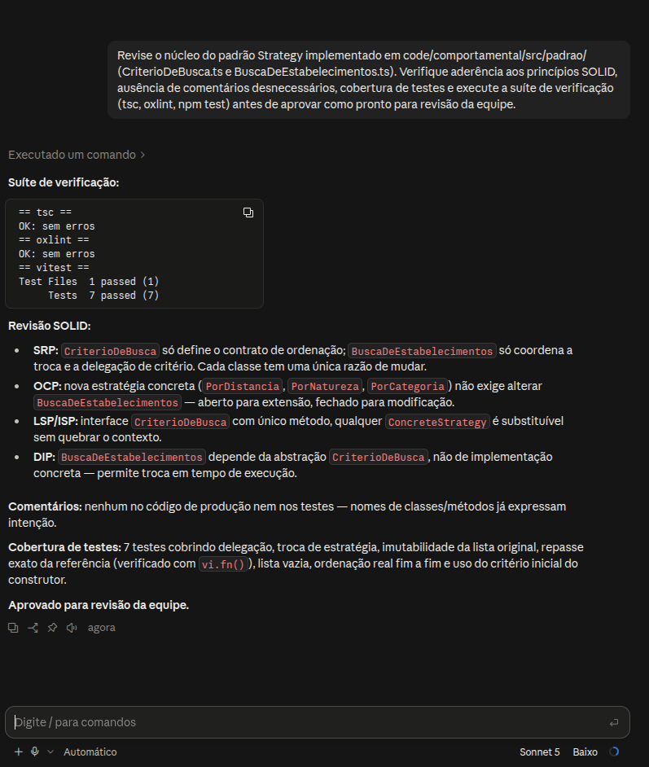

# Uso de Inteligência Artificial Generativa | GoF Comportamental

---

## 1. Descrição e Objetivo

Este documento registra o apoio e o uso de ferramentas de IA Generativa na entrega de Padrões de Projeto (GoF Comportamental — Strategy) pela SubEquipe 03, com transparência, senso crítico e rastreabilidade: o que foi pedido, o que foi obtido e o que foi mantido, corrigido ou descartado.

---

## 2. Metodologia do Foco

A coleta de depoimentos e dados de uso ocorre de forma assíncrona e individual, dentro da responsabilidade de cada integrante (modelagem, código ou execução).

### Ferramentas Empregadas

* **Claude (Sonnet, via Claude Code):** usado como revisor de código do núcleo do padrão Strategy (`CriterioDeBusca`, `BuscaDeEstabelecimentos`), verificando aderência a SOLID, clean code e corretude de compilação/testes.

---

## 3. Experimentos com IA Generativa nesta Entrega

### Experimento 01: Revisão do núcleo do padrão Strategy (código)

#### Objetivo:

Pedir ao Claude uma revisão crítica do núcleo já implementado (`CriterioDeBusca` e `BuscaDeEstabelecimentos`), verificando aderência a SOLID, clean code (sem comentários desnecessários) e cobertura de testes, antes de considerar a responsabilidade pronta para PR.

#### Prompt Utilizado:

```
Revise o núcleo do padrão Strategy implementado em code/comportamental/src/padrao/
(CriterioDeBusca.ts e BuscaDeEstabelecimentos.ts). Verifique aderência aos
princípios SOLID, ausência de comentários desnecessários, cobertura de testes e
execute a suíte de verificação (tsc, oxlint, npm test) antes de aprovar como
pronto para revisão da equipe.
```



<center><strong>Legenda:</strong> Prompt e resposta do Claude revisando o núcleo do padrão Strategy.</center>

#### Resultado Obtido:

Numa primeira passada, ao rodar `tsc -b --noEmit`, `oxlint` e `npm test` sobre o código recém-implementado, o Claude encontrou um erro real de compilação: o teste usava `constructor(private readonly resultado: UnidadeDeSaude[])` (parameter property), que o `tsconfig.json` do projeto rejeita por ter `erasableSyntaxOnly` habilitado. A IA corrigiu isso declarando o campo manualmente no construtor, aplicou `readonly UnidadeDeSaude[]` nas assinaturas de `CriterioDeBusca.ordenar`, `BuscaDeEstabelecimentos.buscar` e no array de dados simulados (reforçando em tipo a imutabilidade já testada em runtime), e acrescentou 4 testes novos (lista exata repassada à estratégia via `vi.fn()`, lista vazia, ordenação real com uma estratégia concreta de teste, e uso do critério inicial do construtor), subindo a suíte de 3 para 7 testes.

Com o prompt formal acima (print da Figura 1), foi pedida uma segunda passada de confirmação: a IA reexecutou toda a suíte de verificação (resultado no print) e apresentou um checklist explícito de SOLID (SRP, OCP, LSP/ISP, DIP) e de ausência de comentários, aprovando o núcleo para revisão da equipe.

#### Análise Crítica e Intervenção Humana:

A IA acertou ao não aceitar a implementação como "perfeita" sem rodar o compilador — o erro do `erasableSyntaxOnly` só foi encontrado porque ela executou `tsc -b` de verdade, não porque inspecionou o código visualmente. Isso evitou subir um código que quebraria o build do grupo. As sugestões de `readonly` e de testes adicionais foram aceitas porque são coerentes com o contrato já pretendido pela classe (imutabilidade, delegação pura ao Strategy) e não mudam o comportamento, só o reforçam. Como ponto de atenção: a IA não decide sozinha o que está "pronto" — a revisão foi direcionada pelo pedido explícito de rodar o build/testes e checar SOLID, e o commit final continua sendo decisão humana, não automática.

---

## 4. Análise Crítica e Lições Aprendidas

* **Cobertura Conceitual:** [PREENCHER]
* **Aderência ao Padrão e à UML:** [PREENCHER]
* **Qualidade do Código Gerado e Execução:** [PREENCHER]
* **Influência do Prompting:** [PREENCHER]
* **Confiabilidade e Validação:** [PREENCHER]
* **Limites do Experimento:** [PREENCHER]

---

## 5. Pontos de Vista Individuais

Pontos de vista de cada membro da equipe sobre as lições aprendidas e o uso da IA Generativa.

### Resumo por Integrante

| Integrante | O que aprendi | Uso de IA Generativa |
| --- | --- | --- |
| [Davi Ursulino de Oliveira](https://github.com/DaviUrsulino) | IA como revisor de código independente pega bug que inspeção visual não pegaria | Claude revisando núcleo Strategy (build, lint, testes) |
| [Gabriel Mota Oliveira](https://github.com/Gabro-MO) | [PREENCHER] | [PREENCHER] |
| [Yasmim de Souza Santos](https://github.com/eii-yahs) | [PREENCHER] | [PREENCHER] |

---

### Detalhamento

### Davi Ursulino de Oliveira

* **GitHub:** [@DaviUrsulino](https://github.com/DaviUrsulino)

* **Uso da IA Generativa (Senso Crítico):** Usei o Claude como revisor do núcleo do padrão Strategy depois de implementado, pedindo explicitamente que verificasse aderência a SOLID e código limpo em vez de só opinar. O ponto crítico foi que a IA não ficou na opinião: rodou o compilador TypeScript e os testes de verdade, e assim achou um erro real (`erasableSyntaxOnly` rejeitando parameter property no teste) que uma leitura visual do código dificilmente pegaria. Aceitei as correções porque eram verificáveis (build e testes passando antes/depois), não porque a IA "disse que estava certo".

* **Lições Aprendidas:** Pedir pra IA "validar com evidência" (rodar build, lint, teste) em vez de só dar opinião sobre o código muda o tipo de erro que ela encontra — passa a pegar bug de configuração/compilação, não só estilo. Reforcei também que melhorias sugeridas (como `readonly` nos tipos) só valem a pena quando reforçam um contrato que a classe já pretendia ter, não quando mudam comportamento por conta própria.

---

### Gabriel Mota Oliveira

* **GitHub:** [@Gabro-MO](https://github.com/Gabro-MO)

* **Uso da IA Generativa (Senso Crítico):** Utilizei o ChatGPT como apoio à evolução e à documentação do codigo. A ferramenta auxiliou na organização das descrições das classes, na revisão textual da documentação da V3.

* **Lições Aprendidas:** Aprendi que o padrão _GoF Strategy_ permite organizar as multiplas maneiras de fazer algo em estruturas organizadas, tratando elementos individuais e divisões de trabalho de forma simples. Compreendi como essa estrutura facilita a implementação de novas estrategias. Também aprendi que a IA pode auxiliar no codigo e na documentação, mas suas sugestões precisam ser analisadas e validadas para garantir a coerência com o padrão e os objetivos do projeto.

---

### Yasmim de Souza Santos

* **GitHub:** [@eii-yahs](https://github.com/eii-yahs)

* **Uso da IA Generativa (Senso Crítico):** [PREENCHER]

* **Lições Aprendidas:** [PREENCHER]

---

## 6. Síntese do Aprendizado da Subequipe

[PREENCHER]

---

## 7. Referências e Ferramentas Utilizadas

1. Claude (Anthropic), via Claude Code — https://claude.com/claude-code — acesso em 15/10/2026.
2. ChatGPT (OpenAI), via https://chatgpt.com/ - acesso em 17/10/2026

---

## Histórico de Versionamento

| Nome do Membro | Contribuição | Data | Commit |
| :--- | :--- | :--- | :--- |
| [Gustavo Fornaciari](https://github.com/GUGOFO) | Inicio do Teamplate do trabalho | 06/10/2026 | [18b6195](https://github.com/UnBArqDsw2026-2-Turma01/2026.2-T01-_G5_ProjetoGovernoEletronico_Entrega_03/tree/18b61958e419b67f95469d4a704ddcb9629b9803) |
| [Davi Ursulino de Oliveira](https://github.com/DaviUrsulino) | Experimento 01 (revisão do núcleo do Strategy via Claude) e depoimento individual | 15/10/2026 | [0403bc3](https://github.com/UnBArqDsw2026-2-Turma01/2026.2-T01-_G5_ProjetoGovernoEletronico_Entrega_03/commit/0403bc3b776fedea710dfa2aa03967dd4a183041) |
| [Gabriel Mota](https://github.com/Gabro-MO)                                                     | adição do uso de IA na entrega | 17/10/2026 | [Preencher]()                                                                                                                                            |