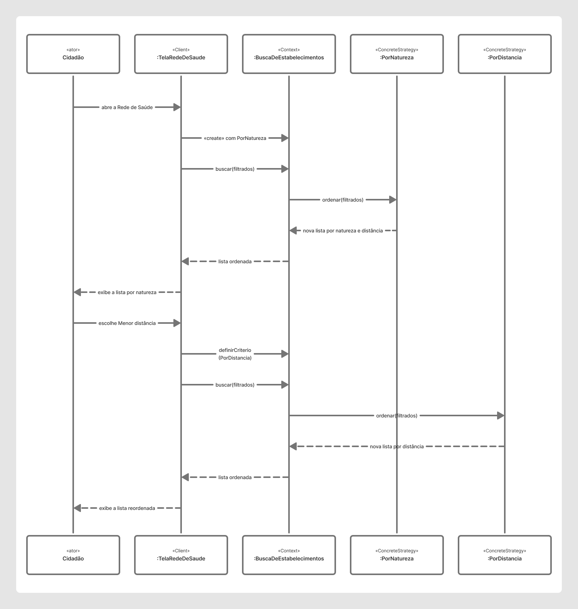

# Diagrama de Sequência do Strategy (SubEquipe 3)

Iniciativa extra da Entrega 3. O plano da entrega recomenda um diagrama de sequência que mostre o padrão em execução, e a SubEquipe 03 ainda não tinha um. Este diagrama mostra, mensagem por mensagem, o que acontece na tela da Rede de Saúde do Meu SUS Digital quando o cidadão troca o critério de ordenação. É o momento em que o Strategy realmente aparece.

---

## Diagrama

<strong>Legenda:</strong> Diagrama de sequência do padrão Strategy: a tela abre ordenando por natureza e, quando o cidadão escolhe "Menor distância", entrega a nova estratégia ao contexto e pede a busca de novo.

<strong>Link Editável:</strong> <a href="https://www.figma.com/board/orlr4PMVwHEotAAtbGKUXW/Untitled?node-id=0-3&t=qtQPZKppqIIoNmNI-1">Abrir e editar no FigJam</a>

---

## Como ler o diagrama

Cada coluna é um objeto, e o nome com dois-pontos (`:TelaRedeDeSaude`) indica um objeto daquela classe. Acima do nome está o papel que ele cumpre no padrão: a tela é o **Client**, `BuscaDeEstabelecimentos` é o **Context**, e `PorNatureza` e `PorDistancia` são **ConcreteStrategy**. As setas cheias são chamadas e as tracejadas são retornos.

O diagrama tem duas partes. Na primeira, o cidadão abre a Rede de Saúde. A tela cria o contexto já com a `PorNatureza`, que é a primeira opção do seletor, e pede `buscar(filtrados)`. O contexto não ordena nada sozinho: ele repassa a lista para `ordenar(filtrados)` da estratégia atual, que devolve uma lista nova, organizada por natureza e, dentro de cada natureza, por distância.

Na segunda parte, o cidadão escolhe "Menor distância". A tela entrega a nova estratégia ao contexto com `definirCriterio(PorDistancia)` e chama `buscar(filtrados)` de novo. Desta vez o contexto delega para a `PorDistancia`. Nada mudou no contexto: ele continua só repassando a lista e nem sabe qual estratégia concreta está usando. Essa é a ideia central do Strategy: trocar o algoritmo em tempo de execução sem nenhum `if` ou `switch` escolhendo o critério.

O argumento `filtrados` é a lista depois do filtro de categoria e do termo de pesquisa, que a própria tela aplica antes de chamar o contexto. A estratégia só ordena e nunca remove estabelecimentos.

---

## Ligação com os outros artefatos

- **Diagrama de classes V2:** os objetos do diagrama são instâncias das classes modeladas na [Versão 2 do GoF Comportamental](/3-PadroesDeProjetos/Relatórios/3.1.3.SubEquipe_03/GoFComportamental.md), e as mensagens são as operações definidas lá (`definirCriterio`, `buscar` e `ordenar`). O diagrama de classes mostra a estrutura, e este mostra a mesma estrutura funcionando ao longo do tempo.
- **Diagrama de Colaboração da Entrega 2:** o objeto `:TelaBusca` do [Diagrama de Colaboração do fluxo Rede de Saúde](https://github.com/UnBArqDsw2026-2-Turma01/2026.2-T01-_G5_ProjetoGovernoEletronico_Entrega_02/blob/main/docs/2-Modelagem/Relat%C3%B3rios/2.1.3.SubEquipe_03/ModelagemDinamica.md) virou a `:TelaRedeDeSaude`. Na Entrega 2, a busca dos estabelecimentos ficava toda com o `:RedeService`. Aqui, a parte de ordenar a lista foi separada em estratégias intercambiáveis, chamadas pelo contexto.
- **Código:** o fluxo segue o que está em [`TelaRedeDeSaude.tsx`](https://github.com/UnBArqDsw2026-2-Turma01/2026.2-T01-_G5_ProjetoGovernoEletronico_Entrega_03/blob/main/code/comportamental/src/ui/TelaRedeDeSaude.tsx), [`BuscaDeEstabelecimentos.ts`](https://github.com/UnBArqDsw2026-2-Turma01/2026.2-T01-_G5_ProjetoGovernoEletronico_Entrega_03/blob/main/code/comportamental/src/padrao/BuscaDeEstabelecimentos.ts), [`PorNatureza.ts`](https://github.com/UnBArqDsw2026-2-Turma01/2026.2-T01-_G5_ProjetoGovernoEletronico_Entrega_03/blob/main/code/comportamental/src/padrao/PorNatureza.ts) e [`PorDistancia.ts`](https://github.com/UnBArqDsw2026-2-Turma01/2026.2-T01-_G5_ProjetoGovernoEletronico_Entrega_03/blob/main/code/comportamental/src/padrao/PorDistancia.ts).

Uma diferença em relação ao código: a tela chama `definirCriterio()` toda vez que recalcula a lista, inclusive na abertura, quando passa a própria `PorNatureza` que o contexto já tinha recebido no construtor. Deixamos essa chamada repetida fora da primeira parte do diagrama, porque ela não muda o comportamento e só atrapalharia a leitura.

---

## Referências

1. GAMMA, Erich et al. Padrões de Projeto: soluções reutilizáveis de software orientado a objetos. Porto Alegre: Bookman, 2000.
2. OBJECT MANAGEMENT GROUP. OMG Unified Modeling Language (OMG UML), Version 2.5.1. 2017. Disponível em: https://www.omg.org/spec/UML/2.5.1. Acesso em: 19 out. 2026.
3. SERRANO, Milene. Material de aula sobre padrões GoF Comportamentais (Strategy e Template Method), disciplina de Arquitetura e Desenho de Software, UnB, 2026.

---

## Histórico de Versionamento

| Nome do Membro | Contribuição | Data | Commit |
| :--- | :--- | :--- | :--- |
| [Yasmim de Souza Santos](https://github.com/eii-yahs) | Criação do diagrama de sequência do padrão Strategy como iniciativa extra | 19/10/2026 | [21c728e](https://github.com/UnBArqDsw2026-2-Turma01/2026.2-T01-_G5_ProjetoGovernoEletronico_Entrega_03/commit/21c728e81a1e3f64548bdcd40a82bf094d557337) |
