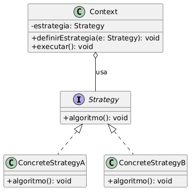
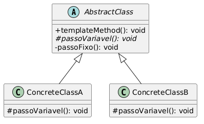

# Guia de GoF Comportamental

Guia de apoio aos padrões de projeto **Comportamentais** do GoF (Gang of Four), elaborado como iniciativa extra para a Entrega 3. Serve de referência rápida para quem for modelar ou revisar essa categoria, qualquer que seja a subequipe.

---

## 1. O que são padrões Comportamentais

Dentro das três categorias clássicas do catálogo GoF, os padrões **Comportamentais** são os que tratam de **como os objetos se comunicam e distribuem responsabilidade de execução entre si**, não de como são criados (Criacionais) nem de como se compõem em estruturas maiores (Estruturais). O foco é o **fluxo de controle** entre os participantes e a **flexibilidade de um comportamento variar em tempo de execução**, sem exigir que a classe cliente conheça os detalhes de cada variação.

A categoria reúne 11 padrões: Chain of Responsibility, Command, Interpreter, Iterator, Mediator, Memento, Observer, State, **Strategy**, **Template Method** e Visitor. Este guia detalha os dois que a disciplina trabalhou em aula — Strategy e Template Method — por serem os recomendados pelo plano de divisão da entrega para a categoria Comportamental.

---

## 2. Strategy

### Intenção
Definir uma família de algoritmos, encapsular cada um deles numa classe própria e torná-los intercambiáveis, permitindo que o algoritmo varie independentemente dos clientes que o utilizam.

### Participantes
| Papel | Responsabilidade |
| --- | --- |
| `Strategy` | Interface comum a todas as variações do algoritmo. |
| `ConcreteStrategy` | Cada implementação concreta de uma variação do algoritmo. |
| `Context` | Mantém uma referência à estratégia atual e delega a ela a execução, sem conhecer qual implementação concreta está em uso. |

<strong>Legenda:</strong> Estrutura genérica do Strategy — o Context depende apenas da abstração <code>Strategy</code>, nunca de uma implementação concreta.

### Quando usar
Quando existem várias variações de um mesmo algoritmo e o cliente precisa trocar entre elas, inclusive em tempo de execução, sem recorrer a condicionais (`if`/`switch`) espalhados pelo código.

---

## 3. Template Method

### Intenção
Definir o esqueleto de um algoritmo numa operação, postergando a definição de alguns dos seus passos para as subclasses. O Template Method permite que subclasses redefinam certos passos do algoritmo sem mudar a sua estrutura geral.

### Participantes
| Papel | Responsabilidade |
| --- | --- |
| `AbstractClass` | Implementa o `templateMethod()` (o esqueleto fixo do algoritmo) e declara os passos variáveis como métodos abstratos. |
| `ConcreteClass` | Implementa apenas os passos variáveis, herdando o restante do algoritmo já pronto. |

<strong>Legenda:</strong> O método <code>templateMethod()</code> é fixo na superclasse; só o passo variável muda em cada subclasse concreta.

### Quando usar
Quando várias classes compartilham o mesmo algoritmo, mas diferem em um ou poucos passos específicos — evita duplicar a parte comum do algoritmo em cada subclasse.

---

## 4. Strategy x Template Method

Os dois padrões resolvem um problema parecido (variação de comportamento), mas por mecanismos diferentes:

| | Strategy | Template Method |
| --- | --- | --- |
| **Mecanismo** | Composição (o Context *tem um* Strategy) | Herança (a subclasse *é um* AbstractClass) |
| **Troca em tempo de execução** | Sim, basta trocar a referência | Não — a variação é fixada na herança |
| **Quem decide a variação** | O cliente, ao instanciar/injetar a estratégia | A subclasse, ao implementar o passo abstrato |

---

## 5. Fontes

1. GAMMA, Erich et al. *Padrões de Projeto: soluções reutilizáveis de software orientado a objetos*. Porto Alegre: Bookman, 2000.
2. SERRANO, Milene. Material de aula sobre padrões GoF Comportamentais (Strategy e Template Method), disciplina de Arquitetura e Desenho de Software, UnB, 2026.
3. [uml-diagrams.org — Behavioral Patterns](https://www.uml-diagrams.org/design-patterns.html)

---

## Histórico de Versionamento

| Nome do Membro | Contribuição | Data | Commit |
| :--- | :--- | :--- | :--- |
