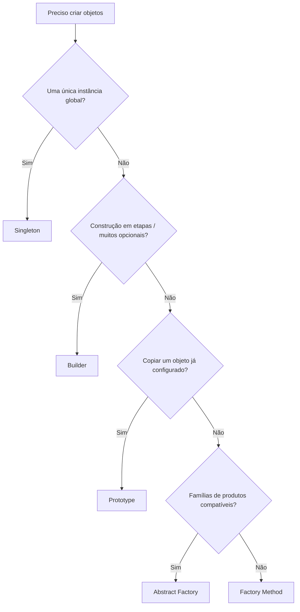
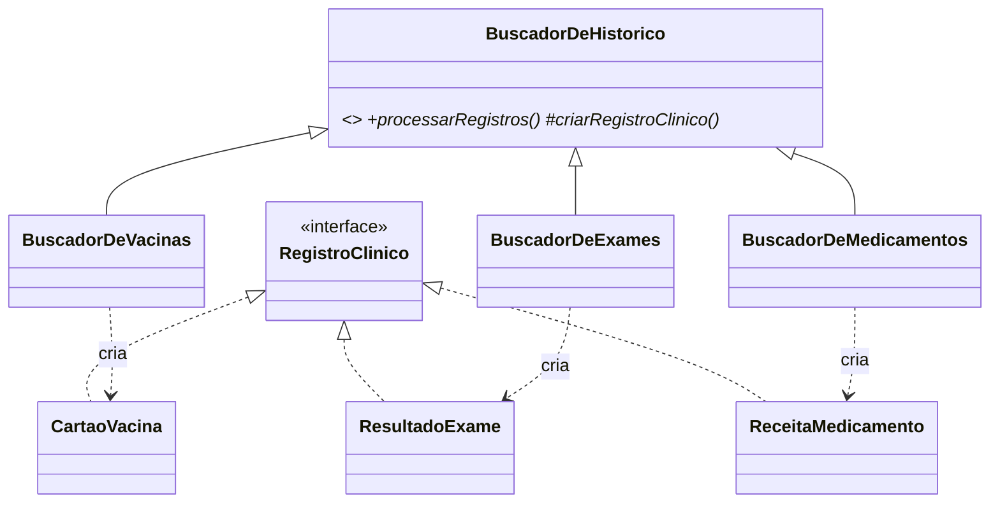

# Guia de Padrões GoF Criacionais

Este guia é uma iniciativa extra da Entrega 3. Ele serve de **material de consulta rápida** para a equipe sobre os padrões **GoF Criacionais**: o que são, quando usar cada um, como identificá-los e como foram aplicados no mini-projeto `code/criacional/` (Meu SUS Digital). A ideia é que qualquer membro consiga entender o padrão adotado pela SubEquipe 1 (Factory Method) e **estender o código com segurança**.

> **Relacionados:** [GoF Criacional (SubEquipe 01)](/3-PadroesDeProjetos/Relatórios/3.1.1.SubEquipe_01/GoFCriacional.md) · [Código](/3-PadroesDeProjetos/Relatórios/3.1.1.SubEquipe_01/Codigo.md) · [Execução](/3-PadroesDeProjetos/Relatórios/3.1.1.SubEquipe_01/Execucao.md) · [Padrão de Testes](/Projeto/ExtrasEntrega3/PadraoDeTestes.md)

---

## 1. O que são Padrões Criacionais?

Os padrões criacionais, catalogados por Gamma, Helm, Johnson e Vlissides (a *Gang of Four*, 1995), **abstraem o processo de instanciação**. Eles tornam o sistema independente de *como* seus objetos são criados, compostos e representados.

Eles resolvem dois problemas recorrentes:

1. **Acoplamento ao `new`:** quando o cliente instancia classes concretas diretamente, qualquer nova variação exige alterar o cliente (viola o Princípio Aberto/Fechado).
2. **Construção complexa ou controlada:** objetos com muitos parâmetros, famílias de objetos que precisam ser compatíveis, ou recursos que devem existir uma única vez.

---

## 2. Os Cinco Padrões em Resumo

| Padrão | Intenção (uma frase) | Escopo | Use quando... |
| :--- | :--- | :---: | :--- |
| **Factory Method** | Define uma interface para criar um objeto, mas deixa as subclasses decidirem qual classe instanciar. | Classe | Há uma família de produtos e o algoritmo geral é o mesmo, mudando só *o que* é criado. |
| **Abstract Factory** | Fornece uma interface para criar **famílias** de objetos relacionados sem especificar classes concretas. | Objeto | Vários produtos precisam ser criados juntos e serem compatíveis entre si (ex.: tema claro/escuro). |
| **Builder** | Separa a construção de um objeto complexo da sua representação. | Objeto | O objeto tem muitos parâmetros opcionais ou é montado em etapas. |
| **Prototype** | Cria novos objetos copiando (clonando) uma instância protótipo. | Objeto | Criar do zero é caro e já existe um objeto “modelo” configurado. |
| **Singleton** | Garante que uma classe tenha uma única instância com ponto de acesso global. | Objeto | Um recurso deve ser único (configuração, conexão). **Use com cautela.** |

### 2.1. Como escolher



---

## 3. Exemplos Mínimos em TypeScript

Exemplos curtos, no domínio de saúde, só para fixar a estrutura de cada padrão.

### 3.1. Factory Method

```typescript
interface Registro { resumo(): string; }

class Vacina implements Registro { resumo() { return 'Vacina'; } }

abstract class Buscador {
  protected abstract criar(dado: unknown): Registro;   // método fábrica
  processar(dados: unknown[]): Registro[] {              // operação de alto nível
    return dados.map((d) => this.criar(d));
  }
}

class BuscadorDeVacinas extends Buscador {
  protected criar(): Registro { return new Vacina(); }
}
```

### 3.2. Abstract Factory

```typescript
interface Botao { render(): string; }
interface Cartao { render(): string; }

interface FabricaDeTema { criarBotao(): Botao; criarCartao(): Cartao; }

class TemaGov implements FabricaDeTema {
  criarBotao() { return { render: () => '<button class="gov">' }; }
  criarCartao() { return { render: () => '<div class="gov-card">' }; }
}
```

### 3.3. Builder

```typescript
class Receita { constructor(public itens: string[], public obs?: string) {} }

class ReceitaBuilder {
  private itens: string[] = [];
  private obs?: string;
  adicionarItem(i: string) { this.itens.push(i); return this; }
  comObservacao(o: string) { this.obs = o; return this; }
  build() { return new Receita(this.itens, this.obs); }
}

const r = new ReceitaBuilder().adicionarItem('Losartana 50mg').comObservacao('Uso contínuo').build();
```

### 3.4. Prototype

```typescript
class ModeloDeLaudo {
  constructor(public exame: string, public parametros: string[]) {}
  clonar(): ModeloDeLaudo { return new ModeloDeLaudo(this.exame, [...this.parametros]); }
}
```

### 3.5. Singleton

```typescript
class ConfiguracaoRNDS {
  private static instancia?: ConfiguracaoRNDS;
  private constructor(public readonly url = 'https://rnds.saude.gov.br') {}
  static get(): ConfiguracaoRNDS {
    return (this.instancia ??= new ConfiguracaoRNDS());
  }
}
```

> **Atenção:** o Singleton introduz estado global e dificulta testes. Prefira injeção de dependência sempre que possível.

---

## 4. O Factory Method no Meu SUS Digital

### 4.1. Mapeamento de papéis

| Papel GoF | Classe no projeto | Arquivo |
| :--- | :--- | :--- |
| **Product** | `RegistroClinico` (interface) | `src/padrao/RegistroClinico.ts` |
| **Creator** | `BuscadorDeHistorico` (abstrata) | `src/padrao/BuscadorDeHistorico.ts` |
| **ConcreteProduct** | `CartaoVacina`, `ResultadoExame`, `ReceitaMedicamento` | `src/padrao/*.ts` |
| **ConcreteCreator** | `BuscadorDeVacinas`, `BuscadorDeExames`, `BuscadorDeMedicamentos` | `src/padrao/*.ts` |
| **Client** | `App.tsx` | `src/App.tsx` |



### 4.2. Por que Factory Method (e não outro)?

- **Abstract Factory:** não há *famílias* de produtos que precisem ser criadas juntas; cada buscador cria um único tipo.
- **Builder:** os registros chegam prontos da RNDS; não há montagem em etapas.
- **Singleton/Prototype:** não resolvem o problema central, que é **variar o tipo de registro sem alterar o cliente**.

### 4.3. Princípios reforçados

- **OCP:** as Versões 2 e 3 adicionaram exames e medicamentos sem alterar o núcleo.
- **DIP:** o cliente depende de `BuscadorDeHistorico` e `RegistroClinico`, não das classes concretas.
- **LSP:** qualquer `ConcreteProduct` substitui `RegistroClinico` na interface.
- **GRASP Creator / Low Coupling / High Cohesion / Protected Variations.**

---

## 5. Passo a Passo: Adicionando uma Nova Fatia

Exemplo: adicionar **Consultas** ao histórico.

1. **ConcreteProduct:** crie `src/padrao/RegistroConsulta.ts` implementando `RegistroClinico`, com validações no construtor.
2. **ConcreteCreator:** crie `src/padrao/BuscadorDeConsultas.ts` estendendo `BuscadorDeHistorico` e sobrescrevendo **apenas** `criarRegistroClinico()`.
3. **Mocks:** crie `src/dominio/consultasMock.ts` com dados realistas e anonimizados.
4. **Testes:** crie `RegistroConsulta.test.ts` e `BuscadorDeConsultas.test.ts` em `src/padrao/__tests__/`, seguindo o [Padrão de Testes](/Projeto/ExtrasEntrega3/PadraoDeTestes.md) (AAA, em português).
5. **Interface:** integre em `App.tsx` usando o novo buscador e estilize em `src/ui/meuSus.css`.
6. **Verifique:**

```bash
cd code/criacional
npx vitest run     # todos os testes devem passar (inclusive os antigos)
npx tsc --noEmit   # sem erros de tipagem
```

> **Regra de ouro:** se você precisou alterar `RegistroClinico.ts` ou `BuscadorDeHistorico.ts`, pare e reavalie; o padrão deveria permitir a extensão sem modificação.

---

## 6. Checklist de Revisão (Pull Request)

- [ ] O novo produto implementa `RegistroClinico` por completo.
- [ ] O novo criador sobrescreve somente o método fábrica.
- [ ] Nenhum arquivo do núcleo abstrato foi alterado.
- [ ] O cliente não usa `new` em classes concretas de produto.
- [ ] Payloads nulos/parciais são tratados (programação defensiva).
- [ ] Testes novos criados e testes antigos continuam passando.
- [ ] Documentação (`GoFCriacional.md`, `Codigo.md`, `Execucao.md`) atualizada.

---

## 7. Erros Comuns

| Erro | Por que é um problema | Como corrigir |
| :--- | :--- | :--- |
| `if/switch` por tipo no cliente para decidir o `new` | Recria o acoplamento que o padrão elimina | Delegar a criação ao ConcreteCreator |
| Lógica de negócio duplicada nos criadores concretos | Fere a coesão e o DRY | Manter o algoritmo comum em `processarRegistros()` |
| Núcleo do padrão importando React | Mistura camadas e dificulta testes | Manter `src/padrao/` livre de UI |
| Usar Singleton para “facilitar” o acesso | Estado global e testes frágeis | Injeção de dependência |

---

## 8. Bibliografia

1. GAMMA, Erich; HELM, Richard; JOHNSON, Ralph; VLISSIDES, John. **Design Patterns: Elements of Reusable Object-Oriented Software**. Boston: Addison-Wesley, 1995.
2. FREEMAN, Eric; ROBSON, Elisabeth. **Head First Design Patterns**. 2. ed. Sebastopol: O'Reilly, 2020.
3. LARMAN, Craig. **Applying UML and Patterns**. 3. ed. Upper Saddle River: Prentice Hall, 2004.
4. MARTIN, Robert C. **Clean Architecture**. Boston: Prentice Hall, 2017.
5. REFACTORING.GURU. **Creational Design Patterns**. Disponível em: <https://refactoring.guru/design-patterns/creational-patterns>. Acesso em: 16 out. 2026.

---

## Histórico de Versionamento

| Nome do Membro | Contribuição | Data | Commit |
| :--- | :--- | :--- | :--- |
| [João Leles](https://github.com/joaoleless) | Criação do guia de padrões GoF Criacionais | 16/10/2026 | - |
