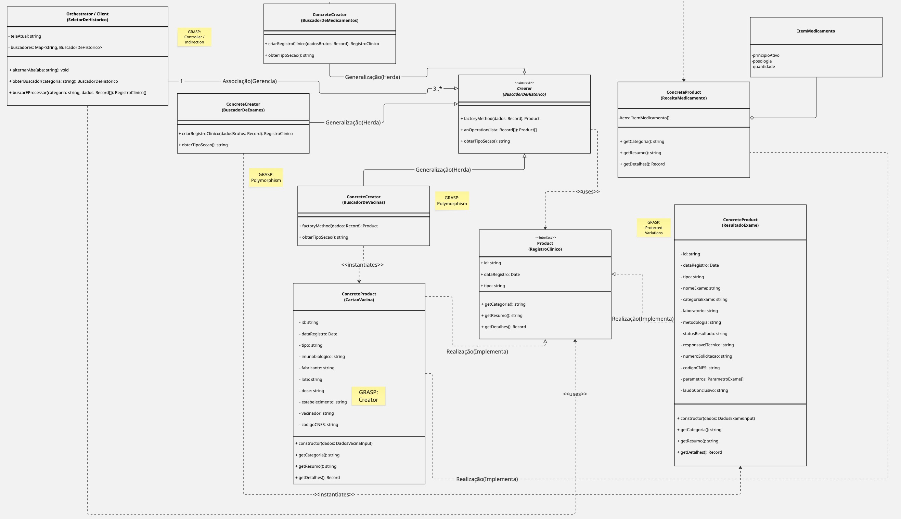

# Governo Eletrônico — Meu SUS Digital

**Disciplina:** FGA0208 — Arquitetura e Desenho de Software  
**Grupo:** G5 — Turma T01  
**Entrega:** 03 — Padrões de Projeto GoF

## Alunos

| Matrícula | Aluno |
| --- | --- |
| 2410125891 | [Ana Beatriz Souza Araujo](https://github.com/AnnaBeatrizAraujo) |
| 241010923 | [Artur Fernandes Galdino](https://github.com/ArturFGaldino) |
| 241012202 | [Davi Ursulino de Oliveira](https://github.com/DaviUrsulino) |
| 241011081 | [Gabriel Mota Oliveira](https://github.com/Gabro-MO) |
| 241032500 | [Giovani de Oliveira Teodoro Coelho](https://github.com/Gotc2607) |
| 241032519 | [Gustavo Gomes Fornaciari](https://github.com/GUGOFO) |
| 241025274 | [João Eduardo de Souza Leles](https://github.com/joaoleless) |
| 231027140 | [Julia Oliveira Patricio](https://github.com/juliapat18) |
| 241012347 | [Nicole Jovita Fernandes](https://github.com/nicolejovita) |
| 222021826 | [Victor Leandro Rocha de Assis](https://github.com/Afrontoso) |
| 241040860 | [Yasmim de Souza Santos](https://github.com/eii-yahs) |

## Sobre o projeto

Esta entrega explora três padrões de projeto do catálogo GoF a partir de fluxos inspirados no **Meu SUS Digital**, plataforma do Ministério da Saúde que reúne serviços e informações digitais de saúde, como histórico de vacinação, resultados de exames, medicamentos e localização de estabelecimentos de saúde. A plataforma oficial é descrita no [portal do Ministério da Saúde](https://meususdigital.saude.gov.br/login).

O grupo desenvolveu três miniaplicações independentes em **React, TypeScript e Vite** para demonstrar como os padrões podem organizar responsabilidades e facilitar a evolução do software:

- **GoF Criacional — Factory Method:** organiza a criação de diferentes tipos de registros clínicos por meio de criadores especializados, compartilhando a abstração `RegistroClinico`. O modelo final reúne as fatias de vacinas, exames e medicamentos e o seletor de histórico.
- **GoF Estrutural — Composite:** representa a interface do dashboard como uma árvore de elementos. A interface comum `ElementoDeTela` é implementada por folhas, como `CartaoDeAtalho` e `BannerInformativo`, e pelo composto `Secao`, organizado pelo `Dashboard`.
- **GoF Comportamental — Strategy:** permite trocar o critério de ordenação durante a execução nos fluxos de busca de estabelecimentos de saúde e de conteúdos, sem concentrar todos os algoritmos nos componentes clientes.

As aplicações são **protótipos acadêmicos demonstrativos**. Os dados são simulados localmente e não há integração real com sistemas do Ministério da Saúde, com a Rede Nacional de Dados em Saúde (RNDS), nem uso de credenciais reais. As telas não substituem o aplicativo oficial.

## Modelagens finais dos padrões

### 1. GoF Criacional — Factory Method (SubEquipe 01)

O diagrama final apresenta a interface de produto `RegistroClinico`, o criador abstrato `BuscadorDeHistorico`, os criadores concretos `BuscadorDeVacinas`, `BuscadorDeExames` e `BuscadorDeMedicamentos`, os produtos clínicos correspondentes e o `SeletorDeHistorico`, que coordena a escolha do buscador.



Documentação: [modelagem e fundamentação](3-PadroesDeProjetos/Relatórios/3.1.1.SubEquipe_01/GoFCriacional.md) · [código](3-PadroesDeProjetos/Relatórios/3.1.1.SubEquipe_01/Codigo.md) · [execução](3-PadroesDeProjetos/Relatórios/3.1.1.SubEquipe_01/Execucao.md) · [uso de IA](3-PadroesDeProjetos/Relatórios/3.1.1.SubEquipe_01/IA.md).

### 2. GoF Estrutural — Composite (SubEquipe 02)

O diagrama final define `ElementoDeTela` como contrato comum, `Secao` como composição recursiva e `Dashboard` como raiz/cliente. A hierarquia inclui as folhas `CartaoDeAtalho`, `BannerInformativo`, `MiniAppLeaf` e `CardFaqLeaf`, além dos DTOs de representação retornados pela operação de renderização. **Observação:** o relatório da subequipe registra que `MiniAppLeaf` e `CardFaqLeaf` estão presentes na modelagem, mas ainda não foram implementadas no código entregue.


Documentação: [modelagem e fundamentação](3-PadroesDeProjetos/Relatórios/3.1.2.SubEquipe_02/GoFEstrutural.md) · [código](3-PadroesDeProjetos/Relatórios/3.1.2.SubEquipe_02/Codigo.md) · [execução](3-PadroesDeProjetos/Relatórios/3.1.2.SubEquipe_02/Execucao.md) · [uso de IA](3-PadroesDeProjetos/Relatórios/3.1.2.SubEquipe_02/IA.md).

### 3. GoF Comportamental — Strategy (SubEquipe 03)

A modelagem final organiza dois fluxos de consulta: busca de estabelecimentos de saúde e busca de conteúdos. Em cada fluxo, um contexto delega a ordenação a uma interface de estratégia, permitindo alternar entre critérios concretos, como distância, natureza, categoria ou relevância.


Documentação: [modelagem e fundamentação](3-PadroesDeProjetos/Relatórios/3.1.3.SubEquipe_03/GoFComportamental.md) · [código](3-PadroesDeProjetos/Relatórios/3.1.3.SubEquipe_03/Codigo.md) · [execução](3-PadroesDeProjetos/Relatórios/3.1.3.SubEquipe_03/Execucao.md) · [uso de IA](3-PadroesDeProjetos/Relatórios/3.1.3.SubEquipe_03/IA.md).

## Há algo a ser executado?

**[x] SIM**  
**[ ] NÃO**  

A entrega contém três miniaplicações independentes. É necessário ter **Node.js e npm** instalados. Para executar uma aplicação, abra um terminal na raiz do repositório e execute **apenas o bloco da aplicação desejada**.

### GoF Criacional — Factory Method

```bash
cd code/criacional
npm install
npm run dev
```

### GoF Estrutural — Composite

```bash
cd code/estrutural
npm install
npm run dev
```

### GoF Comportamental — Strategy

```bash
cd code/comportamental
npm install
npm run dev
```

O Vite informará no terminal o endereço local para abrir no navegador. Para encerrar o servidor, use `Ctrl+C`.

### Testes, build e lint

Cada miniaplicação define os scripts `test`, `build` e `lint` no seu `package.json`. Execute-os de dentro da pasta da aplicação que deseja verificar:

```bash
npm run test
npm run build
npm run lint
```

As três aplicações usam dados simulados e não necessitam de chaves de API ou conexão com serviços de saúde externos.

### Referências

1. **Ministério da Saúde.** [Meu SUS Digital](https://www.gov.br/saude/pt-br/composicao/seidigi/meususdigital/meususdigital). Referência para o contexto e os fluxos de saúde digital utilizados como inspiração.
2. **Gamma, E.; Helm, R.; Johnson, R.; Vlissides, J.** *Design Patterns: Elements of Reusable Object-Oriented Software*. Addison-Wesley, 1994/1995. [Referência bibliográfica](https://www.informit.com/store/design-patterns-elements-of-reusable-object-oriented-software-9780201633610).
3. **React.** [Using TypeScript](https://react.dev/learn/typescript). Documentação oficial de apoio à tecnologia usada nas interfaces.
4. **Vite.** [Documentação oficial](https://vite.dev/). Ferramenta de desenvolvimento e build usada nos mini-projetos.
